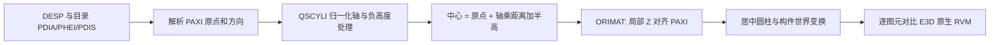

# CPV 通风 STRT 轴向修复：E3D TTY / RVM / IDA 对拍

已修复目录圆柱的轴向错误。截图中的支管为 `/-CPV-S-2-L-1301`（`24381/76729`），三段 STRT 为 `24381/76730..76732`。完整站点 `/1CPV-HVACHB`（`24381/76564`）的 82 段 STRT 对拍全部通过。

## 根因和算法

`vendor/e3d-model/src/catalogue.rs::uses_clfl_centreline_frame` 原先把所有非 ATTA、`CLFL=true` 的 SCYL 都当成另一种局部标架：在 PAXI 标架上额外转 −90°，并沿新轴额外平移半个高度。`/CSTRA-BODY` 和四个法兰都是 `CLFL=true`，因此三段竖直圆风管被横放，法兰也错位。

通过 ida-bridge 重用 Core3D.dll 实例，实读以下函数：

- `QSCYLI`，`0x103BF3FC`：读取 PDIS、PHEI、PDIA 和 PAXI；负高度时反转高度、距离和轴；归一化轴；中心为 `origin + (PDIS + abs(PHEI)/2) * axis`。
- `CRCATI`，`0x10345ACC` 的 SCYL/NSCY 分支，伪代码 247–260 行：调用 QSCYLI，再 `ORIMAT`，再建立半径 `abs(PDIA)/2`、居中 Z 轴圆柱。仅 NSCY 额外加 0.01 mm 轴向过切。
- QSCYLI 的属性常量实读为 `912103/712465/557809/726127`，分别为 PDIS/PHEI/PDIA/PAXI。

CLFL 属于显示规则，不应给路由构件增加 90° 旋转。修复将现有特殊标架限制在原先的 HELE/PCLA 支撑族，STRT、其他风管及管道目录件按 QSCYLI 的 PAXI 标架生成。没有按元素参考号、规格名或截图坐标硬编码修复。



## 实际导出与回归结果

2026-09-05 使用 E3D 3.1 DESIGN TTY 原生 `/expdri.so` 导出，未执行 SAVEWORK 或修改设计元素。分别显式设置 `representation level hvac 0` 和 `6`；仅 `repre lev 6` 不会设置 HVAC 学科的表现级。

| 检查 | 结果 |
|---|---|
| CPV 三段 STRT，HVAC 0 | 3 个原生 Cylinder，本体直径 1600 mm、长度 1220 mm |
| CPV 三段 STRT，HVAC 6 | 15 个原生 Cylinder，本体加每端两个法兰 |
| 全站点 STRT | 82 个元素、410 个原生图元：370 Box + 40 Cylinder |
| 修复前全站点对拍 | 8/82 超差，最大 1097 mm |
| 修复后全站点对拍 | 82/82 通过，最大误差 0.001752641 mm |
| 真实库集成回归 | CPV 与 CAM 两支管、6 段 STRT、30 个本体/法兰全部逐件通过 |
| e3d-model 单元测试 | 242 通过，0 失败 |
| gen-model 集成编译 | `cargo check --lib` 通过 |

全站点判据使用原生 RVM Box/Cylinder 的尺寸和 PRIM 变换，在构件局部系求解析包围盒，再与实际生成网格比较；容差 0.51 mm，覆盖网格弦高 0.5 mm 和 RVM f32 舍入。三方可视化使用相同视角和比例。


真实库测试另外逐个匹配本体和四个法兰，不只检查整件包围盒，覆盖竖直、水平、斜向三种姿态。RVM 的旧版辅助三角化曾使用 Y-up；本次测试直接读取原始 PRIM 记录，避免将辅助工具的坐标错误作为真值。

本次失败的 8 个参考号：`24381/76693`、`76697`、`76730`、`76731`、`76732`、`76838`、`76844`、`76845`。其余 74 段矩形 STRT 原本已匹配，本次仍匹配。

## 重跑

在 gen-model 根目录执行：

```powershell
python scripts/strt_cpv_validation.py verify
```

此命令编译当前 e3d-model，使用独立 E3D 用户/工作目录逐次导出两档支管和全站点，生成当前站点模型，校验 82 段 STRT。分三次 TTY 会话执行，避免本机长批处理宏的启动崩溃。完整输出在 `output/strt-cpv-20260905/`。

修复前的确定性红灯记录：`red-test.log`，断言报告轴方向 `DVec3(-1, 0, 6.12e-17)`；`before-comparison.json` 记录 8 个失败。修复后：`green-lib.log`、`real-rvm-test.log`、`after-comparison.json`、`gen-model-check.log`。

在 `../vendor/e3d-model` 执行真实库测试：

```powershell
$env:CARGO_TARGET_DIR = 'D:/work/plant-code/old/target-e3d-model'
cargo test --release --test strt_rvm -- --ignored
```

该测试显式标为需要本机 AMS/CATA 安装，固定 DESI 会话 106；本次已实际执行，不是跳过后的通过。原生 RVM 夹具位于 `tests/fixtures/strt/`；IDA 输出、完整原生导出和校验摘要归档到 `evidence/20260905-strt-cpv/`。

## 修改范围与运行状态

- e3d-model：目录圆柱标架谓词；CPV 本体/法兰单元回归；真实库 RVM 集成回归和原始二进制夹具。
- gen-model：生成器指纹新增 `catalogue-route-scyl-paxi-frame-v1`，使新后端的后续生成请求不复用旧几何凭证；新增可复现对拍与绘图脚本。
- 已重新生成验证目录中的 CPV 站点与截图支管，并完成下述真实 plant-ui 验证。9099 的旧后端没有被重启或替换；验证窗口连接独立修复版后端 18206，网格、设置与进程均隔离。
- 保留了工作区原有未提交修改；本次未提交 Git，也未修改 E3D 设计数据。

## plant-ui 实际验证（18:11–18:20）

已编译含修复指纹的实际 gen-model 可执行文件，启动在 `http://127.0.0.1:18206`，直接读取 AMS7997 会话 106。真实 plant-ui 使用 `output/strt-cpv-20260905/live/ui/plant-ui-app.exe`，连接此后端与独立网格目录；没有使用模拟模式或导入对比图冒充场景。

通过后端重新生成 `/1CPV-HVACHB`，随后在 plant-ui 模型树中执行“显示模型”，展开 `/-RX-CPV-S01` → `/-RX-CPV-S01-13` → `/-CPV-S-2-L-1301`，定位并逐个选中三段 STRT。正面与等轴方向均检查过：三段同轴，法兰与管身方向一致，连续连接，没有原先的横向鼓包。三次高亮分别对应 76730、76731、76732；截图右侧参考号与实际位置已核对。界面日志显示 WARN 0、ERROR 0。

| STRT | 世界 Z 范围（mm） | 高度（mm） |
|---|---:|---:|
| 24381/76730 | -695 → 525 | 1220 |
| 24381/76731 | 525 → 1745 | 1220 |
| 24381/76732 | 1745 → 2965 | 1220 |

实际 API 返回整个站点的 82 个唯一 STRT；280 个生成根的逐根响应合计 1337 条记录，引用的网格文件全部存在。首次 ensure 的生成实例计数为 806，与逐根读取记录数是不同口径。运行验证脚本 `python scripts/verify_strt_plant_ui_runtime.py` 已通过，结果见 `output/strt-cpv-20260905/live/runtime-verification.json`，同时保存健康状态、模型记录和后端 SHA-256。


第二、第三段截图在同目录 `plant-ui-strt-76731.png`、`plant-ui-strt-76732.png`。验证窗口与修复版后端保持运行供直接查看；原 9099 环境仍保留。

运行准备脚本为 `scripts/strt_plant_ui_runtime.py`，启动脚本为 `scripts/Start-StrtPlantUiValidation.ps1`（backend / ui 两个入口）。启动已有环境前先确认对应端口和进程没有重复实例。
