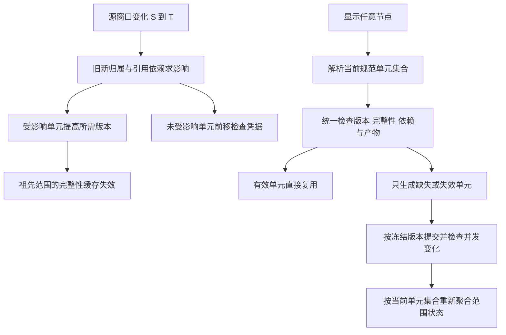

# 模型范围复用与子节点版本传播：IDA 与当前后端对照

日期：2026-09-09。范围：当前工作区 gen-model、相邻 plant-ui，以及已打开的 Core3D.dll / core.dll IDB。本文是分析与建议，未修改生产实现，未声称已经完成性能或端到端验证。

## 结论

需要后端建立统一的「生成单元版本 + 覆盖关系 + 祖先范围状态」。有产物不等于产物仍有效；祖先范围失效不等于整个祖先范围要重算。

核心不变量：对某个显示范围，在当前输入下已经完整生成的单元复用；缺失、失效的单元才生成。子节点变化必须影响依赖它的单元及祖先范围的完整性，不能让祖先的旧“完成”结论继续有效，也不能因此重算未受影响的兄弟。

## IDA 实查证据

通过 ida-bridge 复用 headless 实例，全部为只读 SQL；未改 IDB。原始反编译输出在 `artifacts/scope-reuse-audit/ida/`，采集脚本为 `capture_ida.py`。这些是反编译结果，不是恢复出的原始源码。

| 模块、函数、地址 | 实际看到的行为 | 能支持的结论 |
|---|---|---|
| Core3D `DES_DrawListManager::changesBetweenSessions`，`0x1052b730` | 保存/切换会话，调用 `DB_Compare::scan`，分别调用 `processDeletes`、`processCreates`、`processModifications` | 三维更新以会话差分为输入，创建、删除、修改分开处理。此函数有 bad stack pointer 警告，只采信清晰调用，不推断全部参数布局 |
| Core3D `processModifications`，`0x1052cf80` | 对变化元素逐个调用 `findTopLevelElement`，将有效结果交给集合插入路径 | 子件变化先向绘制单元归并，不只看父元素自己的属性是否变化 |
| Core3D `findTopLevelElement`，`0x1052c450` | 定位当前元素，针对 TUBI 设置分支参数，再调用 `sub_10380e38` | 归属解析包含类型语义，不能简单取任意父节点 |
| Core3D `desdblib/FNDTOP`，`0x10380e38` | `LISTOP` 判定，随后经 `DGETF` / `DGOTO` 循环上溯，并有终止和特殊处理 | 三维侧有专门的向上归属算法；本次未重新识别所有数字常量，不把它们硬翻成 noun |
| Core3D `processCreates`，`0x1052cc10` | 新增元素同样向上找绘制单元 | 新增也会使已有父单元失效，即使新增元素从未生成过 |
| Core3D `processDeletes`，`0x1052cd20` | 找原绘制单元；找不到时从 draw list 获取子 TOPF 元素 | 删除需要原有归属/显示记录，不能只查删除后的新树 |
| Core3D `PartialUpdateDesiMgr::GranularityExpansion`，`0x1047d8c0` | 存在 `SignificantOwner`、`AbsentPrimitives`、`AncestorDeletes` 调用 | DRAFT 局部更新也会扩大影响范围；它与三维 TOPF 是不同粒度，不直接替换当前 MDU 规则 |
| core `DB_Element::hasElementChangedBetween`，`0x593d6d0` | 以会话区间检查元素变化；TUBI 特判 POS、ORI、ITLE、SPRE | 变化检测有元素/属性语义，不能把单一元素修改号当作完整模型依赖版本 |

反证边界：`hasTopLevelGraphicsChanged(0x1052c850)` 的当前反编译末尾返回 false，不能仅凭函数名宣称它已经提供完整的祖先脏版本机制。本次也未证明原程序存储了类似 Merkle 树或每个祖先递增版本号；下面的版本结构是针对本项目提出的设计。

## 当前后端已有基础与缺口

1. `src/data_interface/on_demand_model.rs:535` 的 `memory_root_current` 只判断精确根的 receipt 是否存在。`ensure_exact_generation_root` 的 memory-only / read-through 分支使用这一判据，没有在此比较输入版本。其正确性依赖别处及时撤销凭证。
2. `src/lib.rs:1791` 的 read-through 快照刷新回调，在变更后枚举所有已登记根，处理已删除根，`invalidate_all_receipts`，再生成存活根。这能保守防止旧模型长期被当成有效，但也说明这条路尚未实现子树精确失效。不能只删除这次全局失效，否则按需命中可能读旧。
3. `src/fast_model/model_memory_store.rs:109` 的 `RootReceipt` 已有 `source_sesno`、`model_target`、manifest、实例数。`e3d_model_service.rs:85` 的 `ModelTarget` 已包含设计源、目录源、模板、生成器与网格参数；应复用，不能另做一个只比较 refno 或设计库 session 的缓存。
4. `e3d_model_service.rs:1854` 的底层 target 匹配要求源 session 和 target 相同。它不能单独解决“整个库保存了，但这根没变化”的复用。
5. `model_update_pending.rs:2408` 的持久凭证读取检查完成状态和设计/目录会话下限。它与内存存在性判据不是同一套，仍缺统一入口。
6. `window_root_plan.rs:196` 已有 `regen / delete / advance / lazy`；`WindowRootSources::impact` 使用祖先闭包并扩展引用影响。未受影响根可只前移凭证。这是应该接入按需和内存路径的现成基础。
7. 父子范围选根不一致是上一轮的独立问题：ZONE 枚举的 STRU 根与点击 PLOO 得到的 PANE 根可以不一致。仅给精确 root 加版本号仍不能复用父级覆盖的结果。

## 建议的数据与判据

### 1. 先统一生成单元身份

所有显示请求先解析成稳定的生成单元集合。ZONE 是集合范围，EQUI/BRAN 等原有交付语义保留；PLOO、顶点、路径点等输入节点映射到真正消费它们的几何单元。批量生成和点击子节点必须使用同一个归属事实。

如果暂时保留 STRU 批量生产、PANE 单独生产的不同范围，则发布时要记录「本次完整产物覆盖了哪些规范单元、各满足哪个版本」。不能仅检查祖先有 receipt，也不能把所有 visited 节点都无条件盖上完成章：访问过、无几何、失败和完整成功是不同状态。

已有一个不可分割的父级布尔结果时，子件改变确实要重算这个父单元。若父级只是独立子单元集合，则只替换受影响单元。不要凭树层级决定能否拆分产物。

### 2. 复用现有 desired / published 语义

下列是逻辑字段，优先复用现有 `gen_root.desired_revision` / `published_revision` 和 `ModelTarget`，不默认新建一套平行表：

| 状态 | 含义 |
|---|---|
| required_revision(U) | 当前输入已知对单元 U 造成的最新模型影响版本 |
| published_revision(U) | 最后一次完整成功发布实际满足的版本 |
| published_target(U) | 该产物真实使用的设计源、目录、模板、生成器等落款 |
| coverage(U) | 产物归属/覆盖、是否完整、空结果、实际可读的位置 |
| scope_revision(N) | 节点 N 的模型范围/组成发生改变的版本，可作为派生缓存标记 |
| change_checkpoint | 变化检测确实处理到的源版本向量；与数据水位、模型水位区分 |

对同一模型谱系及生成策略，复用的必要条件是：完整有效凭证、发布版本满足所需版本、依赖仍有效、产物可读。若一次检查发现输入变化检测落后，要先补齐差分或保守判未知，不能凭旧 receipt 放行。

这里的 revision 必须是可比较的模型事件序列，或明确身份的复合 token。不同数据库的 sesno 不能直接取最大值比较。源文件替换/回退还需要 epoch/文件身份；同一个数字不代表同一份输入。

### 3. 子节点变化的传播

按冻结的变化窗口 S→T：

1. 取得新增、修改、删除、搬迁，以及必要的目录/引用影响。
2. 复用当前模型影响分类，求受影响规范单元；删除用旧树，搬迁取旧归属与新归属的并集。
3. 对受影响单元提高 required_revision；**此时旧几何可以保留显示，但不再算最新**。
4. 对受影响单元的祖先范围提高 scope_revision，或撤销其缓存的完整性结论。
5. 未受影响单元只推进“已检查到 T”的凭据，不重算几何，不把它说成“在 T 重新生成过”。
6. 目录或跨元素引用变化经依赖关系定位消费者；仅做 OWNER 向上传播不够。祖先 POS/ORI 改动也会影响后代位姿，合格时复用当前 TransformOnly 路径。

影响传播与新快照可见性必须有一个原子边界：不能先让新树可读，再异步撤销旧凭证，中间的 ensure 会错误命中。可发布同一 epoch 的骨架与失效状态，或让旧 epoch 凭证在差分确认前统一处于 Unknown。

### 4. 父范围版本不能替代子单元版本

例：ZONE 下独立单元 A、B 均已发布。A 的子点修改：A 所需版本增加，ZONE 范围版本增加，B 的模型所需版本不变。

- 点击 B：直接复用 B，不能因 ZONE 变旧而重算 B。
- 点击 A 的子点：归并到 A，只生成 A。
- 点击 ZONE：展开当前单元集合，差集得到只欠 A。
- A 发布后：ZONE 当前要求的所有单元都满足时，其范围重新完整；不必调用一次“ZONE 整体生成”才能恢复状态。

因此，祖先“变旧”主要使它的聚合结论失效；不应把同一个祖先 revision 无条件写给所有子单元。也不要只用当前子版本的 `max()` 充当范围身份：删除、成员顺序、搬迁和重建谱系会丢信息。范围 epoch 或含成员身份/顺序的摘要更可靠。

## 并发与发布

生成开始捕获单元的 required_revision、源快照、依赖目标与覆盖范围，完成时提交这份冻结版本，不能读取“现在最新版本”后直接盖章。

例如开始算 A@7，期间子节点变化让 A 需要 8：A@7 即使生成成功，也不能把 `published_revision` 写成 8、清掉失效或宣称最新。已有更晚产物时不能覆盖；保留旧结果也必须明确仍需补到 8。失败/部分成功不能发布完整覆盖凭证，成功的独立单元可分别提交。

按规范单元合并在途请求（ZONE 与子节点同一单元同一版本只生成一次），锁后重新校验。若仍允许重叠父子生产范围，只锁不同 refno 不足以去重，必须在覆盖单元层协调。

## 建议落地顺序

1. 在模型面建立统一的 freshness/coverage 判定入口，覆盖 memory-only、read-through、持久恢复三种来源。旧凭证缺所需信息时保守未命中；不要先移除全局失效保护。
2. 固化规范生成单元与源输入归属，使 ZONE 与子件命中相同单位；过渡期父级批量发布写完整覆盖信息。
3. 将 `WindowRootSources::impact` / `plan_window_roots` 的差分成果用于内存按需路径，失效与快照 epoch 同步发布，再替换 read-through 的全根失效/重算回调。差分不可用时保留有说明的保守退化。
4. 发布同时提交版本、产物与覆盖状态；重启恢复保持一致。scope 完整状态可派生重建，不制造另一张永久“已生成节点表”。

验收必须覆盖：父后子/子后父零额外生成；子件修改只重算所属单元；兄弟复用；新增；删除；搬迁旧新两端；布尔负体与路径点；目录依赖；父级位姿变化；并发旧任务不能盖新版本；部分失败不标完整；无几何结果复用；重启/源替换不错误命中。

## 本次验证与边界

- 已直接查询 IDA 中九个函数并保存反编译证据。
- 上一轮 `python artifacts/scope-reuse-audit/check.py --assert-reuse` 能在普通结构示例检出父子根号不一致；它验证的是选根，不是本方案的运行实现。
- 本次未实现上述版本/覆盖体系，未进行生产数据重生成、数据库写入或吞吐测量。方案中的 epoch/CAS/coverage 是本项目设计建议，不包装成 IDA 中已经发现的字段。
