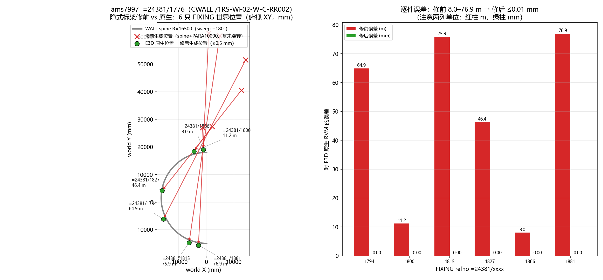

# ams7997 `=24381/1776` 圆弧墙 FIXING 隐式标架修复（2026-10-19）

vendor 提交 `e3d-model@6667217`。症状：ams7997 WALL `=24381/1776`
（CWALL `/1RS-WF02-W-C-RR002`）名下 41 只 JLDATU→PLDATU→FIXING 全部错位
10–77 m、朝向镜像——`FIXING` 等类型「都不对」。

## 根因（隐式 WALL → JLDATU → PLDATU → FIXING 标架）

1. **站位半径误加名义壁厚**：`fixing_host_frame` 用 `spine半径 + wall_profile_thickness`，
   而后者读墙型材 SPRF 的 `PARA[0]`。本墙 `SPRF /Single_leaf_wall` 的 `PARA[0]=10000`
   是名义参数（真壁厚在 `DESP[0]=900`），站位被推出约 10 m。原生 RVM 里全部
   PLDATUM 原点都落在 R=16500 的 **spine 圆上**。ams1112 同一路径当年能对上，
   只是因为 `Variable_thk_wall` **没有 `PARA` 属性**、厚度回落成 0——
   即旧实现从未被非零厚度真正验证过。
2. **p-line 基未随扫掠方向翻转**：本墙 spine `sweep≈−180°`（负扫掠），PLDATU
   隐式 pline 基的 y/z 两列要随行进方向翻转：`(-Y, travel·Z, -travel·X)`。
   旧代码恒取 `(-Y, +Z, -X)`（只对正扫掠成立，ams1112 sweep=+354.8° 恰好无感）。
   翻转后 E3D 的镜像语义被标架吸收，`FIXING` 的 `ORI` 按原样
   `Rz(γ)·Ry(β)·Rx(α)` 读取即可，局部矩阵无需任何补偿。

## 原生证据（E3D 3.1 TTY 只读导出，无 SAVEWORK）

- `verification/fixing-7997-20261019/wall_1776.rvm`：`=24381/1776` 子树导出，
  FacetGroup 记录含完整世界变换
- `verification/fixing-7997-20261019/native_fixings.json` / `native_pldatu.json`：
  解析出的记录矩阵
- `w1776.log` / `spine.log` / `j*.log` / `p*.log` / `f*.log`：TTY `Q POS/ORI/ZDIS`
  原始输出；`probe.mac` 为探针宏本体

## 修复（`elmodl.rs`）

- `fixing_host_frame`：站位半径取 spine 半径本身；删除 `wall_profile_thickness`
  （连同 `SPRE→SPCO→CATR→SPRF` 的 PARA 读）；pldatum 基两列乘
  `travel = sign(sweep)`。正扫掠时逐位等价旧版。
- `fixing_local_matrix`：`ORI` 原样读取（翻转基已吸收镜像），`POSL=OBOW` 三分量
  全保留、`IBOW` 门窗路径不变。
- 开孔刀 `fixing_world_cutter` 与目录实例 `model_catalogue_member` 继续共用同一
  `fixing_host_frame`，不会分叉。

## 验证

- `wall_fixing_datum_real.rs` 新增 `obow_negative_sweep_wall_fixings_sit_where_e3d_puts_them`：
  6 只 FIXING 对 RVM FacetGroup 变换逐件 **≤0.5 mm / 轴向 1e-6**（复算 0.004 mm 级）；
  ams1112 正扫掠 4 件 0.01 mm / 1e-6 无回归。
- `cargo test` 全量绿；`ancestor_reads_guard` / `reference_reads_guard` 补齐登记。
- 逐件误差（复算修前语义）：8.0–76.9 m → 修后 ≤0.01 mm。

## 遗留

- `POSL=IBOW` + 负扫掠墙无原生样本：基翻转对它同样生效，但 `ORI` 语义未单独
  取证；aps250110 现有门窗用例是正扫掠族，行为不变。
- 服务二进制需重建部署后才在 AMS 端到端生效。
