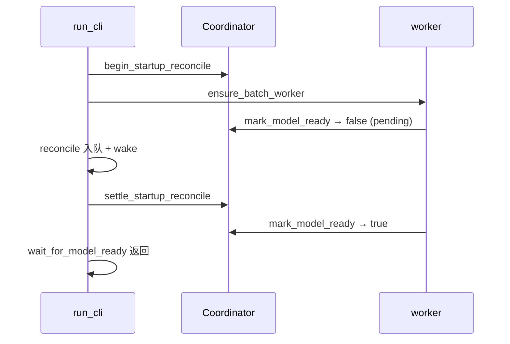

# 2026-09-03 开发计划：增量更新初始化编排层修复（P1/P2/P3）

来源：2026-09-03 对 `run_cli` 增量更新初始化启动流程的审核（P1–P4 发现）。
决策依据：ADR-025（严格初始化阶段）、ADR-048（监听限定域只上弦不拖全量）、ADR-050
（`model_update_pending` 进程私有）、ADR-058（启动即退化窗口）。
边界：接在 `docs/plans/2026-09-03-startup-initialization-refactor-plan.md` S1 之后，**不做 S2–S5**。
已拍板的三个决策：

| # | 问题 | 决定 |
|---|---|---|
| Q1 | 启动清空 `model_update_pending` 时房间行怎么办 | **A**：只清五种数据动作（`DATA_ACTION_FILTER`），`room_recalc_*` 保留 |
| Q2 | 范围 | 只修编排层 P1/P2/P3（含 P4 python 一处），S2–S5 另起计划 |
| Q3 | `model_coverage_current` 是否一并换标尺 | 是，本批换成文件最新会话 |

## 0. 一句话

让「持久模型工作单已收敛」横幅只在它为真时打出来：模型门返回 false 不再静默跳过等待、
启动复核落地前 `model_ready` 置不上、清空与补偿都无条件、两把尺统一成文件最新。

## 1. 审核发现（问题清单；行号是审核时**修前**的位置，修后实位见 §3）

| 级别 | 发现 | 位置 |
|---|---|---|
| P1 | `if initialization.open_model_phase() {…}` 返回 false 时整段模型等待被静默跳过，横幅提前 | `lib.rs:829` |
| P1 | `install_manifest` 自动开模型门 → worker 空闲轮可在 `reconcile_model_coverage_at_startup` 排完之前 `mark_model_ready`；`enqueue_plan` 既不叫醒调度器也不打回 `model_ready`；`mark_model_running` 无生产调用 | `initialization_phase.rs` / `batch_worker.rs:2303-2325` / `model_update_pending.rs` |
| P2 | `clear_stale_at_process_start` 整表 DELETE 连 `room_recalc_*` 一起清，而房间的唯一补偿（启动整库房间重建）在 direct / env / `autorun=false` / `model_incremental=false` 下都不跑 | `model_update_pending.rs:58-68` |
| P2 | 补偿被 `startup_data_ready` 把门，违反 ADR-050「补偿必须无条件」 | `lib.rs:782-799` |
| P2 | `model_coverage_current` 仍拿 `applied_sesno` 当尺，与启动复核（文件最新）两把尺；未限定域路径恒 `true` | `model_update_pending.rs:1720` |
| P3 | `wait_for_data_ready` 无进度无超时；Web 服务在 `init_watcher` 首次全扫之后才起；`latest_source_version` / `build_set` 同步 I/O 跑在 async 上下文；开窗失败退化文案没说死信后果 | `lib.rs:729/747` / `window_root_plan.rs:314-321, 668-690` |
| P4 | python `full_init` 不调 `clear_stale_at_process_start` 却由 `drain_data` 消费同一张表 | `python/src/exec_api.rs:~250` |

## 2. 改动清单（T1–T10）

### T1 · 模型门返回 false 不再静默跳过等待（P1）— `src/lib.rs:829`

```rust
if !initialization.open_model_phase() {
    println!("模型门未能立即打开（重扫刚发现新会话，数据阶段回到未就绪）：照常等待模型收敛，门由清单就绪后自动打开");
}
scheduler.wake();
if !crate::options::model_incremental() { /* 原样 */ } else { /* 原 60s 播报等待循环 */ }
```

`install_manifest` 会在清单就绪时自动开门，返回值只用来播报，不再当门。

### T2 · `model_ready` 在启动复核落地前不可能为真（P1）

- `CoordinatorState` 新增 `startup_reconcile_pending: bool`（默认 **false**，python/测试路径不受影响）；
  `begin_startup_reconcile()`（置 pending，并把 `model_ready` 打回 false）/ `settle_startup_reconcile()` /
  `startup_reconcile_pending()`；`mark_model_ready()` pending 时返回 false；`InitializationSnapshot`
  增 `startup_reconcile_pending` 供 `/health`。
- `run_cli` 在 `configure_model_bootstrap(false)` 之后、`ensure_batch_worker` 之前调 `begin_startup_reconcile()`。
- `reconcile_model_coverage_at_startup` 改为外壳 + 内函数：内函数所有 return 路径之后外壳统一
  `settle_startup_reconcile()` 并 `BatchScheduler::global().wake()`；`reconcile_startup_window`
  入队非空后也 wake。



### T3 · 启动清空只清数据动作，保留房间行（P2，决策 A）— `model_update_pending.rs`

`clear_stale_at_process_start_on` 的 count / delete 都加 `WHERE true {DATA_ACTION_FILTER}`
（与 `discard_pending_for_full_rebuild_on` 同口径），再加一条 `ROOM_ACTION_FILTER` 计数，
保留数 > 0 时打一行「保留 N 行房间任务」。
测试 `startup_cleanup_removes_all_previous_process_work` 改名为
`startup_cleanup_removes_previous_data_work_and_keeps_room_work`；新增源码断言
`startup_cleanup_uses_the_same_data_action_filter_as_full_rebuild_discard`。
ADR-050 §2 加「2026-09-03 修订」块，§6 同步措辞。

### T4 · 补偿无条件（P2）— `lib.rs:782-799`

```rust
if sync_live && startup_data_ready { wait_for_data_ready 播报循环（见 T6） }
// ADR-050：清空无条件，补偿也无条件；!armed 时只入队，行由清单/上弦门控
reconcile_model_coverage_at_startup().await;
```

`lib.rs:711-726` 那段 `!is_auto_work_armed()` 播报补一句「启动模型凭证复核照常执行，只入队不消费」。

### T5 · `model_coverage_current` 换成文件最新标尺（P2）— `model_update_pending.rs:1720`

删 `DbnumState::read` / `applied_sesno`；改用 `spawn_blocking(latest_source_version(dbnum))` 的
`sesno` 做 `<` 比较（`FileStamp` 缓存使其只是一次 stat）。调用点不变
（`batch_worker.rs:2306`、`model_rebuild.rs:206`）。护栏 `model_gate_sql_is_monotone_and_ignores_the_time_column`
加 `!body.contains("applied_sesno")` 与 `body.contains("latest_source_version")`。

### T6 · 可观测性（P3）— `lib.rs`

- `wait_for_data_ready` 包进与模型等待同款的 60s `timeout` 循环：每次超时打 `initialization.snapshot()`
  的 status / current_phase / phases 计数 / blockers（指纹不变时退到 300s 一行，Blocked 时保持 60s）。
- `tokio::spawn(serve_if_configured)` 从 `lib.rs:747` 提前到 `init_watcher()`（`:729`）之前。
  源码顺序测试 `startup_waits_for_data_then_models_before_rooms` 的 `web < data` 仍成立。

### T7 · 启动路径的阻塞 I/O 进 `spawn_blocking`（P3）

- `reconcile_model_coverage_at_startup_inner` 里的 `latest_source_version(dbnum)` 包进
  `tokio::task::spawn_blocking`（**保留字面 `latest_source_version(dbnum)`，且不许出现 `.await?`**，
  见 §4 既有护栏）。
- `build_model_update_plan_from_window`（`window_root_plan.rs:314-321`）：`service.build_set(base)` /
  `build_set(target)` 挪进既有的 `spawn_blocking` 闭包。

### T8 · 开窗失败退化路径把后果说清（P3）— `window_root_plan.rs:668-690`

`report.degraded` 文案追加「全部 N 根按过期重排；T 端已删的根将在生成时失败并进死信，需人工
`pending-units/retry` 或 `model/rebuild`」。不改退化逻辑。

### T9 · python `full_init` 补启动清空（P4）— `python/src/exec_api.rs:~250`

连接成功后调 `clear_stale_at_process_start()`（T3 之后只清数据动作），失败按 ADR-050 §3 上抛。

### T10 · 文档

- `changelog.md` 2026-09-03「变更」下新增一条，逐项列 T1–T9 与理由（引用 P1/P2 编号）。
- ADR-050 修订块（见 T3）。

## 3. 工作树状态（2026-09-03，全部落地，未提交）

| 项 | 状态 | 落地内容 |
|---|---|---|
| T2 协调器 | ✅ | `initialization_phase.rs`：字段、三个方法、`mark_model_ready` 条件、snapshot；单测 `model_ready_waits_for_the_startup_reconcile_to_settle`、`beginning_the_startup_reconcile_retracts_an_early_model_ready` |
| T2 外壳/内函数 | ✅ | 外壳用 `InitializationCoordinator::global()` + `BatchScheduler::global().wake()`；`run_cli` 在 `configure_model_bootstrap(false)` 后、`ensure_batch_worker` 前调 `begin_startup_reconcile()`；`reconcile_startup_window` 入队非空后 wake；护栏 `startup_reconcile_always_settles_the_coordinator`、`startup_reconcile_is_armed_before_the_worker_and_runs_unconditionally` |
| T3 | ✅ | `clear_stale_at_process_start_on` 收窄为 `DATA_ACTION_FILTER` + 保留房间计数播报；测试改名 `startup_cleanup_removes_previous_data_work_and_keeps_room_work` + 新增 `startup_cleanup_uses_the_same_data_action_filter_as_full_rebuild_discard`；ADR-050 修订块 |
| T5 | ✅ | `model_coverage_current` 用 `spawn_blocking(latest_source_version)`；护栏 `model_gate_sql_is_monotone_and_ignores_the_time_column` 已加「含 `latest_source_version`、不含 `applied_sesno`」 |
| T7 | ✅ | `_inner` 里 `latest_source_version` 与 `build_model_update_plan_from_window` 的两个 `build_set` 都在 `spawn_blocking`；护栏 `file_set_builds_stay_inside_the_blocking_planning_task` |
| T1 / T4 / T6 | ✅ | `lib.rs`：开门返回值只播报（护栏 `the_model_gate_open_result_is_never_used_as_a_skip`）；复核顶层无条件执行；`wait_for_data_ready` 60s 快照播报循环；Web 服务提前到 `init_watcher` 之前 |
| T8 | ✅ | 退化文案带「T 端已删的根将进死信 + 两个人工出口」；护栏 `startup_window_fallback_explains_the_dead_letter_consequence` |
| T9 | ✅ | python `full_init` 连接成功后调 `clear_stale_at_process_start()`，失败上抛 |
| T10 | ✅ | `changelog.md` 2026-09-03 变更条目 + ADR-050「修订（2026-09-03）」 |

既有护栏 `startup_coverage_reconcile_covers_unscoped_and_never_aborts_startup` 的
「最近的 `if` 不含 `direct_read_mode`」检查改为「调用必须在 `run_cli` 顶层（4 空格缩进）」：
顶层缩进同时排除 direct 门与 `startup_data_ready` 门，且不会误伤调用上方注释里的历史门名。
验证（2026-09-03）：`cargo check --lib --tests` 与 python crate 均通过；
`cargo test --lib` 全量 **1348 passed / 0 failed**（基线 1335 + 本批新增 13）。**未 live 验证**
（需停现场实例后按 §5 第 3 条跑一次真库重启）。

## 4. 护栏（既有必须继续绿 + 新增）

既有（`model_update_pending.rs` 的 `startup_reconcile_body()` 取 `pub async fn reconcile_model_coverage_at_startup()`
到 `/// 取该生成根当前的收口令牌` 之间全文，外壳与内函数都在其中）：

- `startup_coverage_reconcile_covers_unscoped_and_never_aborts_startup`：全文不含 `.await?`；含
  `startup_coverage_floors()` 与 `reconcile_startup_window(`；`lib.rs` 调用行必须顶格在 `run_cli`
  函数体层级（4 空格缩进，同时排除历史上的 `direct_read_mode` 门与 `startup_data_ready` 门；
  原「最近的 `if` 不含 `direct_read_mode`」写法已换成这条，见 §3），
  且 `lib.rs` 不含 `startup_data_ready && crate::data_interface::watch_scope::active()`。
- `startup_reconcile_reads_neither_pe_backed_coverage_nor_the_watermark`：不含 `sync_gen_roots` /
  `sync_and_seed_model_coverage` / `applied_sesno`；含 `latest_source_version(dbnum)`。
- `startup_reconcile_opens_a_window_only_for_the_libraries_that_lag`：`startup_coverage_floors()` <
  `if !behind {` < `reconcile_startup_window(` 的书写顺序。
- `startup_waits_for_data_then_models_before_rooms`（`lib.rs`）：`web < data`、`data < open_model` 等顺序，
  锚在 `initialization.open_model_phase()` 与 `wait_for_model_ready()` 字面上——T1 改写后字面要保留。
- `-- startup` 24 条基线全绿（改动前实测 24 passed / 3 ignored）。

新增：

- `lib.rs`：源码断言 `open_model_phase()` 不再出现在 `if` 条件位置；`begin_startup_reconcile()` 位于
  `ensure_batch_worker` 之前；`reconcile_model_coverage_at_startup().await` 前最近的 `if` 不含 `startup_data_ready`。
- `initialization_phase.rs`：两条单测（已写，见 §3）。
- `model_update_pending.rs`：`startup_reconcile_always_settles_the_coordinator`（外壳形状：
  `_inner().await` 之后紧跟 `settle_startup_reconcile()`）；T3 两条（已写）；T5 护栏加断言。

## 5. 验证

1. `cargo test --lib -- startup initialization model_coverage`。
   （2026-09-03 实测 **56 passed / 0 failed / 3 ignored**。）
2. `cargo test --lib` 全量（基线 1335 passed）。
   （2026-09-03 实测 **1348 passed / 0 failed / 100 ignored**。）
3. 真库（可选，需停现场实例）：用「数据已追平、`gen_root` 有落后凭证」的库重启一次，确认日志顺序为
   复核入队 → 收敛等待 → 房间 → 横幅，`/health` 在复核期间 `model_ready=false`、`startup_reconcile_pending=true`。
   **未做。**

## 6. 不做

- ADR-058 S2–S5（direct 起 watcher、Catalogue 相删除、CATA 级联、冷库 lazy、`/health` 覆盖面）。
- 退化路径改用 T 端根枚举分 delete 桶（留作后续）。
- `mark_model_running` 的去留（无生产调用，本批不动）。
- **§1 P2 那半句「未限定域路径恒 `true`」不单改**（2026-09-03 复核后关闭）。
  `batch_worker.rs` 空闲轮在 `watch_scope::active()` 为假时仍把 `model_coverage_current` 记作 `true`，
  但 T2 之后它被间接盖住：`mark_model_ready` 要同时满足 `!startup_reconcile_pending` 与
  `data_outcome == Settled`（durable 积压为空），而启动复核把全部凭证缺口都变成了积压行——
  复核落地前置不上，落地后「积压空」就是「覆盖完整」。限定域路径多出的那一道逐库 SQL 门
  是 ADR-048 的第二道范围防线，未限定域没有对应需求。
- **复核失败出口也 `settle`、`/health` 没有「覆盖未确认」位——登记到 S2，本批不动**
  （2026-09-03 拍板）。`startup_coverage_floors()` 读失败 / 若干库取不到文件最新时，外壳照样
  `settle_startup_reconcile()`，空闲轮随后 `mark_model_ready`，「已收敛」横幅照打；`/health` 只有
  `startup_reconcile_pending`，分不出「排过了」与「排成功了」。这一条与 S2 的「`/health` 与启动
  横幅新增覆盖面」同属可观测性，已写进
  `docs/plans/2026-09-03-startup-initialization-refactor-plan.md` S2 第 4 条。
  另记一条形态差异：direct 分支（`lib.rs` `if direct_read_mode {…}`）在复核落地后立刻
  `mark_model_ready()`，不等复核排出的行被消化——ADR-058 D8 有意为之，`/health` 的 `model_ready`
  在 direct 与非 direct 下含义不同，S2 写 `/health` 文案时一并说清。
