# 按名称增量更新：测试案例与解决方案

## 文档说明

### 这份文档是什么

这是一份案例清单，一共 60 个案例，分成 10 组。拿着它可以知道三件事：要测哪些情形，每一种怎样才算通过，系统是按什么规则得到这个结果的。它不讲程序怎么写，也不讲方案是怎么讨论出来的。

要解决的问题是：提资过的单元，如果只是参考号变了、属性和模型都没有变，再次提资时应当视为未修改，不发第二次。原来系统认一个构件只看参考号。一个单元被删掉再原样重建，内容一个字没变，也会被当成「旧的删了、新的来了」：新单元被当成首次提资再发一遍，旧位号还进了待删除列表。

解决的办法是加一种认身份的办法：同一个库里名称相同就是同一个构件，不看参考号。方案里把它叫做名称口径，把原来只认参考号的办法叫做参考号口径。下文说的「判定」和「结果」，指的都是按名称口径比出来的结果。

案例里的期望结果，是这项功能做完之后应有的表现。文中说「原来」，指没有这项功能时的做法。

### 先认识几个词

| 词 | 意思 |
| --- | --- |
| 参考号 | E3D 给每个元素的内部编号，写作 `24384/26616`。元素删掉再重建，参考号是新的；改名、改挂到别的属主下面，参考号不变。 |
| 名称（`NAME`）、位号 | 设计人员给元素起的名字，带前导斜杠，例如 `/AIOS-SUITE-BRAN-S`。最小交付单元的名称在业务上叫位号。 |
| 库 | 一个 E3D 设计库，有一个库号（例如 8000）。E3D 只保证同一个库里名称不重复，不同的库之间可以同名。 |
| 会话 | E3D 每保存一次，就在库里追加一个版本，叫会话，有一个会话号。按会话号可以读回当时整个库的样子。 |
| 已入库 | 库里新的会话要先经过增量更新写进数据库，提资才读得到。已经写进数据库的那个会话，就是这个库已入库的状态。 |
| 最小交付单元（单元） | 独立交付的那一级元素，缺省是 BRAN（支管）、HANG、SUPPO、EQUI（设备）四种类型。提资以单元为单位决定发不发。 |
| 容器 | SITE、ZONE（区域）、PIPE（管线）这些只用来装别的元素的层级。它们有名字，但不属于任何单元。 |
| 提资 | 把单元的数据交给数据中台。需求里说的发布、预发布、二次发布，指的都是它。 |
| 提资版本记录（版本记录） | 提资成功时按单元的参考号记的一行：位号、版本号、状态，以及下一次对比要用的基准。 |
| 待删除记录、待删除列表 | 已提资的单元被删或被改名时，系统记下它原来的位号，等着提资时交给数据中台去删。待删除列表展示的就是这些记录。 |
| 真实名字、有名构件 | 真实名字是设计人员起的名称：不为空，也不是自动命名。有真实名字的元素叫有名构件。 |
| 自动命名 | 以 `/Copy-of-` 或 `/Copy-(数字)-of-` 开头的名称。它是 E3D 复制元素时带出来的，不是设计人员起的。 |
| 名下 | 一个有名构件名下的东西，是它自己加上挂在它下面、没有真实名字的成员。这些成员的变化算到它头上。 |
| 换号 | 同一个名称，前后对应的参考号不同。 |
| 接替 | 已提资的单元让出了名字（被删，或者先改了名），同一个库里又出现叫这个名字的新单元：新单元接替旧单元。 |
| 纯元数据 | 变了既不影响模型、也不影响提资内容的属性，例如 E3D 自己写的计数 `CACHID`。 |
| 基准、目标 | 一次对比的两侧。基准是较早的状态，目标是较新的状态。 |
| 指定对比、提资对比 | 两种比法。指定对比：指定同一个库的两个会话，直接比。提资对比：每个单元以它上一次提资时为基准，和已入库的状态比。提资和预览用的是提资对比。 |
| 原来的办法 | 没有这项功能时，提资判断一个单元要不要重发的办法：看版本记录的状态，再比指纹。指纹是两个数：单元里最后一次改动的会话号，加上成员的个数。单元里任何一次写入都会让它重发。 |

### 每个案例怎么读

每个案例是一张小表，各行的意思如下。

- **场景**：在模型里做了什么操作，前提是什么。
- **期望结果**：按名称比出来的结果应该是什么。哪个名称判成什么类别、带什么标注，哪些行出现、哪些不出现。这就是通过标准。
- **提资时**：提资怎么处理这个单元（跳过、重发、提删除、提新增），预览里归到哪一栏。
- **解决方案**：系统是按哪条规则得到这个结果的。
- **按参考号看**：同一个操作，原来只认参考号时是什么结果。用它说明为什么要有这个案例，不是每个案例都有。
- **说明**：期望结果还没有完全定下来的，在这里注明。「未单独确认」指结果是按已经确认的规则推出来的，没有逐条和需求方确认过；写着「需求方看过、没有反对」的，是推出来之后给需求方看过。「取决于前提」指结果要等所写的前提在实施时验证之后才能定。没有这几种字样的，期望结果已经确认。

案例图的画法都一样，见图 1。每张案例图上面是操作前后的两棵树，下面左边是按参考号看的结果，右边是按名称看的结果，最下面是提资时怎么处理。

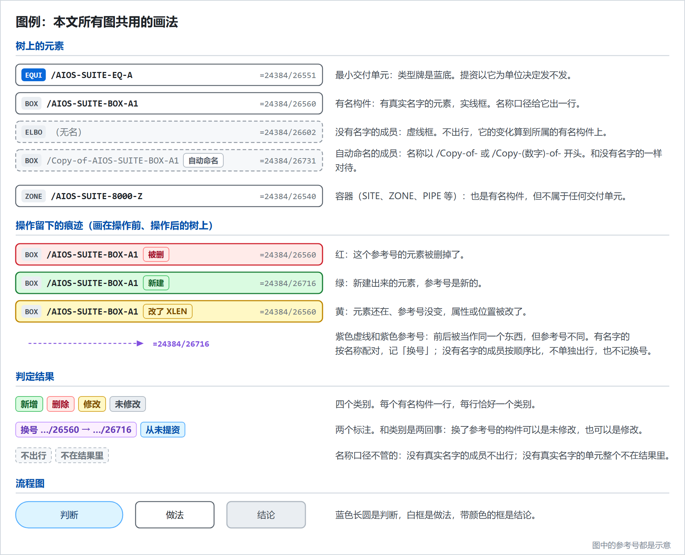

*图 1：图例*

另外有几点对所有案例都适用。

- 编号由组的字母加组内序号组成，例如 A-01。编号固定不变，引用案例时请用编号。
- 案例里的元素名（`/AIOS-SUITE-EQ-A` 等）是测试模型里的例子，标了「示意」的是为举例编的。图里的参考号都是示意。
- 写「某某未修改」时，通过标准是：它不出现在新增、删除、修改的行里，所属单元的汇总是未修改。未修改又没有换号的构件，结果里可以不逐行列出，只计数。
- 除非特别说明，期望结果对指定对比和提资对比都成立。「从未提资」这个标注只在提资对比里出现。
- 一览表里标了「验收」的 10 个案例，合起来是已经确认的八条验收用例，其中两条各拆成了两个案例。

## 解决方案的总思路

后面每个案例的「解决方案」用到的规则，都在下面这几条里。

- **认身份**：同一个库里，名称整串相同就是同一个构件，不看参考号。比的是名称原文：带前导斜杠，只去掉首尾空白，区分大小写。别的库里同名、同名但类型不同、同一个库里重名，都不配对。
- **认谁、跳过谁**：有真实名字的构件每个一行，并写明它属于哪个单元。没有名字的、自动命名的元素不出行，变化算到所属的有名构件上。单元自己没有真实名字的，整个不在结果里，提资对它照原来的办法。
- **怎么比**：比构件的内容。内容是它自己的属性，它名下没有真实名字的成员（按顺序，不带参考号），以及它下面有哪些有名成员和它们的顺序。引用别的元素时，比目标的名称。纯元数据不算。单元那一行另外算上各级上级的位置和方向。
- **类别和标注**：类别有新增、删除、修改、未修改四种，只是参考号换了也是未修改。标注有换号、从未提资两个，和类别是两回事。改名记成旧名删除加新名新增，两行互相指明。
- **单元怎么汇总**：有名成员各判各的。属于一个单元的行里只要有一行不是未修改，单元就算修改。
- **和哪一次比**：提资和预览以每个单元上一次提资时为基准，不是第一次；目标是已入库的状态。新单元没有版本记录时，先看它是不是接替了一个提资过的旧单元。
- **提资怎么用**：未修改的单元跳过，其余照发。换了号的单元不为旧参考号提删除，版本记录转到新参考号。不在结果里的单元照原来的办法。
- **判不了的一律判修改**：读不出来、没有基准、重名，都不会判成未修改。宁可多发，不能漏发。

## 案例一览

下表列出全部 60 个案例。「验收」一栏标了「是」的，属于已经确认的八条验收用例。

| 编号 | 案例 | 期望结果 | 验收 |
| --- | --- | --- | --- |
| A-01 | 只改名 | 旧名删除、新名新增，两行互相指明；提资走改名：旧位号提删除，新位号提新增。 | 是 |
| A-02 | 单元删后同名重建，内容不变 | 未修改，换号；提资跳过，不提旧位号的删除，版本记录转到新参考号。 | 是 |
| A-03 | 成员删后同名重建，内容不变 | 成员未修改、换号，单元未修改；提资跳过。 | 是 |
| A-04 | 成员删后同名重建，内容有变 | 成员修改、换号，单元修改；提资重发。 | 是 |
| A-05 | 单元删后同名重建，内容有变 | 修改，换号；按原位号重发，不提旧位号的删除。 | — |
| A-06 | 删掉重建，同时换了名字 | 旧名删除、新名新增，不互相指明；旧位号提删除，新位号首次提资。 | 是 |
| B-01 | 只动了纯元数据 | 未修改；提资跳过。 | 是 |
| B-02 | 只改了描述或自定义属性 | 修改；提资重发。 | — |
| B-03 | 只改了模型和提资都不用的属性 | 提资读取清单到位之前判修改，到位之后判未修改。 | — |
| B-04 | 只改了单元下面一个有名成员 | 成员修改，上一级未修改，单元修改；提资重发。 | — |
| B-05 | 有名成员的名单或顺序变了 | 上一级修改，单元修改；提资重发。 | — |
| B-06 | 有名构件换了单元或属主 | 只出一行修改，写明新旧；新旧两个单元都修改。 | — |
| B-07 | 有名构件在无名层级之间挪动 | 构件自己不判修改，它的有名祖先判修改。 | — |
| C-01 | 无名成员删后原样重建 | 所属的有名构件未修改；提资跳过。 | — |
| C-02 | 无名成员改了属性 | 无名成员不出行，所属的有名构件修改；提资重发。 | 是 |
| C-03 | 多了或少了一个无名成员 | 所属的有名构件修改；提资重发。 | — |
| C-04 | 无名成员换了顺序 | 所属的有名构件修改；提资重发。 | — |
| C-05 | 没有名字的单元 | 整个不在结果里；提资照原来的办法。 | 是 |
| C-06 | 没有名字的单元下面的有名构件 | 指定对比出一行，所属单元为空；提资对比不出行。 | — |
| C-07 | 自动命名的成员 | 不出行，变化算到所属的有名构件上。 | 是 |
| C-08 | 自动命名的单元 | 整个不在结果里；提资照原来的办法。 | 是 |
| C-09 | 名称中间含有 Copy-of | 当作真实名字照常出行；提资原有的「不发」规则仍然先生效。 | — |
| D-01 | 同名但类型不同 | 不配对：旧的删除、新的新增，都标「类型变了」。 | — |
| D-02 | 同一个库里出现重名 | 不配对，进重名清单；所在单元按修改处理。 | — |
| D-03 | 别的库里有同名的 | 不配对，只提示。 | — |
| D-04 | 名称只差大小写 | 不算同名：旧名删除、新名新增。 | — |
| E-01 | 被引用的对象删后同名重建 | 引用方未修改；提资跳过。 | — |
| E-02 | 引用换到另一个名称的对象 | 引用方修改；提资重发。 | — |
| E-03 | 被引用的对象自己改了名 | 引用方修改；提资重发。 | — |
| E-04 | 引用的目标没有真实名字，随所在单元重建 | 引用方未修改；提资跳过。 | — |
| E-05 | 引用的目标在别的库：换了目标 | 引用方修改；提资重发。 | — |
| E-06 | 引用的目标在别的库：目标自己变了 | 看不出来，引用方未修改。这是已知的盲区。 | — |
| E-07 | 引用为空，或目标已经不存在 | 两侧同为空、或同为不存在，不算变化。 | — |
| E-08 | 引用的目标往上一直没有有名祖先 | 退回按参考号比：目标的参考号变了，引用方判修改。 | — |
| F-01 | 上级移动了，单元自己没动 | 下面每个单元都判修改；提资重发。 | — |
| F-02 | 容器自己的变化 | 指定对比出一行；提资对比不出行。 | — |
| F-03 | 提资从上级或经引用读到的属性变了 | 上级只是改名不算换了属主；提资读取清单到位之后，提资读了这个名称的单元判修改，到位之前看不出来。 | — |
| G-01 | 从未提资过的新单元 | 新增，标「从未提资」；按首次提资。 | — |
| G-02 | 提资之后没有任何改动 | 未修改；提资跳过。 | — |
| G-03 | 改过并提资，之后又改回原样 | 修改；提资重发。 | — |
| G-04 | 上级移动后已经提资，此后没有改动 | 未修改；提资跳过，不会每次都重发。 | — |
| G-05 | 旧的版本记录上只有替代的基准 | 退回用它当基准，照常比。 | — |
| G-06 | 旧的版本记录上没有可用的基准 | 按已修改处理，标「没有基准」；重发一次。 | — |
| G-07 | 基准会话已经读不回来 | 按已修改处理，标明原因；重发一次。 | — |
| G-08 | 接替：复制一份改回原名，再删掉原件 | 认定接替：未修改，换号；提资跳过。 | — |
| G-09 | 复制后只把单元改回原名，成员还是自动命名 | 修改，换号；原来的有名成员各出一行删除。 | — |
| G-10 | 已提资的单元被删除，没有被接替 | 删除；提资提删除。 | — |
| G-11 | 库里有还没入库的会话 | 以已入库的会话为准，没入库的改动不算。 | — |
| G-12 | 库还没有入库 | 提资对比报错。 | — |
| G-13 | 有一次提资没用上名称口径 | 之后不会拿更早的基准去比：改回原样仍判修改。 | — |
| H-01 | 不在结果里的单元照原来的办法 | 发不发、跳不跳，和没有这项功能时逐项相同。 | — |
| H-02 | 名称口径的判定用不了时 | 全部单元照原来的办法，提资照常完成，回执里说明。 | — |
| H-03 | 一次提资涉及多个库 | 各库各自判定，互不影响。 | — |
| I-01 | 提资预览的分栏和数量 | 分六栏，每个单元只落一栏；数量和实际提资一致；预览不改记录；预览之后又有新会话入库的，提资时提示重新预览。 | — |
| I-02 | 待删除列表里已被接替的记录 | 带「已被接替」的标记，缺省不勾选，提资时不提这条删除。 | — |
| J-01 | 结果的每一行都带齐信息 | 每个有名构件一行、恰好一个类别，并带所属单元。 | — |
| J-02 | 判不了的一律判修改 | 任何判不了的情形，都不会判成未修改。 | — |
| J-03 | 判定只读，不改任何记录 | 判定前后，版本记录和待删除记录不变。 | — |
| J-04 | 现有的增量更新和模型生成不受影响 | 和没有这项功能时逐项相同；换了号的构件照样重新生成模型。 | — |
| J-05 | 判为未修改的单元，模型确实没变 | 前后生成的模型完全一致。 | — |

## A 组：改名与删后重建

这一组的操作都让参考号或者名称变了。考的是：系统认不认得出前后是同一个构件，该跳过的跳过，该重发的重发。

### A-01 只改名

| 项目 | 内容 |
| --- | --- |
| 场景 | 把设备 `/AIOS-SUITE-EQ-B` 改名为 `/AIOS-SUITE-EQ-B-RENAMED`，别的都不动。还是同一个元素，参考号不变。前提：这台设备提资过。 |
| 期望结果 | 旧名 `/AIOS-SUITE-EQ-B` 一行删除，新名 `/AIOS-SUITE-EQ-B-RENAMED` 一行新增。两行的参考号相同，互相指明：旧名那一行写明改成了什么，新名那一行写明由什么改来。提资对比时，新名那一行不标「从未提资」。 |
| 提资时 | 走改名提资：旧位号提删除，新位号提新增，和原来一样。预览归「改名」一栏。 |
| 解决方案 | 名称就是身份，名称变了就是换了一个身份，所以记成一删一增。参考号没变，系统认得出这是同一个元素改了名，所以让两行互相指明。数据中台也是按位号认实例的，改名在提资时本来就是旧位号删除加新位号新增。 |
| 按参考号看 | 只有一行修改（`NAME` 变了），看不出位号换了。 |
| 说明 | 「新名那一行不标从未提资」是按已确认的规则推出来的，需求方看过、没有反对。 |

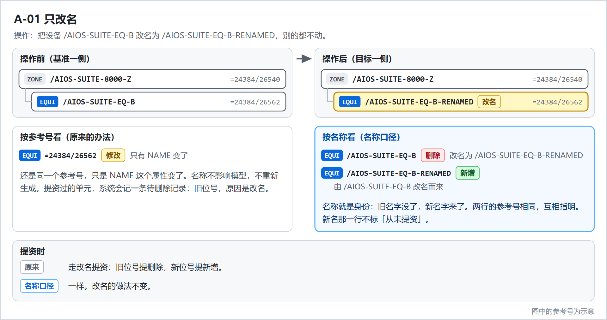

*图 2：A-01 只改名*

### A-02 单元删后同名重建，内容不变

| 项目 | 内容 |
| --- | --- |
| 场景 | 把整条支管 `/AIOS-SUITE-BRAN-S` 删掉，再按原样重建，成员起回原来的名字。名称都没变，参考号全换了。前提：这条支管提资过；重建出来的内容和原来逐项相同。 |
| 期望结果 | 支管和每个有名成员各一行：未修改，带换号标注（旧参考号、新参考号）。单元汇总：未修改，换号。没有任何一行是新增、删除或修改。 |
| 提资时 | 跳过，不重发。不为旧参考号提删除，不管这条删除是人工勾选的、系统补的，还是改名带出来的。版本记录转到新参考号，位号和版本号沿用；旧参考号的版本记录和待删除记录随之消失。提资之前，待删除列表里旧参考号那一条标为「已被接替」。预览归「跳过」一栏，并计入其中「换了参考号」的那个数。数据中台既收不到这个位号的删除，也收不到再次提资。 |
| 解决方案 | 按名称把前后两侧对上：四个名称前后都在，内容逐项相同，只是参考号换了，判未修改。新参考号没有版本记录，系统就到同一个库的待删除记录里找：旧位号等于它的名称、类型相同、旧参考号有版本记录的那一条。找到了，就认定新单元接替了旧单元，用旧单元的基准来比。 |
| 按参考号看 | 旧的全删、新的全加。新参考号查不到版本记录，被当成首次提资再发一遍；旧位号进待删除列表，可能真的向数据中台提了删除。 |
| 说明 | 取决于前提：删掉再重建出来的内容是否逐项相同，要在第一次实测时确认，例如单元内部互相引用的属性是否都指向了新建的成员。不相同就会判修改，按 A-05 处理。提资前后两张记录怎么变，见 A-05 后面的图 6。 |

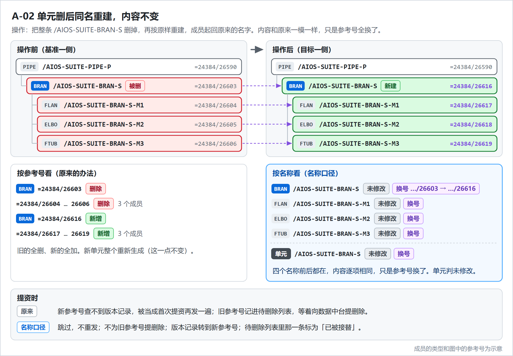

*图 3：A-02 单元删后同名重建，内容不变*

### A-03 成员删后同名重建，内容不变

| 项目 | 内容 |
| --- | --- |
| 场景 | 删掉设备 `/AIOS-SUITE-EQ-A` 下面的 `/AIOS-SUITE-BOX-A1`，再建一个同名、同尺寸的，在成员里的位置和原来一样。设备自己没有动，参考号没变。 |
| 期望结果 | `/AIOS-SUITE-BOX-A1` 一行：未修改，带换号标注。`/AIOS-SUITE-EQ-A` 未修改，不换号。单元汇总：未修改。没有任何一行是修改。 |
| 提资时 | 跳过。预览归「跳过」一栏。 |
| 解决方案 | 同名的 BOX 尺寸相同，只是换了参考号，不算修改。设备这一行只看它下面有哪些有名成员以及它们的顺序，名单和顺序都没变，所以设备也是未修改。 |
| 按参考号看 | BOX 一删一增，设备一行修改（成员表变了），整台重新生成。提资因为单元里有写入而重发。 |

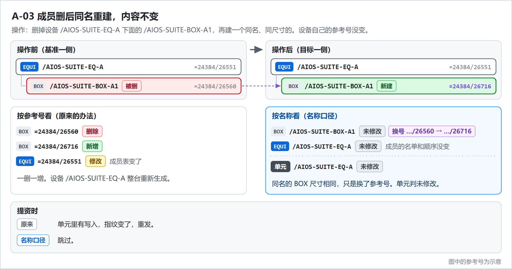

*图 4：A-03 成员删后同名重建，内容不变*

### A-04 成员删后同名重建，内容有变

| 项目 | 内容 |
| --- | --- |
| 场景 | 和 A-03 一样删掉 `/AIOS-SUITE-BOX-A1` 再同名重建，但重建时把长度（`XLEN`）从 2000 改成了 2500。 |
| 期望结果 | `/AIOS-SUITE-BOX-A1` 一行：修改，带换号标注，变化摘要指出 `XLEN` 从 2000 变成 2500。`/AIOS-SUITE-EQ-A` 自己那一行未修改。单元汇总：修改。 |
| 提资时 | 重发。预览归「重发」一栏。 |
| 解决方案 | 同名的 BOX 两侧都在，内容不同，判修改；参考号也不同，同时标换号。设备自己的内容没变，但属于这个单元的行里有一行不是未修改，单元就算修改。 |
| 按参考号看 | 和 A-03 完全一样：一删一增，单元修改，重发。分不出这一次内容其实变了，也说不出改了什么。 |

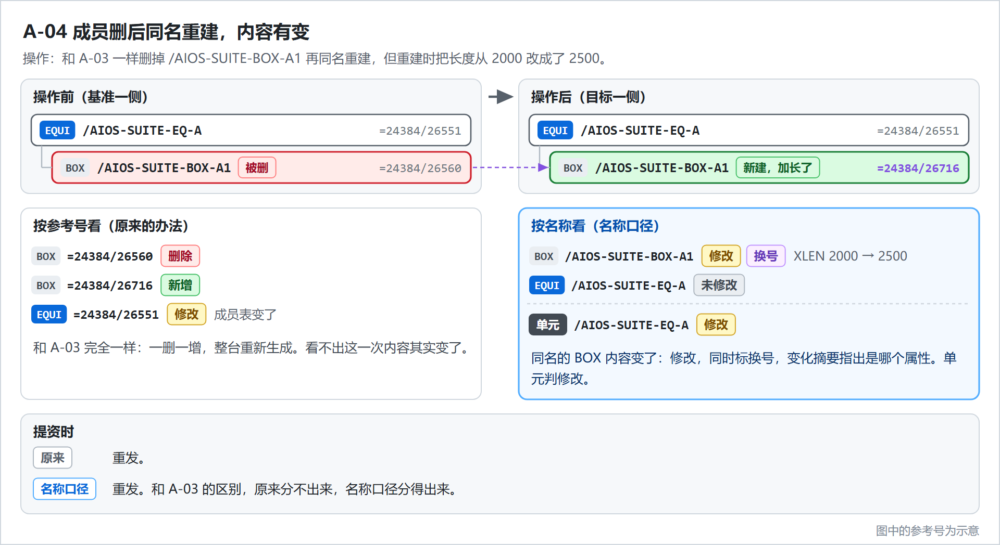

*图 5：A-04 成员删后同名重建，内容有变*

### A-05 单元删后同名重建，内容有变

| 项目 | 内容 |
| --- | --- |
| 场景 | 把整条支管 `/AIOS-SUITE-BRAN-S` 删掉后同名重建，成员起回原来的名字，但重建时改了其中一个有名成员 `/AIOS-SUITE-BRAN-S-M2` 的一个属性。前提：这条支管提资过。 |
| 期望结果 | `/AIOS-SUITE-BRAN-S-M2` 一行：修改，换号，变化摘要指出哪个属性变了。支管和其余有名成员各一行：未修改，换号。单元汇总：修改，换号。 |
| 提资时 | 按原位号重发：当作这个位号的修改提交，不是新增，版本号接着旧记录往下走。不为旧参考号提删除。提资成功后，版本记录落在新参考号上，旧参考号的版本记录和待删除记录都没有了，不会出现新旧两条都在、或者两条都不在的情况。预览归「重发」一栏。数据中台收到这个位号的修改，收不到删除。 |
| 解决方案 | 认定接替的办法和 A-02 相同。接替之后比内容，有变化就判修改。因为还是同一个位号，所以按修改重发，而不是删旧发新。 |
| 按参考号看 | 旧的全删、新的全加：旧位号提删除，新参考号按首次提资。 |
| 说明 | 取决于前提：数据中台对「同一个位号、按修改提交、版本号接着走」的处理是否符合预期，要在实施时验证。这种提交方式是方案里的做法，未单独确认。 |

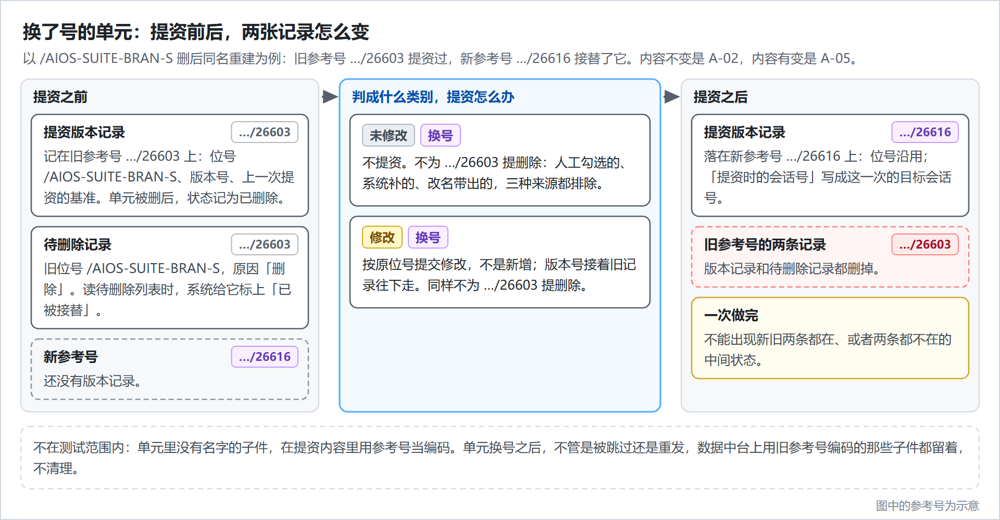

*图 6：换了号的单元，提资前后两张记录怎么变（A-02、A-05）*

### A-06 删掉重建，同时换了名字

| 项目 | 内容 |
| --- | --- |
| 场景 | 删掉设备 `/AIOS-SUITE-EQ-B`，新建一台内容相同、名字叫 `/AIOS-SUITE-EQ-C`（示意）的设备。参考号和名称都变了。前提：`/AIOS-SUITE-EQ-B` 提资过。 |
| 期望结果 | 旧名 `/AIOS-SUITE-EQ-B` 一行删除，新名 `/AIOS-SUITE-EQ-C` 一行新增。两行不互相指明。提资对比时，新名那一行标「从未提资」。 |
| 提资时 | 旧位号提删除，新位号按首次提资，和原来一样。预览里旧名归「删除」一栏，新名归「首次提资」一栏。 |
| 解决方案 | 参考号和名称都变了，没有任何依据认定它们是同一个东西，所以就是互不相干的一个删除、一个新增。内容相同也不配对：配对只看名称。 |
| 按参考号看 | 一删一增，结果相同。 |

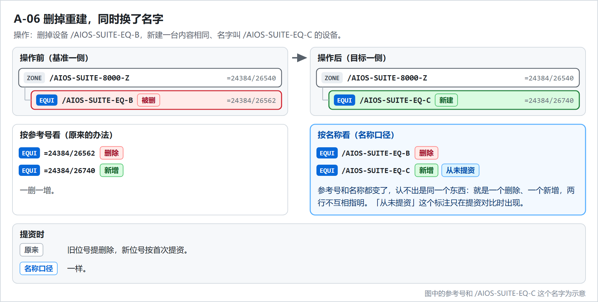

*图 7：A-06 删掉重建，同时换了名字*

## B 组：内容变没变

这一组考的是「内容」怎么才算变了：哪些属性算，哪些不算；成员变了，算谁的。

### B-01 只动了纯元数据

| 项目 | 内容 |
| --- | --- |
| 场景 | 设备 `/AIOS-SUITE-EQ-A` 上只有 `CACHID` 变了，`SPAMAP` 同理。它们是 E3D 自己写的计数，设计人员没有改任何东西。测试时可以用只有这两个属性不同的两份数据来验。前提：这台设备提资过。 |
| 期望结果 | 没有任何一行变成修改。`/AIOS-SUITE-EQ-A` 未修改，单元汇总：未修改。 |
| 提资时 | 跳过。预览归「跳过」一栏。即使版本记录的状态已经被标成了「已修改」，也照样跳过。 |
| 解决方案 | 纯元数据不算内容，比较之前先去掉。提资按判定的类别办，不再看版本记录的状态：那个状态是按参考号的办法标的，记录被写过就会标，分不出改的是不是纯元数据。 |
| 按参考号看 | 一行修改。模型这一侧原来就会分辨，不重新生成；但提资只看单元里有没有写入，会重发。 |
| 说明 | 这两个属性之外还有哪些算纯元数据，要等提资读取清单到位，见 B-03。 |

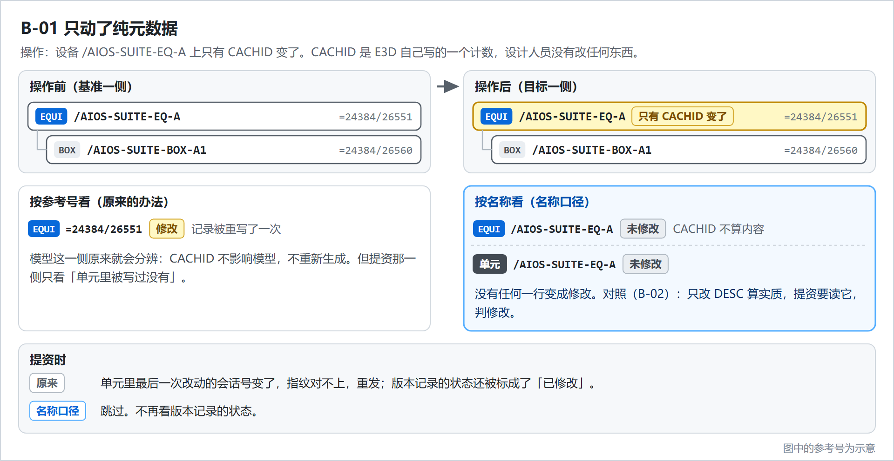

*图 8：B-01 只动了纯元数据*

### B-02 只改了描述或自定义属性

| 项目 | 内容 |
| --- | --- |
| 场景 | 只改了设备 `/AIOS-SUITE-EQ-A` 的描述（`DESC`），或者它的任何一个用户自定义属性。尺寸、位置这些属性都没动。 |
| 期望结果 | `/AIOS-SUITE-EQ-A` 一行修改，变化摘要指出是哪个属性、从什么变成什么。单元汇总：修改。 |
| 提资时 | 重发。预览归「重发」一栏。 |
| 解决方案 | 名称、描述和全部用户自定义属性一律算实质内容，哪怕它们不影响模型：提资内容里要用到它们。 |
| 按参考号看 | 一行修改，重发，结果相同。这个案例是 B-01 的对照。 |

### B-03 只改了模型和提资都不用的属性

| 项目 | 内容 |
| --- | --- |
| 场景 | 只改了设备上一个既不影响模型、提资也不读的属性，而且不是 `CACHID`、`SPAMAP`。例如功能（`FUNC`），它是否属于这一类以清单为准。 |
| 期望结果 | 提资读取清单到位之前：判修改。清单到位之后：这个属性如果同时满足三条，判未修改。三条是：E3D 认为它变了不用重画；模型生成不读它；提资不读它。 |
| 提资时 | 清单到位之前重发；到位之后跳过。 |
| 解决方案 | 一个属性算不算纯元数据，要三条同时满足，其中「提资不读它」需要一份提资读取清单，列出提资到底读了哪些属性。清单到位之前宁可多发：只认两个计数，其余属性的变化一律算修改。不能只看前两条：描述（`DESC`）和伴热规格（`TSPE`）前两条都满足，但提资在读。 |
| 说明 | 取决于前提：提资读取清单是否到位，以及这个属性在不在清单里。 |

### B-04 只改了单元下面一个有名成员

| 项目 | 内容 |
| --- | --- |
| 场景 | 只改设备 `/AIOS-SUITE-EQ-A` 下面 `/AIOS-SUITE-BOX-A1` 的长度（`XLEN` 从 2000 改成 2500）。参考号都没变，设备自己的属性没有动。 |
| 期望结果 | `/AIOS-SUITE-BOX-A1` 一行修改，变化摘要指出 `XLEN`。`/AIOS-SUITE-EQ-A` 自己那一行未修改，设备下面别的有名成员未修改。单元汇总：修改。 |
| 提资时 | 重发。预览归「重发」一栏。 |
| 解决方案 | 有名成员各判各的：它的变化只记在它自己那一行，上一级不跟着变，上一级只看有哪些有名成员和它们的顺序。按单元汇总时，属于这个单元的行里只要有一行不是未修改，单元就算修改。 |
| 按参考号看 | 一个元素修改，设备重发。结果一样，但按名称能说出是哪个构件的哪个属性变了。 |

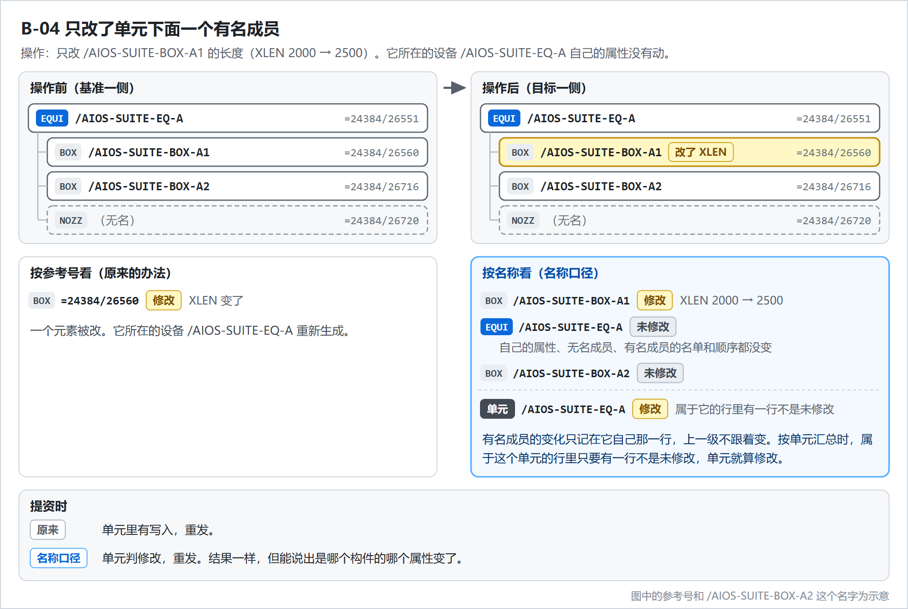

*图 9：B-04 只改了单元下面一个有名成员*

### B-05 有名成员的名单或顺序变了

| 项目 | 内容 |
| --- | --- |
| 场景 | 设备 `/AIOS-SUITE-EQ-A` 下面有三种变法。① 新增一个有名的 BOX。② 删掉一个有名的 BOX。③ 把 `/AIOS-SUITE-BOX-A1` 删掉后同名、同尺寸重建，但重建后落在成员里的另一个位置。 |
| 期望结果 | 三种变法下，`/AIOS-SUITE-EQ-A` 自己那一行都判修改，原因是有名成员的名单或顺序变了。成员自己那一行：① 新增；② 删除；③ 未修改，换号。单元汇总：修改。 |
| 提资时 | 重发。预览归「重发」一栏。 |
| 解决方案 | 一个有名构件的内容，包括它下面有哪些有名成员以及它们的顺序。E3D 里成员的顺序就是管路的走向，所以顺序变了也算。③ 和 A-03 的区别只在位置：位置没变，上一级未修改；位置变了，上一级判修改。 |

### B-06 有名构件换了单元或属主

| 项目 | 内容 |
| --- | --- |
| 场景 | 把 `/AIOS-SUITE-BOX-POSE` 从设备 `/AIOS-SUITE-EQ-PA` 改挂到 `/AIOS-SUITE-EQ-PB` 下面。BOX 的参考号和名称都没变。 |
| 期望结果 | `/AIOS-SUITE-BOX-POSE` 只出一行：修改，写明旧单元和新单元。不拆成旧单元里一行删除、新单元里一行新增。`/AIOS-SUITE-EQ-PA` 和 `/AIOS-SUITE-EQ-PB` 各一行修改：一个少了有名成员，一个多了。两个单元的汇总都是修改。 |
| 提资时 | 两个单元都重发。预览都归「重发」一栏。 |
| 解决方案 | 它还是同一个名称、同一个构件，所以是一行修改，不是一删一增。挪到了别的属主或者别的单元下面，直接判修改。在同一个单元里从一个有名构件下面挪到另一个有名构件下面，同样是一行修改，写明旧属主和新属主。 |
| 按参考号看 | 三条记录修改，两台设备都重发，结果相同。 |
| 说明 | 对照：上级只是改名，构件没有被挪动的，不算换了属主，也不算换了单元，见 F-03。 |

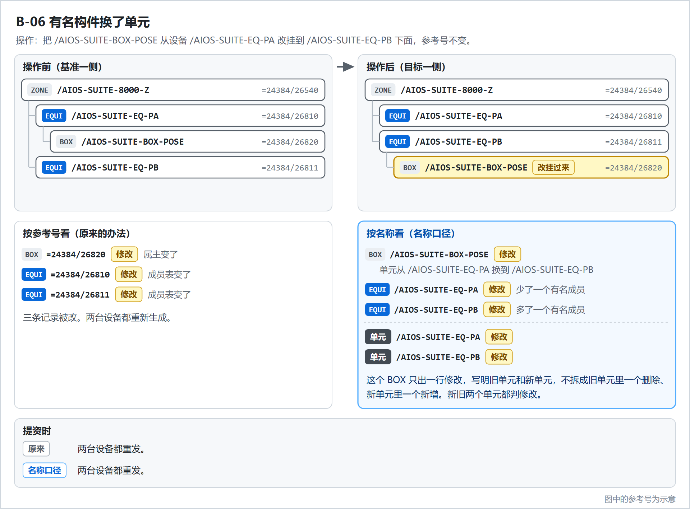

*图 10：B-06 有名构件换了单元*

### B-07 有名构件在无名层级之间挪动

| 项目 | 内容 |
| --- | --- |
| 场景 | 设备 `/AIOS-SUITE-EQ-A` 下面有两个没有名字的子层级（示意）。把有名的 `/AIOS-SUITE-BOX-A1` 从第一个子层级挪到第二个里。它自己的属性没变，它最近的有名祖先还是这台设备。 |
| 期望结果 | `/AIOS-SUITE-BOX-A1` 自己不因此判修改。`/AIOS-SUITE-EQ-A` 那一行判修改：它名下的结构变了。单元汇总：修改。 |
| 提资时 | 重发。 |
| 解决方案 | 「属主」按最近的有名祖先认，不按直接属主认。按直接属主认的话，无名属主前面增删一个兄弟、序号一变，下面的有名构件就会被连带判成修改。结构上的变化，由那个有名祖先的内容来体现。 |
| 说明 | 未单独确认。 |

## C 组：没有名字的和自动命名的

没有名字的元素、自动命名的元素不单独出行。这一组考的是：它们的变化算到谁头上，以及没有真实名字的单元怎么对待。图 11 把 C-01 到 C-05 的六种情形画在了一起。

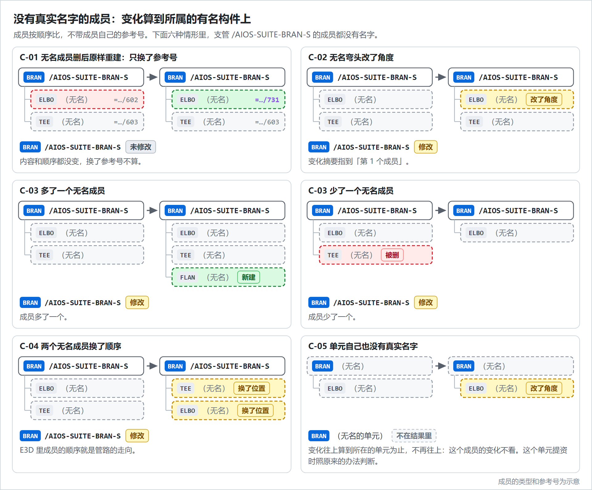

*图 11：没有真实名字的成员的六种情形（C-01 至 C-05）*

### C-01 无名成员删后原样重建

| 项目 | 内容 |
| --- | --- |
| 场景 | 支管 `/AIOS-SUITE-BRAN-S` 的成员都没有名字。把其中一个成员删掉，再在原来的位置按原样建回来。这个成员换了参考号，内容和位置都没变。 |
| 期望结果 | 支管未修改，不换号。无名成员不出行，也不记换号。单元汇总：未修改。 |
| 提资时 | 跳过。预览归「跳过」一栏。 |
| 解决方案 | 没有真实名字的成员不单独出行，它们算在所属有名构件的内容里：按顺序逐个比类型和属性，一层层往下，不带成员自己的参考号。成员只是换了参考号，内容和顺序都没变，两侧相同。 |
| 按参考号看 | 成员一删一增，支管修改，重发。 |

### C-02 无名成员改了属性

| 项目 | 内容 |
| --- | --- |
| 场景 | 设备 `/AIOS-SUITE-EQ-COPY` 是复制出来的，它的成员都没有名字。改了其中一个无名 BOX 的长度。同样的情形：支管里一个无名弯头改了角度。 |
| 期望结果 | `/AIOS-SUITE-EQ-COPY` 一行修改，变化摘要指到第几个成员的哪个属性。无名成员不出行，只计入被跳过的数量。单元汇总：修改。 |
| 提资时 | 重发。预览归「重发」一栏。 |
| 解决方案 | 管件常常不命名。无名弯头改了角度，管线的几何和提资内容都变了，必须重发。所以无名成员虽然不出行，它的变化要算到所属的有名构件上。 |
| 按参考号看 | 成员一行修改，单元重发，结果相同。 |
| 说明 | 复制出这台设备的那一步本身，结果里只有 `/AIOS-SUITE-EQ-COPY` 一行新增，它的成员都不出行。 |

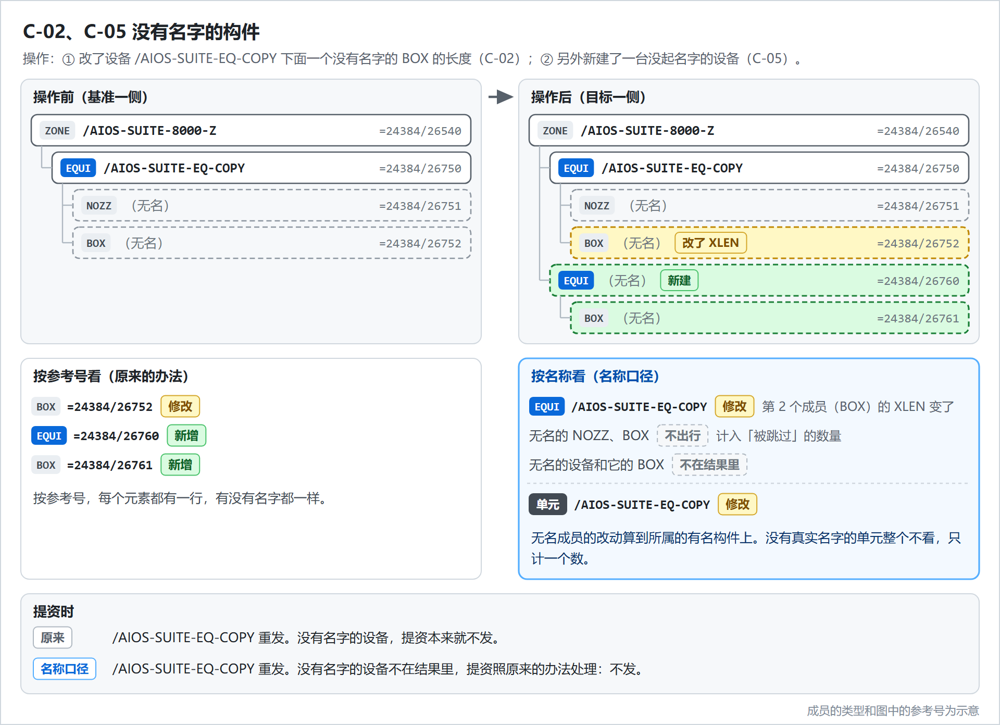

*图 12：C-02、C-05 没有名字的构件*

### C-03 多了或少了一个无名成员

| 项目 | 内容 |
| --- | --- |
| 场景 | 支管 `/AIOS-SUITE-BRAN-S` 下面多了一个无名成员，或者少了一个。 |
| 期望结果 | 支管一行修改，变化摘要指出第几个成员增了或者删了。单元汇总：修改。 |
| 提资时 | 重发。预览归「重发」一栏。 |
| 解决方案 | 无名成员的增、删，都算所属有名构件的修改。 |
| 按参考号看 | 成员新增或删除，支管修改，重发，结果相同。 |

### C-04 无名成员换了顺序

| 项目 | 内容 |
| --- | --- |
| 场景 | 支管 `/AIOS-SUITE-BRAN-S` 下面两个无名成员换了位置，各自的属性没变。 |
| 期望结果 | 支管一行修改，变化摘要指出顺序变了。单元汇总：修改。 |
| 提资时 | 重发。预览归「重发」一栏。 |
| 解决方案 | 成员按顺序比。E3D 里成员的顺序就是管路的走向，顺序变了，内容就变了。 |
| 按参考号看 | 支管一行修改，重发，结果相同。 |

### C-05 没有名字的单元

| 项目 | 内容 |
| --- | --- |
| 场景 | ① 新建一台没起名字的设备。② 一条没有名字的支管，改了它下面一个无名弯头的角度。 |
| 期望结果 | 两种情况下，这个单元和它下面没有真实名字的成员在结果里完全不出现：没有行，没有单元汇总，不参与换号配对，只计入「没有真实名字的单元」的数量。它所在的区域等容器也不因此判修改。 |
| 提资时 | 照原来的办法，和没有这项功能时逐项相同。没有名字的设备、工艺专业没有名字的支管，原来就不提资，现在也不提资。通风、仪控、电气专业没有名字的支管，原来照常提资，现在也是：单元里有写入就重发。预览里，照常提资的这些归「按原来的办法判断」一栏。 |
| 解决方案 | 没有名字，就没有可以认的身份。无名成员的变化往上算，算到所在的单元为止，不再往上；单元自己没有真实名字，这个变化就不看。 |
| 按参考号看 | 每个元素都有一行，有没有名字都一样。 |
| 说明 | 「算到所在的单元为止」和「没有真实名字的单元在上级容器里不占位置」是按已确认的规则推出来的，需求方看过、没有反对。 |

### C-06 没有名字的单元下面的有名构件

| 项目 | 内容 |
| --- | --- |
| 场景 | 一条没有名字的支管上，有一个有位号的阀门 `/AIOS-SUITE-VALV-X`（示意）。改了这个阀门的一个属性。 |
| 期望结果 | 指定对比：阀门一行修改，所属单元为空，并注明原因是所在单元没有真实名字。提资对比：不出这一行。 |
| 提资时 | 跟着所在的单元走，照原来的办法。 |
| 解决方案 | 每个有名构件都该有一行，所以指定对比照常出行。但这个单元不在结果里，提资对整个单元照原来的办法，这一行在提资对比里既没有基准、也没有人用，所以不出。 |
| 说明 | 按已确认的规则推出来的，需求方看过、没有反对。 |

### C-07 自动命名的成员

| 项目 | 内容 |
| --- | --- |
| 场景 | 第一步，在设备 `/AIOS-SUITE-EQ-A` 下面新建一个名叫 `/Copy-of-AIOS-SUITE-BOX-A1` 的 BOX。第二步，再改这个 BOX 的尺寸。 |
| 期望结果 | 这个 BOX 两步都不出行。`/AIOS-SUITE-EQ-A` 两步都判修改：第一步是多了一个成员，第二步是成员的尺寸变了。单元汇总：修改。名称以 `/Copy-(数字)-of-` 开头的同样处理。 |
| 提资时 | 重发。预览归「重发」一栏。 |
| 解决方案 | 自动命名不是设计人员起的，复制一次就多出一批，不能当身份用。挂在有名构件下面的自动命名成员，和没有名字的成员一样处理：不出行，变化算到所属的有名构件上，它的名称本身不参与比较。哪些前缀算自动命名是一份可以配置的清单，缺省就是这两条。 |
| 按参考号看 | 每个元素一行，名字是不是 Copy-of 开头没有区别。 |

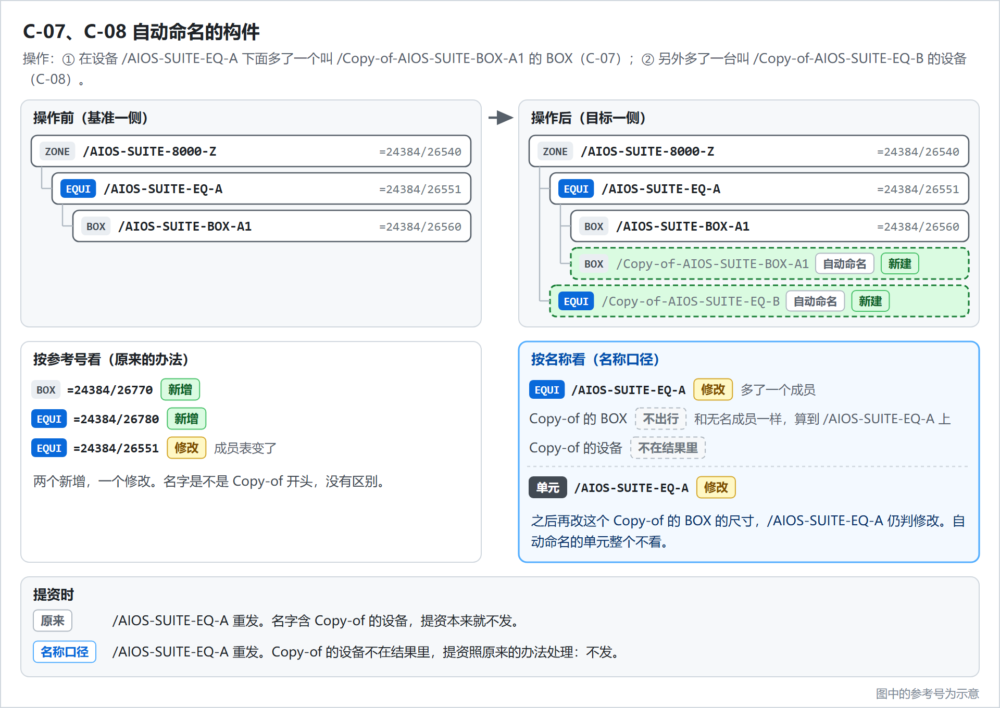

*图 13：C-07、C-08 自动命名的构件*

### C-08 自动命名的单元

| 项目 | 内容 |
| --- | --- |
| 场景 | 新建一台名叫 `/Copy-of-AIOS-SUITE-EQ-B` 的设备。 |
| 期望结果 | 结果里完全没有这台设备：没有行，没有单元汇总，只计入「没有真实名字的单元」的数量。 |
| 提资时 | 照原来的办法，和没有这项功能时相同。名字含 Copy-of 的设备原来就不提资，现在也不提资。 |
| 解决方案 | 单元自己是自动命名的，等同于没有真实名字，整个不在结果里。 |
| 说明 | 名字是 Copy-of 的支管和支吊架，原来是照常提资的。它们同样不在结果里，继续照原来的办法，见「不在测试范围内」。 |

### C-09 名称中间含有 Copy-of

| 项目 | 内容 |
| --- | --- |
| 场景 | 一台设备的名称里有 Copy-of，但不在开头，例如 `/AIOS-SUITE-Copy-of-EQ-B`（示意）。 |
| 期望结果 | 名称口径把它当作有真实名字的构件：照常出行、给类别、有单元汇总。自动命名只认以前缀开头的名称。 |
| 提资时 | 提资原有的「不发」规则不变，并且先于类别生效：名字里含有 Copy-of 的设备原来不提资，现在仍然不提资，不管判成什么类别。换成这样命名的支管，原来照常提资，现在按类别办。 |
| 解决方案 | 判定和提资对「是不是复制件」的判法不一样：判定看名称是否以前缀开头，提资原有的规则看名称里是否含有。两边先各管各的，判得不一样的元素在联调时列出来看。要让这种名称也算自动命名，把它加进前缀清单。 |
| 说明 | 「原有的不发规则先于类别生效」是按已确认的规则推出来的，需求方看过、没有反对。 |

## D 组：名称相同却不算同一个

名称相同，也有不能当成同一个构件的时候。这一组前三个案例的通过标准都是「不配对」，画在图 14 里。配错比不配更糟：配错会把两个不同的构件判成未修改，提资就漏发了。第四个案例是看着像同名、其实不是同名的情形。

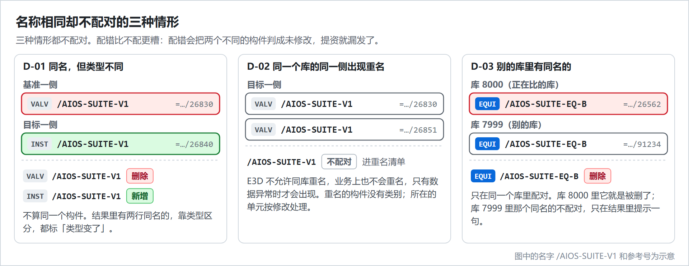

*图 14：名称相同却不配对的三种情形（D-01 至 D-03）*

### D-01 同名但类型不同

| 项目 | 内容 |
| --- | --- |
| 场景 | 名称 `/AIOS-SUITE-V1`（示意）原来是一个阀门（VALV），现在叫这个名字的是一个仪表（INST）。 |
| 期望结果 | 不配对。结果里有两行同名的，靠类型区分：阀门一行删除，仪表一行新增，两行都标「类型变了」。所在单元的汇总是修改。 |
| 提资时 | 所在的单元重发。 |
| 解决方案 | 类型不同，就不是同一个构件。数据中台的实例带对象类型；E3D 自己改类型也是先整体删除再重建。 |
| 说明 | 「结果里有两行同名的」未单独确认。 |

### D-02 同一个库里出现重名

| 项目 | 内容 |
| --- | --- |
| 场景 | 同一个库的同一侧，有两个元素都叫 `/AIOS-SUITE-V1`（示意）。E3D 不允许同一个库里重名，业务上也不会重名，只有数据异常时才会出现。测试时用构造的数据来验。 |
| 期望结果 | 这些重名的元素不配对，没有类别，列进重名清单：名称、在哪一侧、对到哪几个参考号。它们所在的单元按修改处理。 |
| 提资时 | 所在的单元重发。 |
| 解决方案 | 不挑一个来配，而是报出来。判不了的一律按修改。 |
| 说明 | 「所在的单元按修改处理」未单独确认。 |

### D-03 别的库里有同名的

| 项目 | 内容 |
| --- | --- |
| 场景 | 库 8000 里的设备 `/AIOS-SUITE-EQ-B` 被删了。另一个库（例如 7999）里有一台也叫 `/AIOS-SUITE-EQ-B` 的设备。 |
| 期望结果 | 不跨库配对。库 8000 的结果里 `/AIOS-SUITE-EQ-B` 一行删除。别的库里那个同名的只在结果里提示一句（名称、库号、参考号），不影响类别。 |
| 提资时 | 各库各算。库 8000 的这个位号提删除。 |
| 解决方案 | E3D 只保证同一个库里名称不重复，不同库里的同名元素可以同时存在，配不出一对一。 |

### D-04 名称只差大小写

| 项目 | 内容 |
| --- | --- |
| 场景 | 两侧的名称只差大小写：基准一侧叫 `/AIOS-SUITE-EQ-B`，目标一侧叫 `/aios-suite-eq-b`（示意）。 |
| 期望结果 | 两个名称不算同名，不配对：旧名一行删除，新名一行新增。如果是同一个参考号改的名，两行互相指明，和 A-01 一样。 |
| 提资时 | 旧位号提删除，新位号提新增。 |
| 解决方案 | 名称整串精确比较：区分大小写，带前导斜杠，只去掉首尾空白。E3D 认为不同的两个名称，判定不把它们并成一个。 |

## E 组：引用别的元素的属性

有些属性的值是另一个元素的参考号，例如管口接哪条支管（`CREF`）、管件用哪个规格（`SPRE`）、支管的尾端接在哪里（`TREF`）。被引用的对象一重建，这个值就变了。这一组考的是：比的是目标叫什么，不是目标的参考号。图 15 是六种情形的总览。

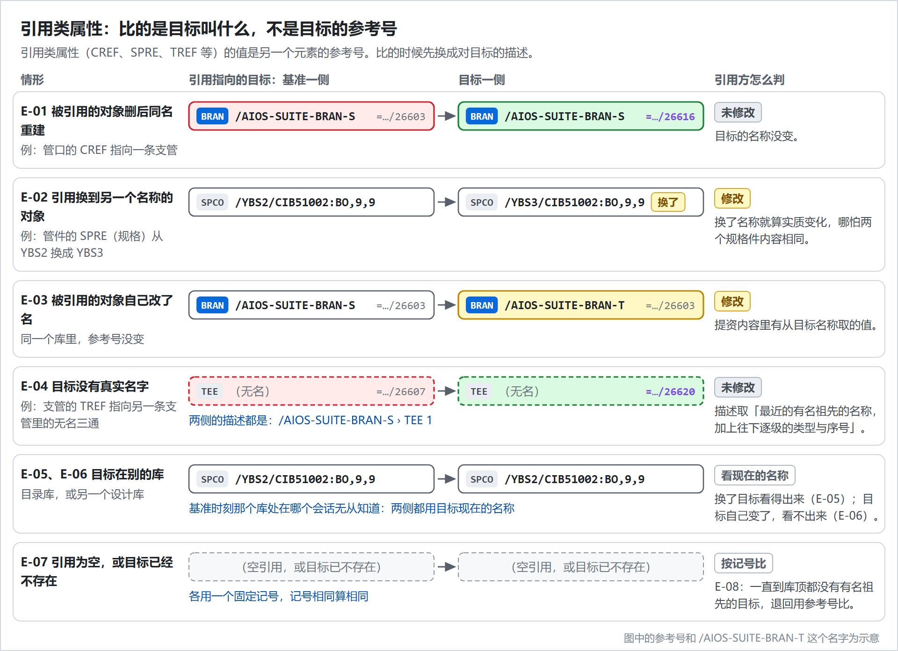

*图 15：引用类属性的六种情形（E 组）*

### E-01 被引用的对象删后同名重建

| 项目 | 内容 |
| --- | --- |
| 场景 | 管口 `/AIOS-SUITE-NOZZ-1` 接着支管 `/AIOS-SUITE-BRAN-S`，管口的 `CREF` 指向这条支管。把支管删掉后同名重建，再接回管口。管口的 `CREF` 跟着变成了新参考号。 |
| 期望结果 | 管口未修改。管口所在的设备，单元汇总：未修改。支管自己按 A-02 判。 |
| 提资时 | 设备跳过。 |
| 解决方案 | 比之前，先把引用里的参考号换成目标的名称。目标删后同名重建，还叫原来的名字，算没变。 |
| 按参考号看 | 管口一行修改，它所在的设备重发。 |

### E-02 引用换到另一个名称的对象

| 项目 | 内容 |
| --- | --- |
| 场景 | 把一个管件的规格（`SPRE`）从 `/YBS2/CIB51002:BO,9,9` 换成 `/YBS3/CIB51002:BO,9,9`。 |
| 期望结果 | 判修改，哪怕两个规格件的内容相同。管件有名字，就记在它自己那一行；没有名字，就算到所在的支管上。单元汇总：修改。 |
| 提资时 | 重发。 |
| 解决方案 | 引用按目标的名称比，换成另一个名称的对象就是实质变化。不比目标的内容：那样要给规格件、目录件各定义一遍什么叫内容相同。 |
| 按参考号看 | 管件一行修改，重发，结果相同。 |

### E-03 被引用的对象自己改了名

| 项目 | 内容 |
| --- | --- |
| 场景 | 把支管 `/AIOS-SUITE-BRAN-S` 改名为 `/AIOS-SUITE-BRAN-T`（示意）。接在它上面的管口 `/AIOS-SUITE-NOZZ-1` 没有动，`CREF` 里还是同一个参考号。两者在同一个库里。 |
| 期望结果 | 支管：旧名一行删除，新名一行新增，同 A-01。管口一行修改：它引用的目标换了名字。管口所在的设备，单元汇总：修改。 |
| 提资时 | 支管走改名提资。设备重发。 |
| 解决方案 | 提资内容里有从目标名称取的值，例如相邻件的编码。目标改了名，引用方的提资内容就变了。所以同一个库里目标改名，算引用方的修改。 |
| 按参考号看 | 只有支管一行修改。设备的记录没有被写过，提资会跳过，数据中台上留的是旧名。这一条是按现有逻辑推断的，没有实测。 |

### E-04 引用的目标没有真实名字，随所在单元重建

| 项目 | 内容 |
| --- | --- |
| 场景 | 支管甲的尾端（`TREF`）接在支管乙里一个没有名字的三通上，两条支管都有真实名字。把支管乙整条删掉后原样重建，再接回去。三通换了参考号，支管甲的 `TREF` 跟着换成了新参考号。 |
| 期望结果 | 支管甲未修改。支管乙未修改，换号。单元汇总：支管甲未修改；支管乙未修改，换号。 |
| 提资时 | 两条支管都跳过。 |
| 解决方案 | 目标没有真实名字时，用「最近的有名祖先的名称，加上从那里往下逐级的类型与序号」来描述它，例如「支管乙的名称，第 1 个三通」。目标随所在的单元一起重建、位置没变，两侧的描述相同。 |
| 按参考号看 | 支管甲一行修改。两条支管都重发。 |

### E-05 引用的目标在别的库：换了目标

| 项目 | 内容 |
| --- | --- |
| 场景 | 管件的规格（`SPRE`）指向目录库里的规格件。把它换成另一个规格件。 |
| 期望结果 | 判修改，同 E-02。 |
| 提资时 | 重发。 |
| 解决方案 | 目标在别的库（目录库，或者另一个设计库）时，两侧都用目标现在的名称来比。换了目标，名称不同，看得出来。 |
| 按参考号看 | 修改，重发，结果相同。 |

### E-06 引用的目标在别的库：目标自己变了

| 项目 | 内容 |
| --- | --- |
| 场景 | 管件的规格指向目录库里的规格件，设计库没有任何改动。① 目录库里把那个规格件改了名。② 目录库里改了那个规格件的内容，名称没变。 |
| 期望结果 | 两种情况都看不出来：设计库这边没有任何一行是修改，单元未修改。 |
| 提资时 | 跳过。原来也是跳过。 |
| 解决方案 | 别的库在基准那个时刻处在哪个会话无从知道，所以两侧都用目标现在的名称，目标改没改名两侧都相同。目录库的内容不比：目标名称相同就算相同。这是已知的盲区，不算缺陷。 |

### E-07 引用为空，或目标已经不存在

| 项目 | 内容 |
| --- | --- |
| 场景 | ① 一个引用类属性前后都是空的。② 前后都指向一个已经不存在的元素。③ 原来有目标，现在变成空的，或者反过来。 |
| 期望结果 | ①② 不因为这个属性判修改。③ 判修改。 |
| 提资时 | ①② 没有别的变化时跳过。③ 重发。 |
| 解决方案 | 引用为空、目标已经不存在，各用一个固定的记号来代表。记号相同算相同；记号和名称不同，算不同。 |

### E-08 引用的目标往上一直没有有名祖先

| 项目 | 内容 |
| --- | --- |
| 场景 | 引用的目标没有真实名字，而且从它往上一直到库的顶层，都没有一个有真实名字的祖先。目标被删掉后原样重建，换了参考号。 |
| 期望结果 | 引用方判修改。 |
| 提资时 | 重发。 |
| 解决方案 | 这种目标没有可用的名称来描述，只能退回用参考号比。目标的参考号变了就判修改，宁可多发。 |
| 说明 | 未单独确认。 |

## F 组：单元之外的变化

单元自己一个字没改，它也可能变了：上级动了，或者提资从上级读的东西变了。原来的办法只看单元里面，看不到这种变化。

### F-01 上级移动了，单元自己没动

| 项目 | 内容 |
| --- | --- |
| 场景 | 把整个区域 `/AIOS-SUITE-ZONE-MV` 向东平移 500。下面两台设备 `/AIOS-SUITE-EQ-MV1`、`/AIOS-SUITE-EQ-MV2` 和它们的 BOX，记录都没有被改，但在世界里的坐标各向东多了 500。 |
| 期望结果 | 两台设备各一行修改，原因是上级的位置变了。两个 BOX 未修改：上级的位置只算在单元那一行。两个单元的汇总都是修改。 |
| 提资时 | 两台设备都重发。预览归「重发」一栏。 |
| 解决方案 | 提资内容里有坐标，上级一动，单元在世界里的位置就变了。所以从单元往上各级的位置和方向，算进单元自己那一行。 |
| 按参考号看 | 只有区域一行修改。两台设备的记录没有被写过，提资会跳过，数据中台上留的是移动之前的坐标。这一条是按现有逻辑推断的，没有实测。 |

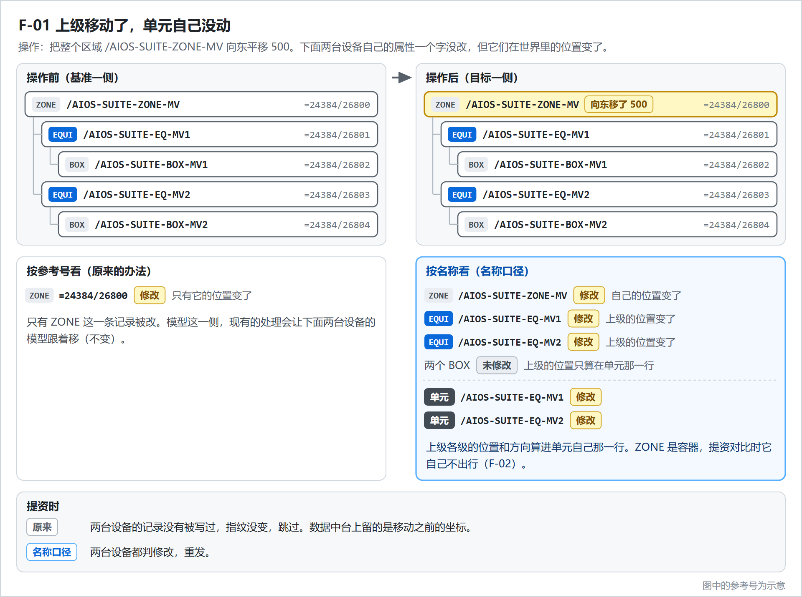

*图 16：F-01 上级移动了，单元自己没动*

### F-02 容器自己的变化

| 项目 | 内容 |
| --- | --- |
| 场景 | 同 F-01，区域 `/AIOS-SUITE-ZONE-MV` 被平移。这里看区域自己那一行。 |
| 期望结果 | 指定对比：区域一行修改，所属单元为空。提资对比：不出这一行。 |
| 提资时 | 容器不单独提资。它的移动通过下面的单元体现，见 F-01。 |
| 解决方案 | 容器是有名构件，指定对比照常出行。但它不是交付单元，没有版本记录，提资对比里找不到基准，所以不出行。SITE、ZONE、PIPE 都按容器对待。 |
| 说明 | 有一类区域（支吊架）在提资里被当作单元，见「不在测试范围内」。 |

### F-03 提资从上级或经引用读到的属性变了

| 项目 | 内容 |
| --- | --- |
| 场景 | 单元自己没动，但提资内容里用到的、来自上级或者被引用对象的属性变了。最常见的是上级只是改名：把支管所属的管线改个名，或者把设备所在的区域改个名，下面的构件没有被挪动。管段的提资内容里用到所属管线、区域的名称。 |
| 期望结果 | 上级只是改名，不算下面的有名构件换了属主，也不算换了单元，它们不因此判修改。提资读取清单到位之后：提资读了这个上级名称的单元判修改；别的从上级或者经引用读到的属性变了，也是读了它的单元判修改。清单到位之前：看不出来，单元未修改。改名的管线、区域自己，指定对比里是旧名一行删除、新名一行新增；提资对比里不出行，因为它们是容器（F-02）。 |
| 提资时 | 清单到位之后，提资读了这个名称的单元重发。到位之前跳过，原来也是跳过。 |
| 解决方案 | 「换了属主」说的是构件被挪到了别的属主下面（B-06）。上级只是改了名，还是那个元素，下面的构件没有挪过地方。上级的名称变了对下面的单元有没有影响，只看提资读没读这个名称：提资到底从上级、经引用读了哪些属性，由提资读取清单声明，清单到位之后，这些属性算进单元的内容。上级的位置和方向不用等清单（F-01），被引用的对象改名也不用等清单（E-03）。 |
| 说明 | 取决于前提：提资读取清单到位。到位之前看不出来，是已知的限制。「上级只是改名，不算换了属主、也不算换了单元」是按已确认的规则推出来的，未单独确认。 |

## G 组：和哪一次比

提资和预览用的是提资对比：每个单元和它上一次提资时比。这一组考的是基准怎么找，找不到怎么办。逐个单元找基准一共六种情形，见图 17。

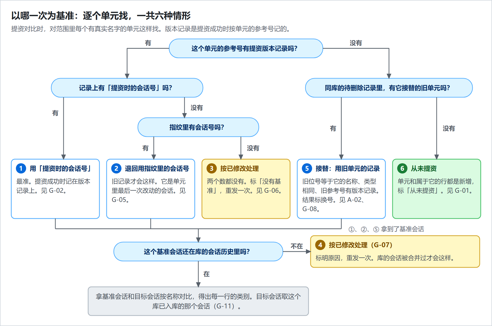

*图 17：以哪一次为基准，六种情形（G 组）*

### G-01 从未提资过的新单元

| 项目 | 内容 |
| --- | --- |
| 场景 | 新建一台有名字的设备，连同它的成员。它从来没有提资过，也没有接替谁。 |
| 期望结果 | 提资对比：单元和属于它的每一行都是新增，都标「从未提资」。单元汇总：新增。指定对比：同样是新增，但没有「从未提资」这个标注。 |
| 提资时 | 按首次提资，提交新增。预览归「首次提资」一栏。 |
| 解决方案 | 这个单元的参考号没有版本记录，同一个库的待删除记录里也没有它能接替的旧单元，所以是从未提资。单元自己那一行是新增，单元的类别就取新增。 |
| 按参考号看 | 新增，首次提资，结果相同。 |
| 说明 | 「单元自己那一行是新增或删除时，单元取这个类别」是按已确认的规则推出来的，需求方看过、没有反对。一个从未提资的单元被删后同名重建，在提资对比里同样是从未提资。 |

### G-02 提资之后没有任何改动

| 项目 | 内容 |
| --- | --- |
| 场景 | 一个有名字的单元提资成功之后，它自己、它的上级、它引用的对象都没有任何改动，库里别处可以有改动。再次提资。 |
| 期望结果 | 单元汇总：未修改，不换号。属于它的行都是未修改，不逐行列出，只计数。 |
| 提资时 | 跳过。预览归「跳过」一栏。 |
| 解决方案 | 提资成功时，版本记录上记下了当时这个库处在哪个会话，叫「提资时的会话号」。下一次就以那个会话为基准，和已入库的状态按名称对比。 |

### G-03 改过并提资，之后又改回原样

| 项目 | 内容 |
| --- | --- |
| 场景 | 一个单元第一次提资之后改了内容，提资了第二次。然后把内容改回第一次提资时的样子，再次提资。 |
| 期望结果 | 判修改。 |
| 提资时 | 重发。 |
| 解决方案 | 基准是上一次提资，不是第一次。数据中台上存的是上一次提资的内容，改回原样之后和它不同，必须重发。 |

### G-04 上级移动后已经提资，此后没有改动

| 项目 | 内容 |
| --- | --- |
| 场景 | 接着 F-01：区域平移之后，两台设备已经重发过一次。此后没有任何改动，再次提资。 |
| 期望结果 | 两台设备未修改。 |
| 提资时 | 跳过，不会每次都重发。 |
| 解决方案 | 版本记录上的基准是「提资当时这个库处在哪个会话」，不是「单元最后一次被改动的会话」。区域平移发生在单元最后一次被改动之后；拿后者当基准，位置永远对不上，每次都会重发。 |

### G-05 旧的版本记录上只有替代的基准

| 项目 | 内容 |
| --- | --- |
| 场景 | 这项功能上线之前提资的单元，版本记录上没有「提资时的会话号」，只有原来的办法留下的那个数：单元里最后一次改动的会话号。之后 ① 没有改动；② 改了内容。 |
| 期望结果 | 系统退回用这个数当基准，照常比：① 未修改；② 修改。结果里注明这个单元的基准取自哪里。 |
| 提资时 | ① 跳过。② 重发。重发过一次之后，记录上就有了准确的基准。 |
| 解决方案 | 旧记录没有「提资时的会话号」时，退回用单元里最后一次改动的会话号。 |
| 说明 | 取决于前提：单元里任何一次增、删、改，都会让这个数变成那一次的会话号。目前是推断，要在实施时验证。已知的限制：如果在那个会话和实际提资之间，单元之外的东西变过（比如上级移动），提资之后又改回去，会被判成未修改。原来的办法同样看不出这种变化。 |

### G-06 旧的版本记录上没有可用的基准

| 项目 | 内容 |
| --- | --- |
| 场景 | 一个单元有版本记录，但记录上既没有「提资时的会话号」，也没有单元里最后一次改动的会话号。 |
| 期望结果 | 按已修改处理，并标明原因是没有基准。 |
| 提资时 | 重发一次。重发之后记录上就有基准了。 |
| 解决方案 | 没有基准就比不了。判不了的一律判修改。 |

### G-07 基准会话已经读不回来

| 项目 | 内容 |
| --- | --- |
| 场景 | 版本记录上的基准会话，已经不在库的会话历史里。库的会话被合并过才会这样。 |
| 期望结果 | 按已修改处理，并标明原因。 |
| 提资时 | 重发一次。重发之后有了新的基准，不会再多发。 |
| 解决方案 | 基准读不回来就比不了。判不了的一律判修改。 |

### G-08 接替：复制一份改回原名，再删掉原件

| 项目 | 内容 |
| --- | --- |
| 场景 | 支管 `/AIOS-SUITE-BRAN-S` 提资过。先把它改名让出名字，例如改成 `/AIOS-SUITE-BRAN-S-OLD`（示意）；另建一条内容相同的支管，用原名，成员也起回原来的名字；再删掉改了名的原件。 |
| 期望结果 | 新支管被认定为接替了原来的支管：支管和有名成员未修改，换号。单元汇总：未修改，换号。结果里不为旧名称出删除那一行。待删除列表里旧参考号那一条（原因是改名）标为「已被接替」。 |
| 提资时 | 和 A-02 相同：跳过；不为旧参考号提删除；版本记录转到新参考号。 |
| 解决方案 | 同一个库里不能有两个同名的元素，所以原件要先改名让出名字。原件改名时，系统给它记了一条待删除记录：旧位号，原因是改名。新单元没有自己的版本记录，就到待删除记录里找旧位号等于它的名称、类型相同、旧参考号有版本记录的那一条。记录的原因是删除还是改名，都算。 |
| 说明 | 按已确认的规则推出来的，需求方看过、没有反对。成员也必须起回原来的名字；成员还是自动命名的话，见 G-09。 |

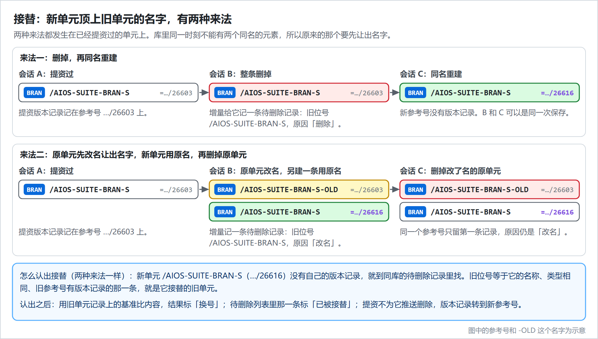

*图 18：接替的两种来法（来法一是 A-02，来法二是 G-08）*

### G-09 复制后只把单元改回原名，成员还是自动命名

| 项目 | 内容 |
| --- | --- |
| 场景 | 和 G-08 一样，用「复制、改回原名、删掉原件」的办法换了一条支管。但只把支管自己改回了原名，复制出来的成员还叫 `/Copy-of-` 开头的名字。原来的成员是有真实名字的。 |
| 期望结果 | 支管判修改，换号。原来那些有名成员的名称各出一行删除。单元汇总：修改，换号。 |
| 提资时 | 按 A-05 重发：按原位号提交修改，不提旧参考号的删除。 |
| 解决方案 | 成员在基准一侧是有名成员，现在是自动命名的成员，算在支管名下，两侧的内容对不上。要判成未修改，成员也要起回原来的名字。这是已知的后果，不算缺陷。 |

### G-10 已提资的单元被删除，没有被接替

| 项目 | 内容 |
| --- | --- |
| 场景 | 删掉一台提资过的设备 `/AIOS-SUITE-EQ-B`。库里没有再出现叫这个名字的设备。 |
| 期望结果 | `/AIOS-SUITE-EQ-B` 一行删除，属于它的有名成员各一行删除。单元汇总：删除。 |
| 提资时 | 提删除。预览归「删除」一栏。待删除列表里这一条没有「已被接替」的标记。 |
| 解决方案 | 名称只在基准一侧有，就是删除。单元自己那一行是删除，单元的类别就取删除。 |
| 按参考号看 | 删除，结果相同。 |
| 说明 | 「单元自己那一行是删除时，单元取删除」和 G-01 一样，是按已确认的规则推出来的，需求方看过、没有反对。 |

### G-11 库里有还没入库的会话

| 项目 | 内容 |
| --- | --- |
| 场景 | 设计人员又保存了一次，但这个新会话还没有入库，数据库里还是上一个会话的状态。这时做提资对比。 |
| 期望结果 | 结果反映的是已入库的那个会话，还没入库的改动不算。结果里写明这一次的目标是哪个会话。 |
| 提资时 | 按已入库的状态判断和提取。 |
| 解决方案 | 提资读的是数据库，所以目标一侧取已入库的那个会话，不取库里最新的会话：库可能比数据库新，提资还读不到。 |

### G-12 库还没有入库

| 项目 | 内容 |
| --- | --- |
| 场景 | 对一个还没有入库的库做提资对比。 |
| 期望结果 | 报错，不给结果。 |
| 提资时 | 这个库没有数据可提。 |
| 解决方案 | 没有已入库的状态，就没有目标一侧。 |
| 说明 | 未单独确认。 |

### G-13 有一次提资没用上名称口径

| 项目 | 内容 |
| --- | --- |
| 场景 | 一个单元第一次提资正常。改了内容之后第二次提资时，名称口径的判定正好用不了（见 H-02），这一次照原来的办法发了出去。然后把内容改回第一次提资时的样子，第三次提资。 |
| 期望结果 | 第三次判修改。 |
| 提资时 | 重发。 |
| 解决方案 | 每次提资成功，这次发出去的每条版本记录上的「提资时的会话号」，要么写成这一次的，要么清空，不能留着上一次的值。留着第一次的值，第三次就会拿第一次的内容当基准，判成未修改，而数据中台上存的是第二次的内容。清空之后退回用替代的基准（见 G-05），是安全的。 |
| 说明 | 按已确认的规则推出来的，需求方看过、没有反对。 |

## H 组：提资时走哪条路

提资时，一个单元要么按名称口径的类别办，要么照原来的办法。这一组考的是两条路怎么分，见图 19。

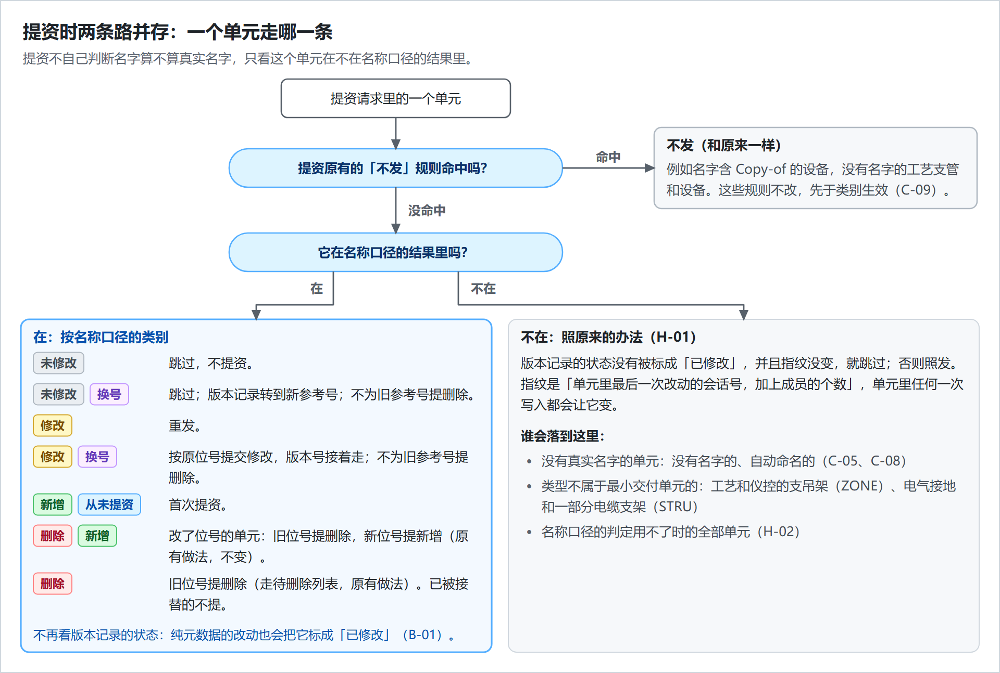

*图 19：提资时一个单元走哪条路（H 组）*

### H-01 不在结果里的单元照原来的办法

| 项目 | 内容 |
| --- | --- |
| 场景 | 一次提资里有不在结果里的单元。一类是没有真实名字的单元（C-05、C-08）。另一类是提资按别的类型算单元的：工艺和仪控的支吊架，电气接地和一部分电缆支架。 |
| 期望结果 | 这些单元在名称口径的结果里没有汇总、没有行。 |
| 提资时 | 原样照原来的办法：发不发、跳不跳，和没有这项功能时逐项相同。预览归「按原来的办法判断」一栏。 |
| 解决方案 | 提资不自己判断一个名字算不算真实名字，只看这个单元在不在结果里：在，就按类别办；不在，就照原来的办法。这样两边不用共用一套命名规则。 |
| 说明 | 「只看在不在结果里」是按已确认的规则推出来的，需求方看过、没有反对。 |

### H-02 名称口径的判定用不了时

| 项目 | 内容 |
| --- | --- |
| 场景 | 提资时，名称口径的判定调不通，例如服务没有起来。 |
| 期望结果 | 提资不受影响，照常完成。回执里说明这一次没有用名称口径。 |
| 提资时 | 这一次全部单元照原来的办法判断。这次发出去的版本记录上，「提资时的会话号」被清空，见 G-13。 |
| 解决方案 | 名称口径只是让提资少发，不能挡住提资。用不了就退回原来的办法，最多多发，不会漏发。 |
| 说明 | 按已确认的规则推出来的，需求方看过、没有反对。 |

### H-03 一次提资涉及多个库

| 项目 | 内容 |
| --- | --- |
| 场景 | 一次提资选中的单元分布在几个库里。 |
| 期望结果 | 每个库各自判定，互不影响。每个单元的类别只和它自己库里的状态有关，不同库里的同名单元不配对（D-03）。 |
| 提资时 | 各库的单元按各自的类别处理。 |
| 解决方案 | 只在同一个库里配对，判定以库为单位，所以按库各判一次。 |
| 说明 | 未单独确认。 |

## I 组：预览和待删除列表

预览和待删除列表用的是同一份结果，考的是展示出来的和实际提资的对不对得上。

### I-01 提资预览的分栏和数量

| 项目 | 内容 |
| --- | --- |
| 场景 | 对一批单元先看提资预览，再真正提资。这批单元里有：未修改的（其中有换了号的）、修改的、从未提资的、改了名的、被删除的、被接替的，以及不在结果里的。 |
| 期望结果 | 预览分六栏，见图 20。跳过：未修改的单元，其中换了参考号的单独计一个数。重发：修改的单元。首次提资：新增并且从未提资的单元。改名：改了位号的单元，旧名删除、新名新增。删除：删除的单元，已被接替的不在其中。按原来的办法判断：不在结果里的单元，只分照发和跳过两个数。每个单元只落在一栏，各栏能展开看到具体的单元。 |
| 提资时 | 预览的数量和随后实际提资的结果一致。预览不改任何记录。预览之后、提资之前如果又有新的会话入库，目标会话就和预览时的不同了；这时真正提资，系统要提示重新预览。 |
| 解决方案 | 预览和提资用同一份结果、走同一条路，所以数量一致。预览的结果里带着这一次的目标是哪个会话；真正提资时的目标会话和它不同，就提示重新预览。 |
| 说明 | 最后一栏「按原来的办法判断」未单独确认。提示重新预览之后，这一次提资是拦下不发、还是允许继续，还没有定。需求里说的「仅参考号变更的单元数」，对应跳过一栏里换了参考号的那个数；「实质变更的单元数」对应重发一栏。 |

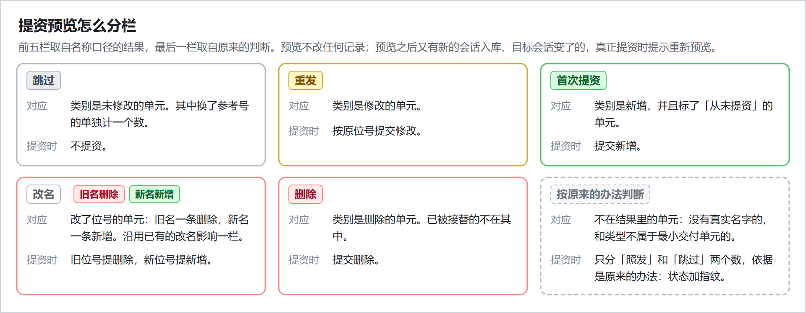

*图 20：提资预览的六栏（I-01）*

### I-02 待删除列表里已被接替的记录

| 项目 | 内容 |
| --- | --- |
| 场景 | A-02 或 G-08 之后、提资之前，旧参考号的那条待删除记录还在待删除列表里，旧位号是 `/AIOS-SUITE-BRAN-S`。 |
| 期望结果 | 这一条带「已被接替」的标记，并指出接替它的新参考号。在待删除列表和删除确认里看得出来，缺省不勾选。没有被接替的记录（G-10）没有这个标记。 |
| 提资时 | 不为它提删除，即使有人勾选了它。提资成功后，这条记录随版本记录的转移一起消失。 |
| 解决方案 | 读待删除列表时，系统现算这个标记：这条记录所在的库里，现在有没有一个叫这个旧位号、类型相同、有真实名字、而参考号和记录上不同的单元。有，就是已被接替。记录的原因是删除还是改名，都算。标记不保存。 |
| 说明 | 「原因是改名的记录也算」是按已确认的规则推出来的，需求方看过、没有反对。 |

## J 组：对每个案例都要成立的检查

这一组不是单独的操作，而是跑上面每个案例时都要成立的检查。

### J-01 结果的每一行都带齐信息

| 项目 | 内容 |
| --- | --- |
| 场景 | 任何一次判定的结果。 |
| 期望结果 | 每个有真实名字的构件一行，每行恰好一个类别：新增、删除、修改、未修改之一。每行带：名称、类型、旧参考号、新参考号、是否换号、所属的最小交付单元；修改的行带变化摘要。每个有真实名字的单元有一条汇总，带类别和是否换号。另外给出：重名清单、别的库里同名的提示、被跳过的数量（没有名字的元素、自动命名的元素、没有真实名字的单元）、这一次的目标是哪个会话。 |
| 提资时 | 不涉及。 |
| 解决方案 | 提资以单元为单位决定发不发，所以每一行都带所属的单元。同时要看得出单元里哪个构件变了，所以细到每个有名构件一行。 |

### J-02 判不了的一律判修改

| 项目 | 内容 |
| --- | --- |
| 场景 | 判定时遇到判不了的情形：没有基准（G-06）、基准读不回来（G-07）、重名（D-02）、构件的内容读不出来。 |
| 期望结果 | 一律按修改处理，并说明原因。任何情况下都不会判成未修改。 |
| 提资时 | 重发。预览里不会归到「跳过」一栏。 |
| 解决方案 | 宁可多发，不能漏发。 |
| 说明 | 这是方案对结果的一条承诺，未单独确认。 |

### J-03 判定只读，不改任何记录

| 项目 | 内容 |
| --- | --- |
| 场景 | 做一次判定（指定对比或者提资对比），或者看一次提资预览。 |
| 期望结果 | 判定前后，版本记录和待删除记录的内容完全相同。结果不保存，每次按需算出来。目标会话相同、规则相同时，同样的条件再算一次，结果相同。 |
| 提资时 | 版本记录只在提资成功时由提资来写。 |
| 解决方案 | 判定只读不写。结果不保存，规则以后调整时没有旧结果要清。 |

### J-04 现有的增量更新和模型生成不受影响

| 项目 | 内容 |
| --- | --- |
| 场景 | 跑完本文的案例之后，对比现有增量更新的结果。 |
| 期望结果 | 按参考号的变更记录、任务回执、生成的模型，和没有这项功能时逐项相同。换了参考号的构件，仍然按新参考号重新生成模型。待删除记录照旧记，版本记录的状态照旧标。 |
| 提资时 | 不涉及。 |
| 解决方案 | 名称口径是另算的一份结果，不改现有的增量更新。它省的是重复提资，不省模型生成。 |

### J-05 判为未修改的单元，模型确实没变

| 项目 | 内容 |
| --- | --- |
| 场景 | 对每个案例里判为未修改的单元，把操作前后的模型各生成一遍来对照。 |
| 期望结果 | 判为未修改的，前后的模型形状、位置、包围范围完全一致。因为尺寸、位置这类属性而判为修改的，前后的模型不一致。 |
| 提资时 | 不涉及。 |
| 解决方案 | 「模型没变」是按生成模型要读的那些属性有没有变来判的，没有为了比一比而把两侧的模型各生成一遍。这个对照只在测试里做，用来确认两种判法一致。已知的盲区是目录库，见 E-06。 |

## 不在测试范围内

下面这些情形容易被当成缺陷。这一版不覆盖它们，测到了不算不通过。

- **支吊架和接地**：工艺和仪控的支吊架、电气接地和一部分电缆支架，提资把它们当单元，但它们的类型不属于最小交付单元，所以不在结果里，仍照原来的办法：只是参考号变了也会重发。要等统计出这类单元有多少，再决定补不补。
- **名字是 Copy-of 的支管和支吊架**：它们原来照常提资，现在也不在结果里：单元里有写入就重发，换了参考号会被当成首次提资。
- **无名子件的旧编码**：单元里没有名字的子件，在提资内容里用参考号当编码。单元换号之后，数据中台上用旧参考号编码的子件都留着，不清理、不为此重发、不做标记。
- **目录库的变化**：规格件、目录件的内容变了而名称没变，或者只在目录库里改了名，都看不出来（E-06）。
