# 名称口径说明：按名称认定构件身份的增量结果（方案、案例与图解）

> - 给谁看：没有参加讨论的同事，rs-server 和 plant-ui 的开发，也可以给业务方看。读完应该明白要做什么、每种情况怎么处理、为什么这么定。
> - 和开发计划的关系：这一份讲「是什么、为什么」，不带代码位置。算法步骤、接口字段、代码行号在[开发计划](2026-11-10-name-keyed-increment-dev-plan.md)里，决策记录是 [ADR-098](../adr/ADR-098-name-keyed-identity-is-an-on-demand-read-computed-in-gen-model-over-refno-keyed-increment-data-and-is-never-persisted.md)。
> - 来源：三代二需求表工作包 5「增量更新判断（仅参考号变化不算修改）」；2026-11-10 与用户的四轮问答，以及发布票之前又追问的两题。
> - 状态（2026-11-11）：**方案已定，还没有实施**，也还没有派人。票已经开在 happyrust/gen-model：七张新票 [#133](https://github.com/happyrust/gen-model/issues/133)–[#139](https://github.com/happyrust/gen-model/issues/139)，三张原有的票 [#99](https://github.com/happyrust/gen-model/issues/99)、[#113](https://github.com/happyrust/gen-model/issues/113)、[#100](https://github.com/happyrust/gen-model/issues/100) 改了口径。开发计划、ADR-098 和词汇表的词条还在本地工作区，没有提交。
> - 图：26 张，文件在 [`2026-11-11-name-keyed-increment-explained/`](2026-11-11-name-keyed-increment-explained/) 下，每张有 PNG 和 SVG 两份。图里的参考号除特别说明外都是示意。
> - 修订（2026-11-11，初稿当天）：图 3 的单元汇总补上「换号」；图 5、图 25 各改了一处画法；正文写明「上级只是改名，不算换了属主」（4.2、4.3 节，案例 10 后面的对照）和预览之后库又前进时的做法（4.5 节）；P5–P7 改记为给用户看过。

目录：[1 一页看懂](#1-一页看懂) · [2 几个词和图例](#2-读图之前几个词和图例) · [3 现在的问题](#3-现在的问题只认参考号) · [4 方案](#4-方案) · [5 案例](#5-案例) · [6 情形总表](#6-考虑过的情形总表) · [7 取舍](#7-讨论时的取舍) · [8 边界和已知后果](#8-边界和已知后果) · [9 落地](#9-落地)

## 1. 一页看懂

- **问题**。今天从增量处理到提资，认一个构件只看参考号。一个单元被删掉再原样重建，内容一个字没变，参考号却是新的，系统就把它当成「旧的删了、新的来了」：提资再发一遍，旧位号还进了待删除列表。需求是：只是参考号变了、属性和模型都没变的，不算修改，不再发第二次。
- **做法**。在 gen-model 里加一种认身份的办法，叫**名称口径**：同一个库里，名称整串相同就是同一个构件，不看参考号。把两个时刻的库按名称对上，比内容，给每个有真实名字的构件一行结果。
- **结果**。每行一个类别（新增、删除、修改、未修改），外加两个标注（是否换了参考号、是否从未提资），并写明它属于哪个最小交付单元。结果按需算，不落库。
- **谁算、谁用**。gen-model 算，通过一条只读接口给出。rs-server 提资时来取：未修改的单元跳过，其余照发。plant-ui 的提资预览用同一份结果分栏显示。
- **不变的**。现有的增量处理、任务回执、模型生成和落库都不动。换了参考号的构件，内部仍按新参考号重新生成。名称口径省的是重复提资，不省模型生成。
- **不管的**。没有名字的元素、名字以 Copy-of 开头的元素不单独出行，它们的变化算到所属的有名构件上。交付单元自己没有真实名字的，整个不在结果里，rs-server 对它们照今天的办法判断。

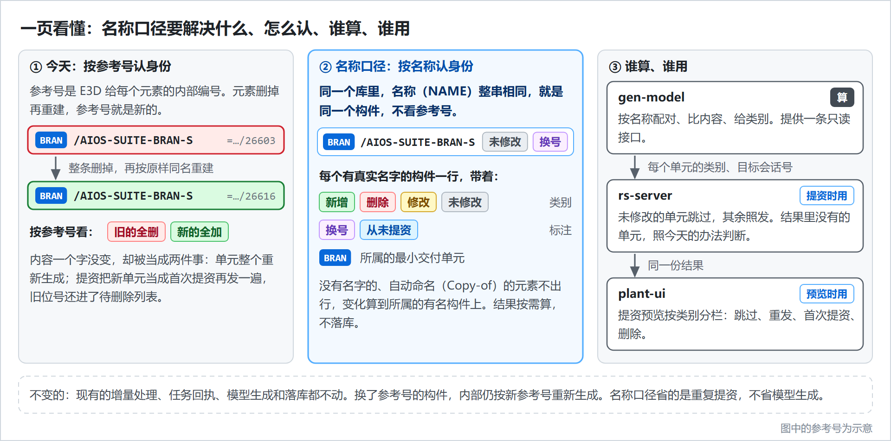

*图 1　一页看懂。*

## 2. 读图之前：几个词和图例

| 词 | 意思 |
| --- | --- |
| 参考号（refno） | E3D 给每个元素的内部编号，写作 `24384/26616`。元素删掉再重建，参考号是新的；改名、改挂到别的属主下面，参考号不变。 |
| 名称（NAME）、位号 | 设计人员给元素起的名字，带前导斜杠，例如 `/AIOS-SUITE-BRAN-S`。最小交付单元的名称在业务上叫位号。 |
| 库、库号 | 一个 E3D 设计库文件，有一个库号（例如 8000）。E3D 只保证同一个库里名称不重复，不同的库之间可以同名。 |
| 会话 | E3D 每保存一次，就在库文件里追加一个版本，叫会话，有一个会话号。按会话号可以读回当时整个库的样子。 |
| 最小交付单元（单元） | 独立交付的那一级元素。类型由 gen-model 的配置定，缺省是 BRAN（支管）、HANG、SUPPO、EQUI（设备）。 |
| 容器 | SITE、ZONE、PIPE 这些只用来装别的元素的层级。它们有名字，但不属于任何单元。 |
| 提资 | 把单元的数据交给数据中台，由 plant-ui 发起、rs-server 执行。需求表里说的「发布」「预发布」「二次发布」指的都是它。 |
| 提资版本记录（版本记录） | rs-server 在提资成功时按单元的参考号记的一行：位号、版本号、状态、上一次提资时的指纹。 |
| 指纹 | rs-server 今天用来判断「提资之后变没变」的两个数：单元子树里最大的会话号，加上存活成员的个数。子树里任何一次写入都会让它变。 |
| 待删除记录、待删除列表 | 已提资的单元被删或被改名时，gen-model 的增量记下它原来的位号，等着提资时交给中台去删。前端的「待删除列表」展示的就是这些记录。词汇表里叫交付删除记录。 |
| 应用水位 | 一个库已经写进数据库的那个会话号。rs-server 提资读的是数据库，所以它看到的就是这个会话的状态。 |
| refno 口径 | 现状：参考号相同才是同一个构件。 |
| 名称口径 | 要加的：同一个库里名称相同就是同一个构件，不看参考号。 |
| 自动命名 | 以 `/Copy-of-` 或 `/Copy-(数字)-of-` 开头的名称。它是 E3D 复制元素时带出来的，不是设计人员起的。 |
| 真实名字、有名构件 | 真实名字是设计人员起的名称：不为空，也不是自动命名。有真实名字的元素叫有名构件。 |
| 名下、上卷 | 一个有名构件名下的东西，是它自己加上挂在它下面、没有真实名字的成员。这些成员的变化算到它头上，叫上卷到名下。 |
| 换号 | 同一个名称，前后对应的参考号不同。它是标注，不是类别。 |
| 接替 | 已提资的单元让出了名字（被删，或者先改了名），同库里又出现叫这个名字的新单元：新单元接替旧单元。 |
| 基准、目标 | 一次对比的两侧。基准是较早的状态，缺省是上一次提资时；目标是较新的状态，缺省是当前。 |
| 纯元数据 | 变了既不影响模型、也不影响提资内容的属性，例如 E3D 自己写的计数 CACHID。 |
| 显式入口、缺省入口 | 接口的两种用法。显式入口：调用方给两个会话号，直接对比。缺省入口：不给会话号，以上一次提资为基准、以应用水位为目标。提资和预览用的是缺省入口。 |

下面所有的图共用一套画法，见图 2。

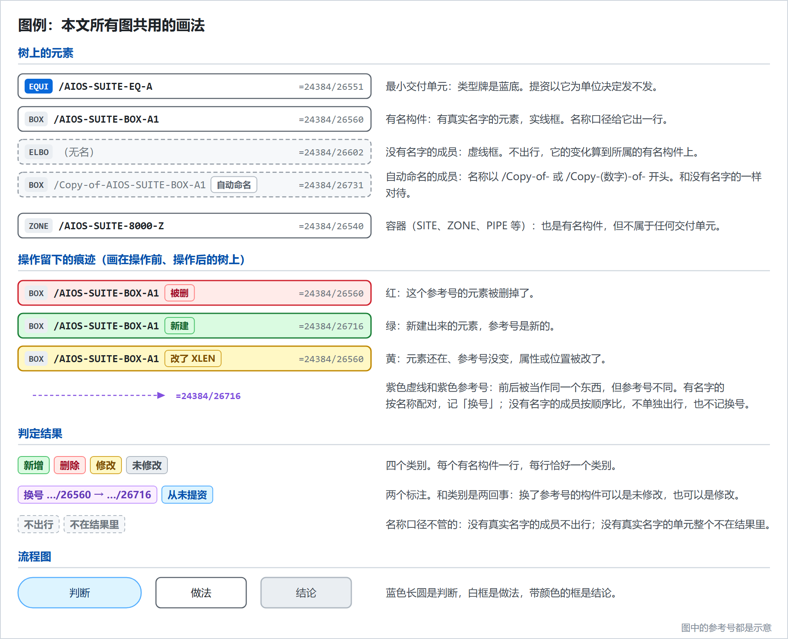

*图 2　图例。实线框是有名构件，虚线框是没有真实名字的元素，类型牌蓝底的是最小交付单元；红、绿、黄是操作留下的痕迹；带颜色的小标签是判定结果。*

## 3. 现在的问题：只认参考号

今天，增量处理的记录、任务回执、模型记录、提资版本记录，全都以参考号为准。这在大多数时候没有问题，但有一种操作会让它失真：**把东西删掉，再原样建回来**。E3D 里重建出来的元素参考号是新的，于是同一个东西被看成了两个。

开发库里有一个真实的例子（库 8000，会话 787 到 788，任务 `db-20261029-111148-000063`）：一条支管连同成员被删掉后同名重建。增量记下的是 13 条删除加 13 条新增，新支管整个重新生成；按参考号做前后对比，旧支管名下全是「删除」，新支管名下全是「新增」，而两条支管的名称一模一样。

图 3 用套件里的名字把这件事画了出来：左下是今天按参考号看到的，右下是按名称看到的。图里支管的两个参考号借用了这个真实例子里的号，名字换成了套件里的，所以仍然标为示意。

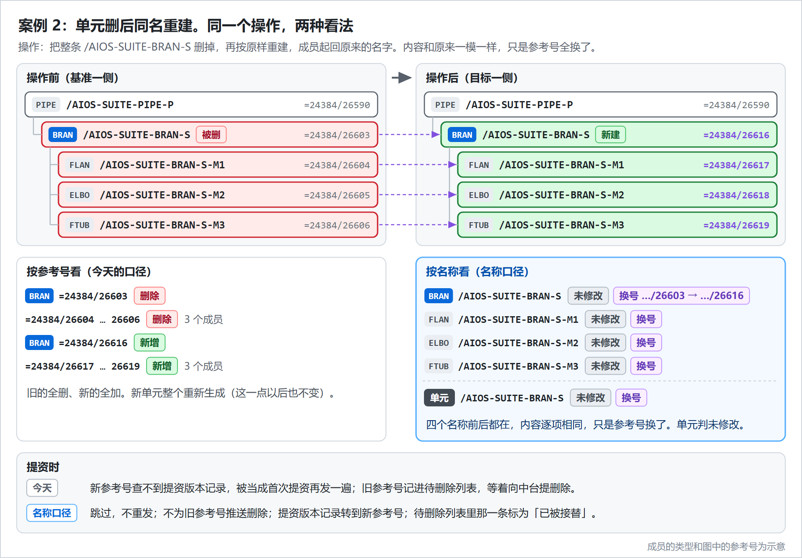

*图 3　案例 2：单元删后同名重建。按参考号看是「旧的全删、新的全加」，按名称看是「未修改，换号」。*

落到提资上，今天的后果是两件事：

- 新参考号查不到提资版本记录，rs-server 把它当成首次提资，再发一遍。
- 旧参考号因为提资过，增量给它记了一条待删除记录，进了待删除列表。如果这条删除和新单元不在同一批里提资，中台还会真的收到这个位号的删除。

需求表工作包 5 的原话是：「进行过预发布的模型，只有发生修改的才进行第二次发布。如果本次修改相比于第一次（或者上一次）发布的，只是参考号发生了改变，其他的属性、模型等都没有改变，则认为未发生修改。」

同一类问题还有两种，名称口径一并解决：

- **单元里的成员被删后重建**，单元自己的参考号没变（案例 3）。今天单元子树里有写入，指纹变了，重发。
- **只动了纯元数据**（案例 6）。例如 E3D 自己写的计数 CACHID 跳了一下，设计人员什么都没改。#92 的口径草案里引用过一次普查：453 个库、2961 个会话窗口里，CACHID 跳了 13,724 次，其中 92.8% 除它之外一个字都没变。按今天的指纹，这些跳动都会触发重发。

## 4. 方案

这一节里标了〔推〕的做法，是按用户的回答推出来的，起草时没有单独问过用户（其中 P1–P3、P5–P7 六条后来给用户看过，没有反对）。它们的清单在 [6 节的总表](#6-考虑过的情形总表)里，编号是 P1–P14。

### 4.1 认谁，跳过谁

**认定规则**

- 用 E3D 里存的名称原文来认：带前导斜杠，只去掉首尾空白，区分大小写，整串精确比较。
- 只在同一个库里配对。别的库里出现同名的元素不配对，只在结果里提示一句。
- 同名但类型不同（例如原来是阀门，现在是仪表）不配对。
- 同一个库的同一侧万一出现两个同名的元素（重名），这些元素不配对，单独报出来，所在的单元按修改处理〔推〕。E3D 不允许同库重名，用户也确认业务上不会重名，这只是给数据异常留的出口。

**跳过规则**

- 没有名称的元素不出行。
- 自动命名的元素（名称以 `/Copy-of-` 或 `/Copy-(数字)-of-` 开头）不出行。前缀做成可配置的清单，缺省就是这两条。
- 这两种元素统称「没有真实名字的」。它们挂在有名构件下面时，变化算到那个有名构件上（4.3 节）。

**单元和容器**

- 每个有名构件一行，行上写明它属于哪个最小交付单元。
- 交付单元自己没有真实名字的，整个不在结果里：没有单元汇总，不参与换号配对，它下面没有真实名字的成员也不看〔推〕。rs-server 对这些单元照今天的办法判断（4.5 节）。
- 有名构件挂在这种单元下面时（比如无名支管上一个有位号的阀门）：显式入口照常给它出一行，所属单元为空；缺省入口不出这一行〔推〕。
- 容器（SITE、ZONE、PIPE 等）不是交付单元，一般没有提资版本记录：显式入口照常出行，缺省入口不出行。有一类 ZONE 在提资里被当作单元，见 [8.1](#81-不在结果里的是哪些) 的缺口。

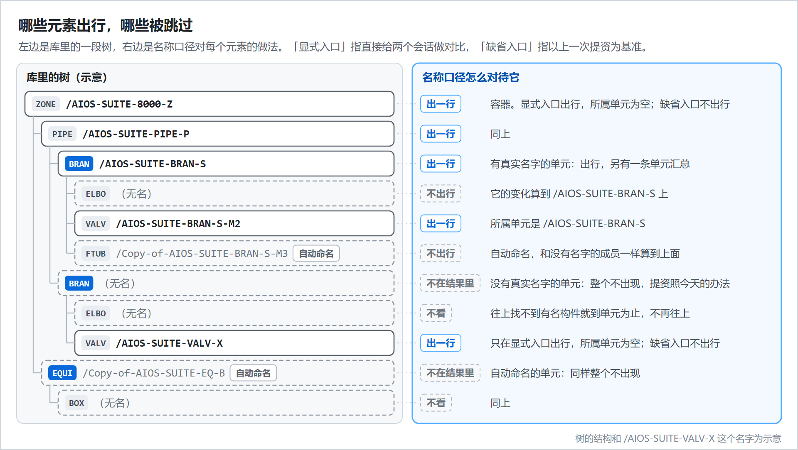

*图 4　哪些元素出行，哪些被跳过。*

为什么只在同一个库里配对：E3D 只保证一个库里名称不重复，不同库里的同名元素可以同时存在，配不出一对一。为什么不给没有名字的元素按「属主加类型加序号」认身份：前面的兄弟一增删，后面的序号全部漂移，会成片误报。

### 4.2 四个类别，两个标注

把一个真实名字在基准一侧、目标一侧各查一次，顺着图 5 的问题走，得到类别。

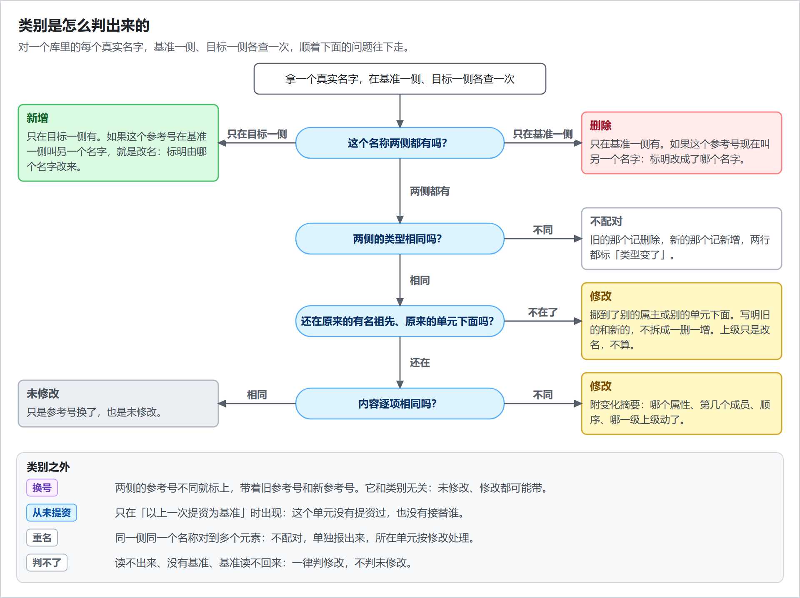

*图 5　类别是怎么判出来的。*

| 类别 | 什么时候 |
| --- | --- |
| 新增 | 名称只在目标一侧有。 |
| 删除 | 名称只在基准一侧有。 |
| 修改 | 两侧都有，类型相同，但内容不同；或者它换了属主、换了单元。 |
| 未修改 | 两侧都有，类型相同，内容逐项相同。只是参考号换了，也是未修改。 |

两个标注和类别是两回事：

- **换号**：两侧的参考号不同就标上，带着旧参考号和新参考号。换了号的构件可以是未修改，也可以是修改。
- **从未提资**：只在缺省入口出现。这个单元没有提资过，也没有接替谁；它和属于它的行都是新增。

几种容易混的情形：

- **改名**（参考号没变，名称变了）记成旧名一行删除、新名一行新增，两行互相指明。名称就是身份，名称变了就是换了一个身份；中台也是按位号认实例的，改名在提资时本来就是旧位号删除加新位号新增。新名那一行不标「从未提资」〔推〕。
- **删掉重建同时换了名字**（参考号和名称都变了）就是互不相干的一个删除、一个新增，不互相指明：认不出它们是同一个东西。
- **有名构件换了属主或换了单元**：出一行修改，写明旧的和新的，不拆成一删一增。新旧两个单元都判修改。这里的「属主」按最近的有名祖先认：在同一个有名祖先下面的无名层级之间挪动，不算它自己的修改〔推〕。上级只是改了名（还是那个元素，参考号没变）也不算换了属主〔推〕；它对下面单元的影响，见 4.3 节「单元之外的变化也算」。
- **判不了的一律判修改**：读不出来、没有基准、基准读不回来、重名，都不会判成未修改。宁可多发，不能漏发。

### 4.3 比的是什么

两侧都有、类型也相同时，比的是这个有名构件的「内容」。内容由图 6 右边的五样组成，两侧逐项相同才算未修改。

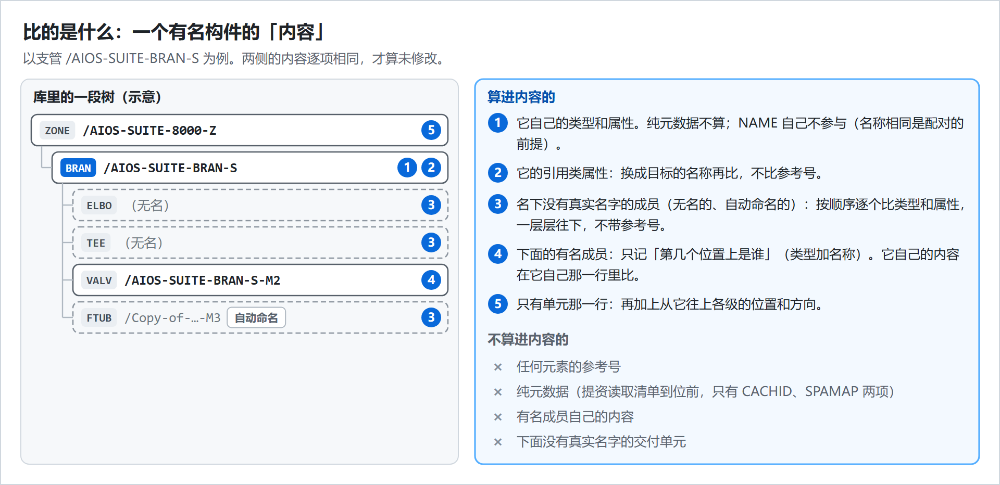

*图 6　一个有名构件的内容由什么组成。*

#### 没有真实名字的成员：上卷到名下

管件常常不命名。无名弯头改了角度，管线的几何和提资内容都变了，必须重发。所以没有真实名字的成员虽然不出行，它们的变化要让所属的有名构件判为修改：

- 成员增了、删了、改了、换了顺序，都算。E3D 里成员的顺序就是管路的走向。
- 成员只是换了参考号，内容和顺序都没变，不算。比的时候按顺序逐个比类型和属性，一层层往下，不带成员自己的参考号。
- 自动命名的成员和没有名字的成员一样处理，它的名称本身不参与比较。rs-server 对复制件的做法也是「不发实例，长度照算」：它不单独提资，但仍然影响所在管段的提资内容。
- 上卷到所在的交付单元为止，不再往上。单元的根没有真实名字，这个成员的变化就不看。没有真实名字的单元，在它上级容器的内容里也不占位置〔推〕。

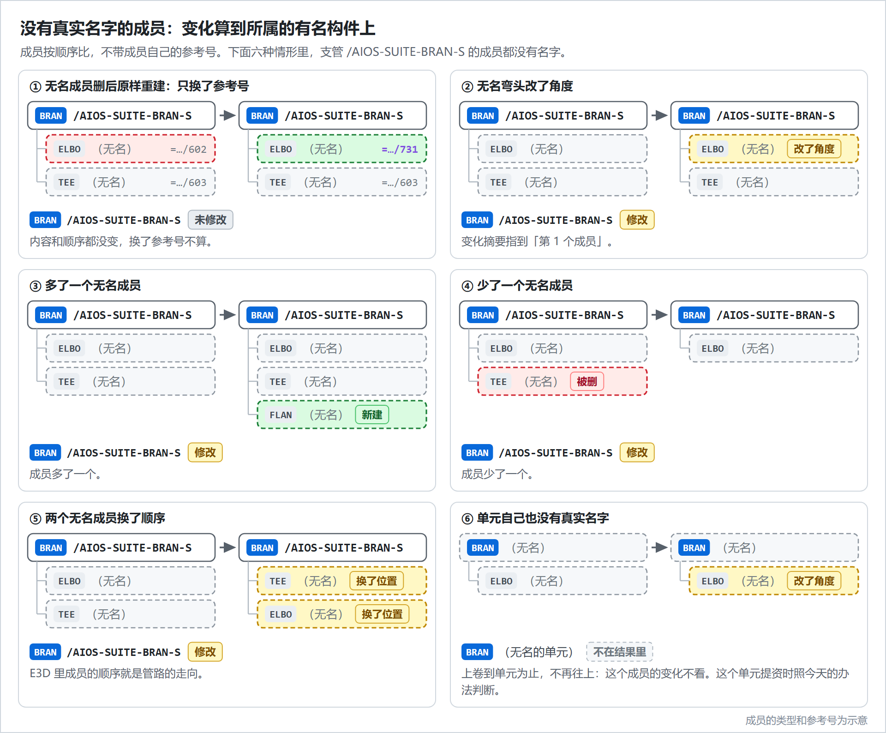

*图 7　没有真实名字的成员的六种情形。*

#### 引用类属性：按目标的名称比

有些属性的值是另一个元素的参考号，例如管口接哪条支管（CREF）、管件用哪个规格（SPRE）。被引用的对象删后重建，这个值就变了，但指向的还是同名、同内容的东西。所以比之前先把参考号换成对目标的描述：

| 情形 | 怎么描述目标 | 引用方怎么判 |
| --- | --- | --- |
| 目标有真实名字 | 用它的名称 | 目标删后同名重建：未修改。换成另一个名称的对象：修改，哪怕两个对象内容相同。 |
| 目标没有真实名字 | 最近的有名祖先的名称，加上从那里往下逐级的类型与序号 | 目标随所在单元一起重建、位置没变：未修改。一直到库顶都没有有名祖先的，退回用参考号比〔推〕。 |
| 目标在别的库（目录库，或另一个设计库） | 两侧都用目标现在的名称 | 换了目标看得出来；目标只是改名，看不出来。 |
| 目标还是同一个对象，只是它自己改了名 | 名称变了 | 同一个库里的：引用方判修改。提资内容里有从目标名称取的值（相邻件编码、材料编码）。别的库里的看不出来。 |
| 引用为空，或目标已经不存在 | 各用一个固定记号 | 记号相同算相同。 |

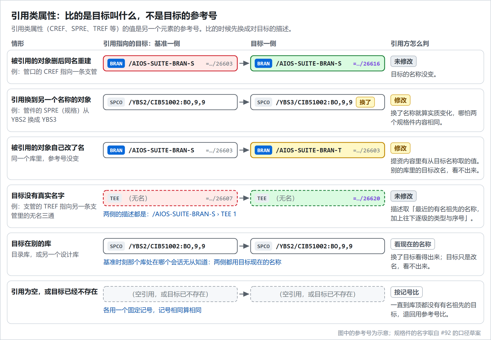

*图 8　引用的六种情形。*

#### 有名成员各判各的，单元再汇总

一个有名构件的类别只看三样：它自己的属性，它名下没有真实名字的成员，它下面有哪些有名成员以及它们的顺序。有名成员自己内容的变化只记在它自己那一行，上一级不跟着变。

按单元汇总时：

- 单元自己那一行是新增或删除，单元就取这个类别〔推〕。
- 否则，属于这个单元的行里只要有一行不是未修改，单元就算修改。
- 都是未修改，单元才是未修改。单元的换号标注取它自己那一行的。

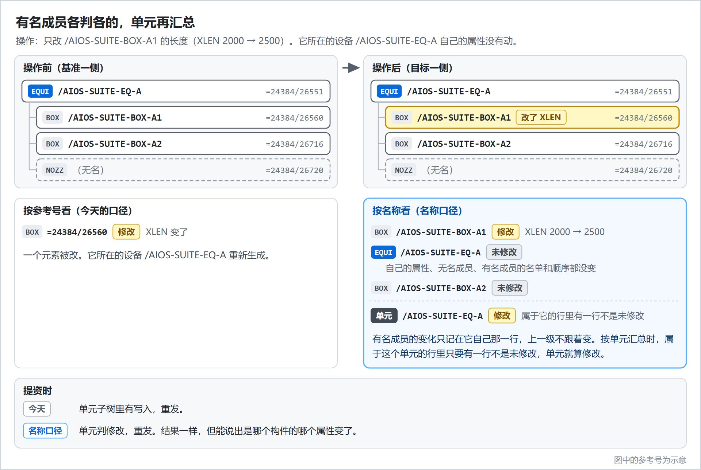

*图 9　只改了设备下面一个有名的 BOX：BOX 那一行是修改，设备自己那一行是未修改，单元汇总是修改。*

一个后果：有名成员删后重建，如果落在成员表里的另一个位置，上一级会因为顺序变了而判修改。

#### 单元之外的变化也算

单元自己一个字没改，它也可能变了：

- **上级移动**。区域（ZONE）整体平移，下面每个单元在世界里的位置都跟着变，而提资内容里有坐标。所以从单元往上各级的位置和方向，算进单元自己那一行（案例 9）。今天的指纹只看单元子树，看不到这种变化。
- **提资从上级、或者经引用读到的属性变了**。例如管段的提资内容里用到所属管线、区域的名称。提资到底读了哪些，由「提资读取清单」声明，清单到位之后才生效。上级只是改名就属于这一种：清单到位之后，提资读了这个上级名称的单元判修改；到位之前看不出来，单元未修改，和今天一样。

#### 纯元数据不算

纯元数据的变化不算修改。判定沿用 #92 的定稿，三条同时满足才算纯元数据：E3D 的属性字典认为它变了不用重画；模型生成器不读它；提资不读它。另外 CACHID、SPAMAP 两个 E3D 自己写的计数直接算。名称、描述（DESC）、全部用户自定义属性（UDA）一律算实质。

第三条需要一份「提资读取清单」。它不手抄：由 rs-server 用脚本从自己的代码里扫出来，加护栏测试，gen-model 把清单文件收进仓库。清单到位之前，只把 CACHID、SPAMAP 当纯元数据，其余属性的变化一律算修改。不能只靠前两条：描述（DESC）和伴热规格（TSPE）前两条都满足，但提资在读。

#### 「模型没变」怎么判

看生成几何要读的那些属性有没有变，不为了比一比而把两侧的几何各生成一遍。重新生成很贵，而且换了号的构件，现有管线本来就要按新参考号重新生成一遍。测试里会用实际生成的几何做对照，确认两种判法在验收用例上一致。已知的盲区是目录库：规格件、目录件的名称没变而内容变了，看不出来。

### 4.4 和哪一次比：基准

比较的基准是**上一次提资**时的状态，不是第一次。中台上存的是上一次提资的内容；改过一次并提资、之后又改回原样的，必须重发。

底层能力是「同一个库的任意两个会话之间按名称对比」（显式入口）。提资和预览用缺省入口：不给会话号，由 gen-model 自己找基准。

**基准会话号用哪个数。** rs-server 在提资成功时，在版本记录上另记一个「提资时的会话号」，gen-model 以它为基准。旧记录没有这个数时，退回用指纹里已有的那个会话号；两个都没有的，按已修改处理。

为什么要另记一个：指纹里的那个数是「单元子树最后一次被写的会话」，不是「提资当时这个库处在哪个会话」。举个例子：单元最后一次被写是会话 100；会话 150 时它所在的区域整体移动；会话 200 时提资，中台拿到的是移动之后的坐标。如果拿会话 100 当基准，位置对不上，判修改、重发；重发之后这个数还是 100，下一次仍判修改，每次都重发。代价是版本记录多一个字段。

**目标一侧**取这个库的应用水位，不取库文件里最新的会话：文件可能比数据库新，rs-server 还读不到。库还没有入库时，缺省入口报错〔推〕。

逐个单元找基准，一共六种情形：

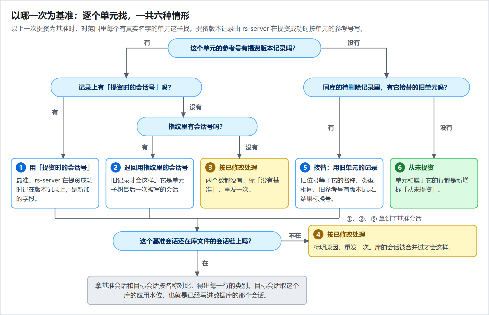

*图 10　基准的六种情形。*

| 编号 | 情形 | 怎么办 |
| --- | --- | --- |
| ① | 有版本记录，记录上有「提资时的会话号」 | 用它当基准。 |
| ② | 有版本记录，没有上面那个数，但指纹里有会话号 | 退回用指纹里的会话号。旧记录才会这样，重发过一次就有 ① 了。 |
| ③ | 有版本记录，两个数都没有 | 按已修改处理，标「没有基准」，重发一次。 |
| ④ | 拿到了基准会话，但它已经不在库文件的会话链上 | 按已修改处理，标明原因，重发一次。库的会话被合并过才会这样。 |
| ⑤ | 没有版本记录，但它接替了一个提资过的旧单元 | 用旧单元记录上的基准，拿旧单元当时的子树和新单元现在的子树比。结果标换号。 |
| ⑥ | 没有版本记录，也没有接替谁 | 从未提资：单元和属于它的行都是新增，标「从未提资」。 |

⑤ 里旧单元的那条记录，同样按 ①②③ 的次序找会话号。

**接替有两种来法**（图 11）。一种是删掉后同名重建。另一种是「复制一份、改回原名、再删掉原件」：同一个库里不能有两个同名的元素，所以原单元要先改名让出名字，新单元才能用原名。两种来法认出接替的办法相同：新单元没有自己的版本记录，就到同库的待删除记录里找，旧位号等于它的名称、类型相同、旧参考号有版本记录的那一条就是。记录的原因是「删除」还是「改名」都算〔推〕。

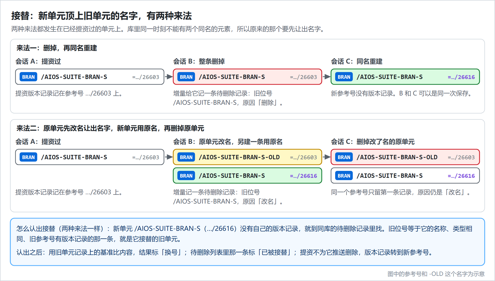

*图 11　接替的两种来法。*

### 4.5 谁算、谁用

| 谁 | 做什么 |
| --- | --- |
| gen-model | 按名称配对、比内容、给类别，提供只读接口。读待删除列表时，把已被接替的记录标出来。只读，不写任何表。 |
| rs-server | 提资时取结果：未修改的单元跳过，其余照发。换了号的单元不推旧参考号的删除，把版本记录转到新参考号。提资成功时写「提资时的会话号」。用脚本扫出「提资读取清单」交给 gen-model。 |
| plant-ui | 提资预览按类别分栏。待删除列表和删除确认里，已被接替的记录要看得出来，并且缺省不勾选。 |

判定为什么放在 gen-model：要读「上一次提资时」的内容，只有按会话读库文件才拿得到，这套读法在 gen-model；rs-server 只看得到数据库里的当前状态，所以它今天只能在提资时存一个指纹。#92 原来设想在 rs-server 里做一个「内容指纹」，没有采用：指纹只能回答相同还是不同，给不出逐个构件的类别和变化摘要。

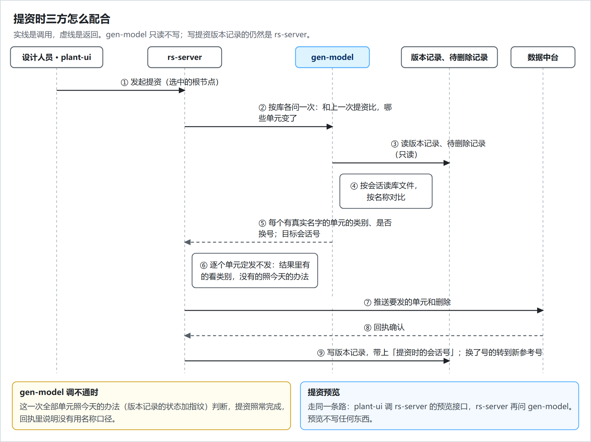

*图 12　提资时三方怎么配合。*

**rs-server 里两条路径并存**（图 13）。rs-server 不自己判断一个名字算不算真实名字，只看这个单元在不在 gen-model 给的结果里〔推〕：

- 在：按类别办。不再看版本记录的状态，因为增量对纯元数据的改动也会把状态标成 Modify。
- 不在：原样走今天的「状态加指纹」判断。落到这里的有三种：没有真实名字的单元；类型不属于最小交付单元的提资单元（工艺和仪控的支吊架是区域 ZONE，电气接地和一部分电缆支架是 STRU）；gen-model 调不通时的全部单元。
- rs-server 现有的「不发」规则（例如名字含 Copy-of 的设备不发）不改，并且先于类别生效。
- 一次提资涉及多个库时，按库各问一次〔推〕。

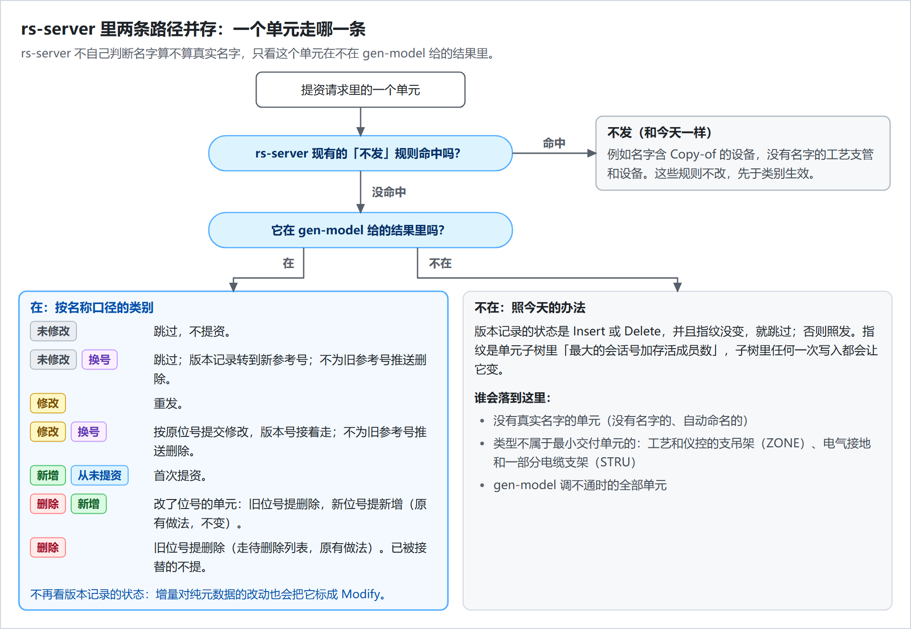

*图 13　一个单元走哪条路径。*

**gen-model 调不通时**，这一次全部单元走今天的路径，提资照常完成，回执里说明没有用名称口径〔推〕。

**版本记录怎么写。** 指纹照旧对所有单元计算和登记。每次提资成功，这次发出去的每条版本记录上的「提资时的会话号」，要么写成这次提取数据之前问到的目标会话号，要么清空，不能留着上一次的值。留着旧值，下一次会拿过时的基准去比〔推〕。另有一条建议（可以不做，也没有问过用户）：判为未修改而跳过的单元，把状态写回 Insert、把「提资时的会话号」前移到这一次，指纹不动。

**换了号的单元**，两张记录表怎么变见图 14。

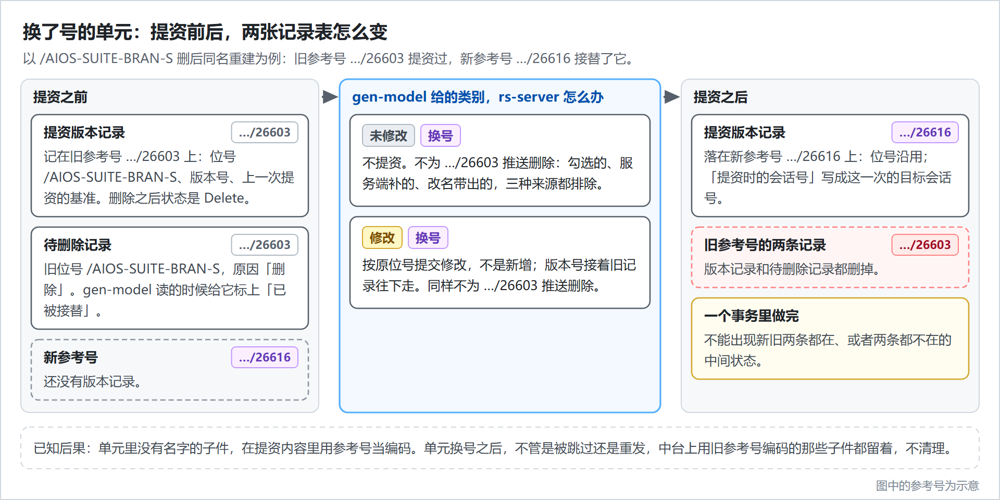

*图 14　换了号的单元，版本记录和待删除记录怎么转。*

**提资预览**走同一条路：plant-ui 调 rs-server 现有的预览接口，rs-server 再问 gen-model。预览不写任何东西。预览的结果里带着这一次的目标会话号；真正提资时如果目标会话号与预览时的不同（预览之后库又前进了），提示重新预览。分栏见图 15；其中最后一栏「按原来的办法判断」装的是不在结果里的单元〔推〕。需求表里说的「仅参考号变更的单元数」对应「跳过」一栏里换了参考号的那个数，「实质变更的单元数」对应「重发」一栏。

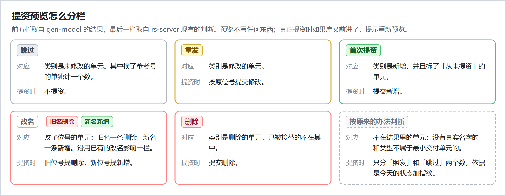

*图 15　提资预览的六栏。*

**接口。** 一条只读接口，路径暂定 `GET /api/v1/name-diff`。入参是库号、范围（给上级节点，不逐个列单元）和基准（缺省读版本记录，也可以显式给两个会话号）。应答里有每个有真实名字的单元的汇总、每个有名构件的行、重名清单、别的库里同名的提示、被跳过的数量，以及这一次用的目标会话号。一行大致是这样（字段名是草案，以开发计划 §6 和实现时的接口规格为准；名字和参考号为示意）：

```json
{ "name": "/1RCV0102A/B1", "noun": "BRAN", "category": "unchanged",
  "old_refno": "24383/73959", "new_refno": "24383/80012", "renumbered": true,
  "unit": { "refno": "24383/80012", "noun": "BRAN", "name": "/1RCV0102A/B1" },
  "changes": [] }
```

### 4.6 不变的

- 增量处理、任务变更清单、任务回执、模型生成和落库、现有接口都不改。换了号的构件，内部仍按新参考号重新生成、落库。
- 增量照旧按 refno 口径标版本记录的状态、照旧写待删除记录。
- 改名提资的做法（旧位号删除加新位号新增，[#97](https://github.com/happyrust/gen-model/issues/97)）不改。
- rs-server 现有的「不发」规则不改；两边对自动命名的判法先各管各的（gen-model 按「以前缀开头」，rs-server 按「名称里含有」）。

## 5. 案例

每个案例按同一个次序讲：做了什么操作，库里实际发生了什么，按参考号看是什么结果，按名称看是什么结果，提资时怎么处理。图也是同一个版式：上面是操作前后的两棵树，下面左边是按参考号看，右边是按名称看，最下面是提资。

案例里的名字尽量用增量测试套件（`scripts/e3d/increment_suite/`）里现成的；标了「示意」的名字和全部参考号是为了举例编的。

### 5.1 八条验收用例

**案例 1：只改名**

- 操作：把设备 `/AIOS-SUITE-EQ-B` 改名为 `/AIOS-SUITE-EQ-B-RENAMED`，别的都不动。套件里有现成的宏 `attr/rename_apply.mac`。
- 库里：还是那一个元素，参考号不变，只有名称变了。
- 按参考号看：一行修改。名称不影响模型，不重新生成。它提资过的话，增量记一条待删除记录（旧位号，原因「改名」）。
- 按名称看：旧名一行删除，新名一行新增。两行的参考号相同，互相指明。
- 提资时：今天和以后一样，走改名提资：旧位号提删除，新位号提新增。

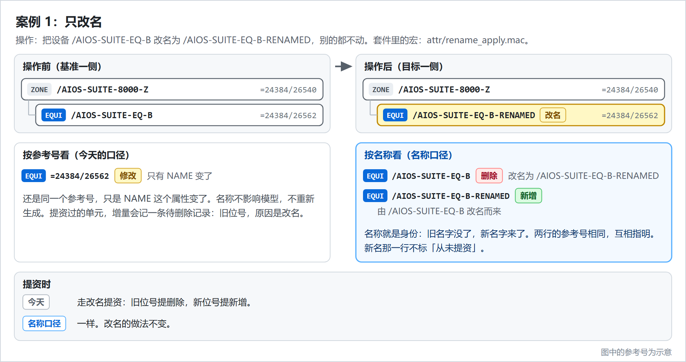

*图 16　案例 1：只改名。*

**案例 2：单元删后同名重建**

- 操作：把整条支管 `/AIOS-SUITE-BRAN-S` 删掉，再按原样重建，成员起回原来的名字。套件里可以用 `connect/bran_del_member_apply.mac` 加 `connect/bran_del_member_restore.mac` 这一对造出来，后者就是整条删掉再重建。重建出来的内容是不是逐项相同，要在第一次跑的时候确认（9.3 节的 V3）。
- 库里：支管和每个成员的名称都没变，参考号全换了。
- 按参考号看：旧的全删，新的全加。新支管整个重新生成。
- 按名称看：支管和每个有名成员都是「未修改，换号」。单元汇总也是未修改，带着换号。
- 提资时：今天当成首次提资再发一遍，旧位号进待删除列表。以后跳过；不为旧参考号推送删除；版本记录转到新参考号；待删除列表里那一条标为「已被接替」（图 14）。

图在 3 节：[图 3](#3-现在的问题只认参考号)。

**案例 3：成员删后同名重建，单元没换号**

- 操作：删掉设备 `/AIOS-SUITE-EQ-A` 下面的 `/AIOS-SUITE-BOX-A1`，再建一个同名、同尺寸的。宏是 `delete/recreate_same_name_apply.mac`。
- 库里：BOX 的名称和尺寸没变，参考号换了。设备的参考号没变，成员表里换了一个号。
- 按参考号看：BOX 一删一增，设备一行修改（成员表变了），整台重新生成。
- 按名称看：BOX 是「未修改，换号」。设备未修改：成员的名单和顺序没变。单元未修改。
- 提资时：今天重发，因为单元子树里有写入。以后跳过。

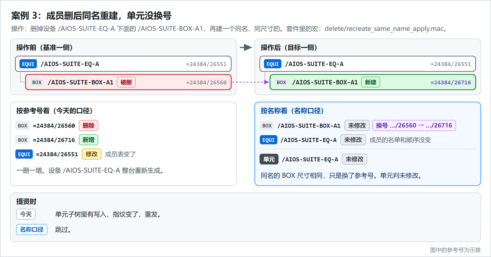

*图 17　案例 3：成员删后同名重建。*

**案例 4：重建且内容有变**

- 操作：和案例 3 一样删掉 `/AIOS-SUITE-BOX-A1` 再同名重建，但重建时把长度从 2000 改成了 2500。
- 库里：同名的 BOX 换了参考号，长度也变了。
- 按参考号看：和案例 3 完全一样，看不出这一次内容其实变了。
- 按名称看：BOX 是「修改，换号」，变化摘要指出 XLEN 2000 → 2500。设备自己那一行未修改，单元汇总是修改。
- 提资时：今天重发，以后也重发。区别在于名称口径能把案例 3 和案例 4 分开，并说出改了什么。

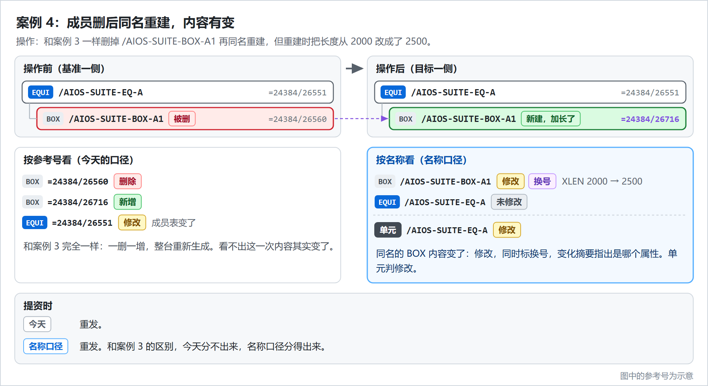

*图 18　案例 4：重建且内容有变。*

**案例 5：重建同时改名**

- 操作：删掉设备 `/AIOS-SUITE-EQ-B`，新建一台内容相同、名字叫 `/AIOS-SUITE-EQ-C`（示意）的设备。
- 库里：旧名字、旧参考号都没了；来了一个新名字、新参考号。
- 按参考号看：一删一增。
- 按名称看：旧名一行删除，新名一行新增，两行不互相指明：参考号和名称都变了，认不出是同一个东西。缺省入口下新名那一行标「从未提资」。
- 提资时：今天和以后一样：旧位号提删除，新位号按首次提资。

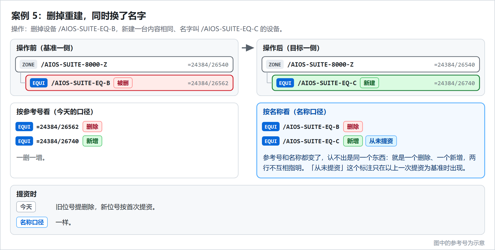

*图 19　案例 5：重建同时改名。*

**案例 6：只动纯元数据**

- 操作：设备 `/AIOS-SUITE-EQ-A` 上只有 CACHID 变了。它是 E3D 自己写的计数，设计人员没有改任何东西。
- 库里：这个元素的记录被重写了一次，名称、参考号、其它属性都没变。
- 按参考号看：一行修改。模型这一侧今天已经会分辨：CACHID 不影响模型，不重新生成。
- 按名称看：未修改。没有任何一行变成修改。
- 提资时：今天重发：子树里最大的会话号变了，指纹对不上；增量还把版本记录的状态标成了 Modify。以后跳过。
- 对照：只改描述（DESC）算实质，判修改，套件里有 `attr/desc_apply.mac`。提资读取清单到位之后还会有别的属性算纯元数据，具体哪些以清单为准。

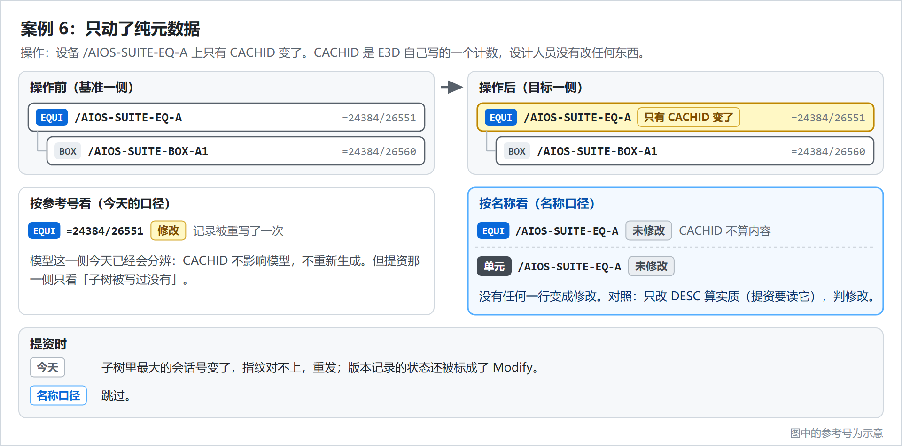

*图 20　案例 6：只动纯元数据。*

**案例 7：没有名字的构件**

- 操作：① 改了设备 `/AIOS-SUITE-EQ-COPY` 下面一个没有名字的 BOX 的长度；② 另外新建了一台没起名字的设备。`/AIOS-SUITE-EQ-COPY` 可以用套件里的 `create/equi_copy_apply.mac` 造：命令行复制出来的成员不带名字。
- 库里：一个无名的 BOX 属性变了；多了一台无名的设备和它的成员。
- 按参考号看：每个元素都有一行，有没有名字都一样。
- 按名称看：`/AIOS-SUITE-EQ-COPY` 判修改，变化摘要指到「第 2 个成员」。无名的成员不出行，只计入被跳过的数量。无名的设备整个不在结果里，只计一个数。
- 提资时：`/AIOS-SUITE-EQ-COPY` 今天和以后都重发。无名的设备，rs-server 今天就不发，以后也不发。

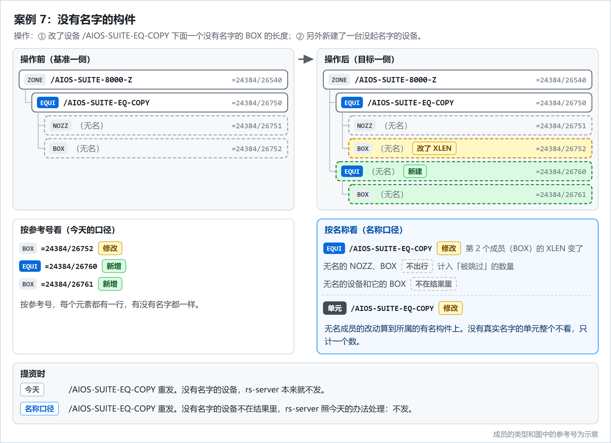

*图 21　案例 7：没有名字的构件。*

**案例 8：名字是 Copy-of 的构件**

- 操作：① 设备 `/AIOS-SUITE-EQ-A` 下面多了一个叫 `/Copy-of-AIOS-SUITE-BOX-A1` 的 BOX；② 另外多了一台叫 `/Copy-of-AIOS-SUITE-EQ-B` 的设备。这种名字是 E3D 复制元素时带出来的；命令行的 COPY 不会自动起名，造数时要显式起这个名字。
- 库里：多了两个元素，名字都以 `/Copy-of-` 开头。
- 按参考号看：两个新增，设备 `/AIOS-SUITE-EQ-A` 一行修改（成员表变了）。名字是不是 Copy-of 开头，没有区别。
- 按名称看：`/AIOS-SUITE-EQ-A` 判修改（多了一个成员）。Copy-of 的 BOX 不出行，和无名成员一样算到 `/AIOS-SUITE-EQ-A` 上；之后再改它的尺寸，`/AIOS-SUITE-EQ-A` 仍判修改。Copy-of 的设备整个不在结果里。
- 提资时：`/AIOS-SUITE-EQ-A` 今天和以后都重发。名字含 Copy-of 的设备，rs-server 今天就不发，以后也不发。要注意：换成名字是 Copy-of 的支管，rs-server 今天是照常提资的，见 [8.2](#82-rs-server-今天怎么对待没有名字的单元和-copy-of-单元)。

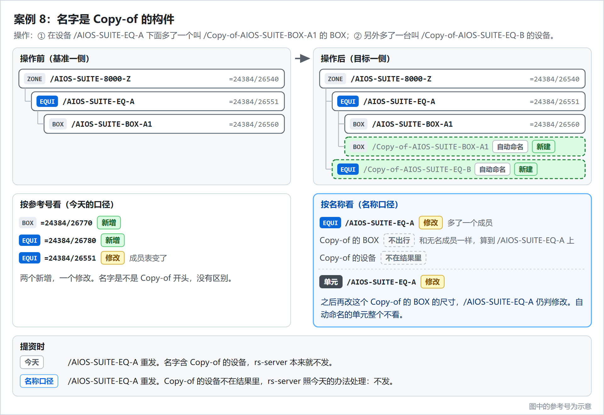

*图 22　案例 8：名字是 Copy-of 的构件。*

### 5.2 另外三个案例

**案例 9：上级移动了，单元自己没动**

- 操作：把整个区域 `/AIOS-SUITE-ZONE-MV` 向东平移 500。宏是 `xform/zone_move_apply.mac`。
- 库里：只有区域的位置变了。下面两台设备和两个 BOX 的记录没有被改，但它们在世界里的坐标各向东多了 500。
- 按参考号看：区域一行修改。模型这一侧，现有的处理会让下面两台设备的模型跟着移。
- 按名称看：两台设备各一行修改，原因是上级的位置变了。两个 BOX 未修改：上级的位置只算在单元那一行。区域自己也是一行修改，但它是容器，缺省入口下不出行。两个单元都判修改。
- 提资时：今天两台设备的子树没有被写过，指纹没变，会被跳过，中台上留的是移动之前的坐标。以后两台都重发。「今天会被跳过」是按代码读出来的，没有在真机上验过。

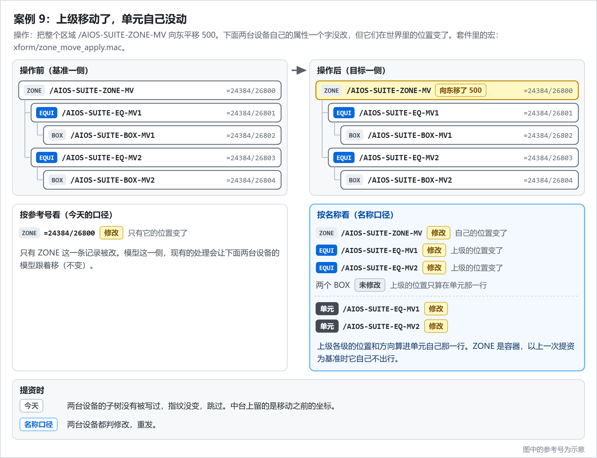

*图 23　案例 9：上级移动。*

**案例 10：有名构件换了单元**

- 操作：把 `/AIOS-SUITE-BOX-POSE` 从设备 `/AIOS-SUITE-EQ-PA` 改挂到 `/AIOS-SUITE-EQ-PB` 下面。宏是 `attr/pose_reparent_apply.mac`。
- 库里：BOX 的参考号和名称都没变，属主变了；两台设备的成员表各变了。
- 按参考号看：三条记录修改，两台设备都重新生成。
- 按名称看：BOX 只出一行修改，写明旧单元和新单元，不拆成旧单元里一个删除、新单元里一个新增。两台设备各一行修改（一个少了有名成员，一个多了）。两个单元都判修改。
- 提资时：今天和以后一样，两台都重发。

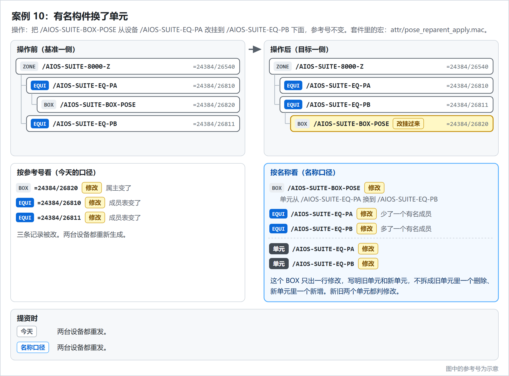

*图 24　案例 10：有名构件换了单元。*

**对照：上级只是改名。** 把支管所属的管线改个名，或者把设备所在的区域改个名，下面的构件没有动。这不算它们换了属主：上级还是那个元素，只是名字变了。改名的管线、区域自己，在显式入口里是旧名一行删除、新名一行新增；它们是容器，缺省入口不出行。下面的单元要不要重发，看提资读没读这个上级的名称：提资读取清单到位之后，读了的单元判修改，重发；到位之前看不出来，单元未修改，跳过，和今天一样。这一条是由已定的决定推出来的，没有单独问过用户。

**案例 11：名字撞在一起的三种情形**

- 同名，但类型不同（例如原来是阀门，现在是仪表）：不算同一个构件。旧的记删除，新的记新增，结果里有两行同名的，靠类型区分，都标「类型变了」。
- 同一个库的同一侧出现重名：不配对，进重名清单；重名的构件没有类别，所在的单元按修改处理。
- 别的库里有同名的：只在同一个库里配对。别的库里那个同名的不配对，只在结果里提示一句。

三种情形都不配对。配错比不配更糟：配错会把两个不同的构件判成未修改，提资就漏发了。

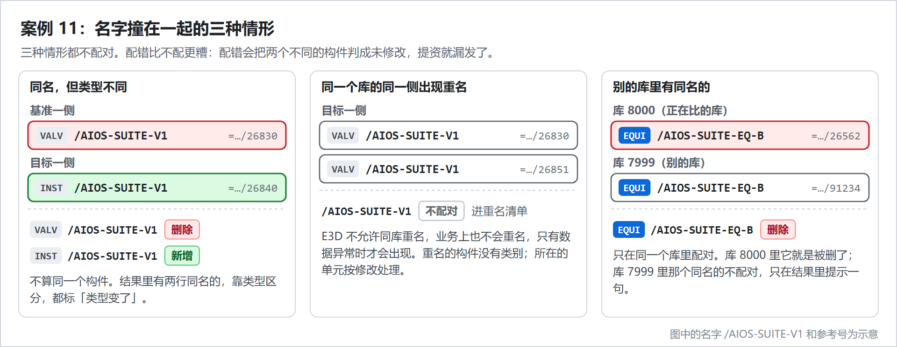

*图 25　案例 11：名字撞在一起的三种情形。*

### 5.3 引用的五种

引用类属性的规则在 4.3 节，图是 4.3 节的[图 8](#43-比的是什么)。下面按同一个次序各举一例。名字除 `/AIOS-SUITE-NOZZ-1`、`/AIOS-SUITE-BRAN-S` 和规格件的名字之外是示意；套件里没有现成的宏。

| 案例 | 操作 | 库里发生了什么 | 按参考号看（今天） | 按名称看 | 提资时 |
| --- | --- | --- | --- | --- | --- |
| 12 被引用的对象删后同名重建 | 管口 `/AIOS-SUITE-NOZZ-1` 接着支管 `/AIOS-SUITE-BRAN-S`。把这条支管删掉后同名重建，再接回管口 | 支管换了参考号。管口的 CREF 跟着换成了新参考号，管口的记录被改写 | 管口一行修改，它所在的设备重新生成 | 管口未修改：CREF 的目标还叫原来的名字。设备未修改 | 今天设备重发。以后设备跳过 |
| 13 引用换到另一个名称的对象 | 把一个管件的规格（SPRE）从 `/YBS2/CIB51002:BO,9,9` 换成 `/YBS3/CIB51002:BO,9,9` | 管件的 SPRE 指向了另一个规格件 | 管件一行修改，所在支管重新生成 | 修改，哪怕两个规格件内容相同。管件有名字就记在它自己那一行；没有名字就算到支管上 | 今天和以后都重发 |
| 14 被引用的对象自己改了名 | 把支管 `/AIOS-SUITE-BRAN-S` 改名为 `/AIOS-SUITE-BRAN-T`。接在它上面的管口没有动 | 支管的名称变了，参考号没变。管口的记录没有被改，CREF 里还是同一个参考号 | 只有支管一行修改 | 支管是旧名删除、新名新增。管口判修改：它引用的目标换了名字。管口所在的设备，单元汇总是修改 | 支管走改名提资，今天和以后一样。设备今天会被跳过，而它的提资内容里有所接管段的名称，中台上留的是旧名；以后重发 |
| 15 目标没有真实名字 | 支管甲的尾端（TREF）接在支管乙里一个没有名字的三通上。把支管乙整条删后原样重建，再接回去 | 三通换了参考号，支管甲的 TREF 跟着换成了新参考号 | 支管甲一行修改 | 支管甲未修改：目标的描述两侧都是「支管乙的名称 › TEE 1」。支管乙自己是「未修改，换号」 | 今天两条支管都重发。以后都跳过 |
| 16 目标在别的库 | 管件的 SPRE 指向目录库里的规格件。① 换成另一个规格件；② 目录库里把那个规格件改了名，设计库没动 | ① 管件的 SPRE 变了。② 设计库里没有任何记录被改 | ① 管件一行修改。② 没有任何一行 | ① 修改。② 看不出来：两侧都用目标现在的名称 | ① 今天和以后都重发。② 今天和以后都跳过，这是已知的盲区 |

案例 14 里「设备今天会被跳过」是按代码读出来的，没有在真机上验过。引用为空、或者目标已经不存在的，两侧各用一个固定记号，记号相同算相同。

### 5.4 没有真实名字的成员和单元

图是 4.3 节的[图 7](#43-比的是什么) 和 4.1 节的[图 4](#41-认谁跳过谁)。支管 `/AIOS-SUITE-BRAN-S` 的成员都没有名字时：

| 操作 | 库里发生了什么 | 按参考号看（今天） | 按名称看 | 提资：今天 | 提资：以后 |
| --- | --- | --- | --- | --- | --- |
| 一个无名成员删后原样重建 | 这个成员换了参考号，内容和位置都没变 | 成员一删一增，支管修改 | 支管未修改 | 重发 | 跳过 |
| 无名弯头改了角度 | 这个成员的一个属性变了 | 成员一行修改 | 支管修改，摘要指到第几个成员 | 重发 | 重发 |
| 多了或少了一个无名成员 | 支管的成员表变了 | 成员新增或删除，支管修改 | 支管修改 | 重发 | 重发 |
| 两个无名成员换了顺序 | 支管的成员表顺序变了 | 支管一行修改 | 支管修改 | 重发 | 重发 |
| 支管自己也没有名字，改了它下面的无名弯头 | 这个成员的一个属性变了 | 成员一行修改 | 不在结果里：上卷到单元为止，单元没有真实名字就不看 | 照今天的办法：工艺的无名支管不发，其它专业的照常提资 | 一样 |
| 没有名字的支管上有一个有位号的阀门，改了这个阀门 | 阀门的属性变了 | 阀门一行修改 | 显式入口：阀门一行修改，所属单元为空。缺省入口：不出行 | 照今天的办法，同上 | 一样 |

### 5.5 其余情形看哪里

| 情形 | 在哪里讲 |
| --- | --- |
| 有名成员各判各的，单元怎么汇总 | 4.3 节，图 9 |
| 没有真实名字的单元 | 4.1 节，图 4；案例 7、案例 8；8.1、8.2 |
| 基准的六种情形 | 4.4 节的表，图 10 |
| 接替的两种来法 | 4.4 节，图 11；换号之后两张记录表怎么转见图 14 |
| 上级只是改名 | 4.3 节「单元之外的变化也算」；案例 10 后面的「对照」 |
| gen-model 调不通；两条路径并存 | 4.5 节，图 12、图 13 |
| 预览怎么分栏 | 4.5 节，图 15 |

### 5.6 案例一览

| 案例 | 按参考号看（今天） | 按名称看 | 提资：今天 | 提资：以后 |
| --- | --- | --- | --- | --- |
| 1 只改名 | 一行修改 | 旧名删除、新名新增，互相指明 | 旧位号删除加新位号新增 | 一样 |
| 2 单元删后同名重建 | 旧的全删、新的全加 | 未修改，换号 | 当成首次提资再发；旧位号进待删除列表 | 跳过；不推旧删除；版本记录转到新参考号 |
| 3 成员删后同名重建 | 成员一删一增，单元修改 | 成员未修改且换号；单元未修改 | 重发 | 跳过 |
| 4 重建且内容有变 | 和案例 3 一样 | 成员修改且换号；单元修改 | 重发 | 重发 |
| 5 重建同时改名 | 一删一增 | 旧名删除、新名新增，不互指 | 旧位号删除，新位号首次提资 | 一样 |
| 6 只动纯元数据 | 一行修改 | 未修改 | 重发 | 跳过 |
| 7 没有名字的构件 | 每个元素一行 | 无名成员上卷；无名单元不在结果里 | 有名单元重发；无名设备不发 | 一样 |
| 8 Copy-of 构件 | 每个元素一行 | Copy-of 成员上卷；Copy-of 单元不在结果里 | 有名单元重发；Copy-of 设备不发 | 一样 |
| 9 上级移动 | 只有上级一行修改 | 下面的单元都判修改 | 跳过（中台上是旧坐标） | 重发 |
| 10 有名构件换单元 | 三行修改 | 一行修改，两个单元都修改 | 两个单元都重发 | 一样 |
| 11 名字相撞 | 不涉及 | 三种都不配对 | 不涉及 | 判不了的按修改，重发 |
| 12 被引用的对象删后同名重建 | 引用方修改 | 引用方未修改 | 重发 | 跳过 |
| 13 引用换到另一个名称的对象 | 引用方修改 | 修改 | 重发 | 重发 |
| 14 被引用的对象自己改名 | 只有被引用的对象一行修改 | 引用方也判修改 | 引用方所在的单元被跳过 | 重发 |
| 15 引用的目标没有真实名字，随单元重建 | 引用方修改 | 引用方未修改 | 重发 | 跳过 |
| 16 引用的目标在别的库 | 换目标：修改；目标改名：没有记录 | 换目标：修改；目标改名：看不出来 | 换目标重发；目标改名跳过 | 一样 |
## 6. 考虑过的情形：总表

四轮讨论里出现过的每一种情形都在下面。「谁定的」一栏的写法：

- **共识 n**：前三轮问答确认的 13 条共识里的第 n 条。
- **四轮 n**：第四轮问答里用户对第 n 题的回答。第 6 题是「其余的都按建议」。
- **追问**：2026-11-10 发布票之前又问用户的两题。
- **推出，看过**：由用户的回答推出来的做法，单独列给用户看过，用户没有反对。
- **推出**：由用户的回答推出来的做法，没有单独问过用户。

「编号」是开发计划里的编号：D 是定下来的决定（D1–D29），P 是推出来的做法（P1–P14）。「票」是 happyrust/gen-model 上的票。

**认谁、跳过谁**

| # | 情形 | 怎么处理 | 谁定的 | 编号 | 票 |
| --- | --- | --- | --- | --- | --- |
| 1 | 这件事叫什么 | 叫名称口径，现状叫 refno 口径。不叫「过滤」：它不筛掉任何数据 | 共识 1 | D1 | — |
| 2 | 凭什么认作同一个构件 | 同一个库里，名称原文整串相同：带斜杠，只去首尾空白，区分大小写 | 共识 3 | D3 | #133 |
| 3 | 别的库里有同名的 | 不配对，只在结果里提示 | 共识 3 | D3 | #133 |
| 4 | 同一个库的同一侧重名 | 不配对，报出来；所在单元按修改处理 | 共识 11；后半句是推出 | D14、P14 | #133 |
| 5 | 同名但类型不同 | 不配对。旧的删除、新的新增，都标「类型变了」；结果里有两行同名 | 四轮 6；两行同名是推出 | D25、P10 | #133 |
| 6 | 没有名称的元素 | 不出行 | 共识 4 | D4 | #133 |
| 7 | 自动命名（Copy-of）的元素 | 不出行。前缀是可配置的清单，缺省两条 | 共识 4 | D4 | #133 |
| 8 | 自动命名怎么判，两边不一样 | gen-model 按「以前缀开头」，rs-server 现有的按「名称里含有」，各管各的；联调时把判得不一样的列出来看 | 四轮 6 | D28 | #133、#139 |
| 9 | 交付单元自己没有真实名字 | 结果里完全不出现；rs-server 对它们保持今天的做法 | 四轮 2；追问时维持 | D17 | #133、#137、#99 |
| 10 | 有名构件挂在没有真实名字的单元下面 | 显式入口出行，所属单元为空；缺省入口不出行 | 推出，看过 | P1 | #133、#137 |
| 11 | 容器（SITE、ZONE、PIPE） | 显式入口出行；缺省入口不出行 | 四轮 6 | D27 | #133、#137 |
| 12 | 提资按别的类型算单元的（支吊架是 ZONE，接地是 STRU） | 不在结果里，按今天的办法判断。做到 #137 时先数出有多少，再决定补不补 | 推出；追问时定了「先数再定」 | P4 | #137、#99 |
| 13 | 每一行带什么 | 名称、类型、类别、旧参考号、新参考号、所属的最小交付单元、变化摘要 | 共识 5、共识 9 | D5 | #133 |

**类别和标注**

| # | 情形 | 怎么处理 | 谁定的 | 编号 | 票 |
| --- | --- | --- | --- | --- | --- |
| 14 | 有哪些类别 | 新增、删除、修改、未修改 | 共识 7 | D10 | #133 |
| 15 | 只是参考号变了 | 类别是未修改，另标「换号」。换号是标注，不是第五个类别 | 共识 7 | D10 | #133 |
| 16 | 从未提资过的 | 单元和属于它的行都是新增，标「从未提资」 | 共识 7、共识 8 | D10、D11 | #137 |
| 17 | 改名（参考号没变） | 旧名删除加新名新增，两行互相指明；新名那一行不标「从未提资」 | 共识 7；后半句是推出，看过 | D10、P3 | #133、#137 |
| 18 | 删掉重建，同时换了名字 | 互不相干的一个删除、一个新增 | 共识 13（验收用例） | D10 | #139 |
| 19 | 有名构件换了属主或换了单元 | 一行修改，写明新旧；两个单元都判修改。属主按最近的有名祖先认；上级只是改名不算换了属主 | 四轮 6；后半句是推出 | D24、P9 | #133 |
| 20 | 读不出来、判不了 | 一律判修改，不判未修改 | 方案里 gen-model 对外的承诺，没有单独问过 | 方案 §7 | #133 |

**比什么**

| # | 情形 | 怎么处理 | 谁定的 | 编号 | 票 |
| --- | --- | --- | --- | --- | --- |
| 21 | 比哪些东西 | 有名构件自己的属性；引用按目标的名称；纯元数据不算 | 共识 6 | D7 | #133 |
| 22 | 被引用的对象删后同名重建 | 引用方未修改 | 共识 6（沿用 #92） | D7 | #134 |
| 23 | 引用换到另一个名称的对象 | 引用方修改，哪怕两个对象内容相同 | 共识 6（沿用 #92） | D7 | #134 |
| 24 | 引用的目标没有真实名字 | 用「最近的有名祖先的名称加逐级的类型与序号」描述；到库顶都没有有名祖先的，退回用参考号 | 四轮 6；后半句是推出 | D23、P8 | #134 |
| 25 | 引用的目标在别的库 | 两侧都用目标现在的名称 | 四轮 6 | D23 | #134 |
| 26 | 被引用的对象自己改了名 | 同一个库里的算引用方修改；别的库里的看不出来 | 四轮 6 | D23 | #134 |
| 27 | 引用为空，或目标已不存在 | 各用一个固定记号 | 四轮 6 | D23 | #134 |
| 28 | 没有名字的成员增、删、改、换顺序 | 所属的有名构件判修改 | 共识 6（用户改过主意，见 7.2） | D8 | #133 |
| 29 | 没有名字的成员只是换了参考号 | 不算 | 共识 6 | D8 | #133 |
| 30 | 自动命名的成员挂在有名构件下面 | 和没有名字的成员一样上卷 | 四轮 4 | D19 | #133 |
| 31 | 上卷到哪里为止 | 到所在的交付单元为止。没有真实名字的单元在上级容器的内容里也不占位置 | 推出，看过 | P2 | #133 |
| 32 | 有名成员的内容变了 | 只记在它自己那一行；上一级只看有哪些有名成员和它们的顺序 | 四轮 3 | D18 | #133 |
| 33 | 单元的类别怎么得出 | 属于它的行里有一行不是未修改，就是修改；单元自己那一行是新增或删除就取它 | 四轮 3；后半句是推出，看过 | D18、P3 | #133 |
| 34 | 「模型没变」怎么判 | 看生成器要读的属性，不重新生成几何；测试里用实际几何对照 | 共识 6 | D9 | #133、#139 |
| 35 | 上级移动 | 算单元的修改，记在单元自己那一行 | 四轮 6 | D21 | #134 |
| 36 | 提资从上级、经引用读到的属性变了（上级只是改名属于这一种） | 也算；读了哪些由提资读取清单声明，清单到位后生效，到位之前看不出来 | 四轮 6 | D21 | #136 |
| 37 | 哪些属性算纯元数据 | #92 的三条判定，加 CACHID、SPAMAP；名称、DESC、全部 UDA 算实质 | 共识 6（沿用 #92） | D7 | #136 |
| 38 | 提资读取清单怎么来；到位之前怎么判 | rs-server 用脚本扫出并加护栏，gen-model 收进仓库；到位前只认 CACHID、SPAMAP | 四轮 5 | D20 | #135、#136 |

**和哪一次比**

| # | 情形 | 怎么处理 | 谁定的 | 编号 | 票 |
| --- | --- | --- | --- | --- | --- |
| 39 | 基准是哪一次 | 上一次提资，不是第一次 | 共识 6（沿用 #92） | D6 | #137 |
| 40 | 底层做成什么样 | 任意两个会话之间按名称对比；缺省入口读版本记录找基准 | 共识 8 | D11 | #133、#137 |
| 41 | 基准会话号用哪个数 | rs-server 另记「提资时的会话号」；旧记录退回用指纹里的会话号 | 四轮 1 | D16 | #137、#99 |
| 42 | 两个数都没有的旧记录 | 按已修改处理 | 共识 8、四轮 1 | D11、D16 | #137 |
| 43 | 基准会话已经不在会话链上 | 按已修改处理，标原因 | 四轮 6 | D27 | #137 |
| 44 | 目标一侧取哪个会话；库还没入库 | 取应用水位；没入库就报错 | 四轮 6；后半句是推出 | D22、P11 | #137 |
| 45 | 怎么认出接替 | 按待删除记录配对：旧位号等于名称、类型相同、旧参考号有版本记录；原因是删除或改名都算 | 推出，看过 | P7 | #137、#138 |

**谁算、怎么给**

| # | 情形 | 怎么处理 | 谁定的 | 编号 | 票 |
| --- | --- | --- | --- | --- | --- |
| 46 | 判定放在哪 | gen-model。rs-server 的提资和 plant-ui 的预览来取结果 | 共识 2 | D2 | #133、#99、#113、#100 |
| 47 | 结果存不存 | 按需算，不落库；新开一条只读接口；现有的处理、回执、接口都不动 | 共识 9 | D12 | #133 |
| 48 | 三方各做什么 | gen-model 配对、比内容、给类别、标已被接替；rs-server 跳过或重发、不推旧删除、转版本记录、出读取清单；plant-ui 预览分栏 | 共识 10 | D13 | 全部 |
| 49 | 接口路径、范围怎么传、预览从哪取数 | 路径暂定 `/api/v1/name-diff`；范围给上级节点；只用 GET；预览经 rs-server 现有的预览接口 | 四轮 6 | D29 | #133、#100 |

**提资时（rs-server）**

| # | 情形 | 怎么处理 | 谁定的 | 编号 | 票 |
| --- | --- | --- | --- | --- | --- |
| 50 | 一个单元走哪条路径 | 只看它在不在 gen-model 的结果里：在就按类别，不在就照今天的办法。现有的「不发」规则先于类别生效 | 四轮 2；判法是推出，看过 | D17、P5 | #99 |
| 51 | gen-model 调不通 | 全部单元照今天的办法，回执里说明 | 推出，看过 | P5 | #99 |
| 52 | 一次提资涉及多个库 | 按库各问一次 | 推出 | P12 | #99 |
| 53 | 换号且未修改的单元 | 跳过；不推旧参考号的删除；版本记录转到新参考号 | 共识 10 | D13 | #113 |
| 54 | 换号且修改的单元 | 按原位号重发；不推旧参考号的删除；版本记录落在新参考号上。「当作修改提交、版本号接着走」是方案里的做法，中台认不认要验证（V12） | 共识 10；括号里那句没有单独问过 | D13 | #113 |
| 55 | 换号后被跳过，中台上无名子件的编码还是旧参考号 | 不处理，不重发，不做标记 | 共识 12 | D15 | #113 |
| 56 | 换号且修改的单元重发后，中台上旧参考号编码的无名子件 | 也不处理 | 四轮 6 | D26 | #113 |
| 57 | 版本记录上「提资时的会话号」怎么写 | 每次提资成功，要么写成这次的，要么清空；指纹照旧登记 | 推出，看过 | P6 | #99 |
| 58 | 被跳过的单元，版本记录要不要刷新 | 建议刷新（状态写回 Insert，会话号前移，指纹不动）；可以不做 | 建议，没有问过 | 方案 §7 第 5 条 | #99 |

**预览、待删除列表、验收**

| # | 情形 | 怎么处理 | 谁定的 | 编号 | 票 |
| --- | --- | --- | --- | --- | --- |
| 59 | 预览怎么分栏 | 跳过、重发、首次提资、改名、删除，另加一栏「按原来的办法判断」装不在结果里的单元 | 共识 10、四轮 6；最后一栏是推出 | D29、P13 | #100 |
| 60 | 待删除列表里被接替的记录 | gen-model 读的时候现算一个「已被接替」的标记，不落库；预览和删除确认里缺省不勾选 | 共识 10 | D13 | #138、#113 |
| 61 | 拿什么验收 | 八条用例：案例 1 到案例 8 | 共识 13 | 方案 §9 | #139 |

总表一共 61 行。另有 13 条已知后果在 [8.3](#83-已知后果)，12 件实施时要验证的事在 [9.3](#93-实施时要验证的事)。

## 7. 讨论时的取舍

### 7.1 每个问题：选了什么，没选什么，为什么

| 问题 | 选了 | 没选 | 为什么 |
| --- | --- | --- | --- |
| 这件事叫什么 | 名称口径 | 「按名称过滤的增量更新」（用户最初的说法）、名称增量 | 它不筛掉任何数据，只是换一种认身份的办法；「过滤」在词汇表里已经有两处明确避开。 |
| 判定放在哪 | gen-model | 在 rs-server 里新做一个内容指纹（#92 原来的分工） | 上一次提资时的内容只有按会话读库文件才拿得到，这套读法在 gen-model。指纹只能回答相同还是不同，给不出逐个构件的类别和变化摘要。 |
| 凭什么认作同一个 | 同库内名称整串精确相同 | 忽略大小写或去掉斜杠；跨库配对；用提资的实例编码配对 | E3D 认为不同的两个名称不能并成一个；跨库配不出一对一；编码把斜杠换成下划线，不同的名称可能撞成同一个编码。 |
| 没有名字的、自动命名的元素 | 不出行 | 按「属主加类型加序号」认身份并出行；把自动命名当真实名字 | 序号会漂移；自动命名不是设计人员起的，复制一次就多出一批。 |
| 结果的粒度 | 每个有名构件一行，带所属单元 | 只按单元出行 | 提资以单元为单位，但要看得出单元里哪个构件变了。 |
| 和哪一次比 | 上一次提资 | 第一次提资 | 中台上存的是上一次提资的内容。 |
| 引用怎么比 | 按目标的名称 | 按目标的内容；按参考号 | 按内容要给规格件、目录件、详图、材料各定义一遍「内容」；参考号一重建就变。 |
| 引用的目标没有名字 | 最近的有名祖先的名称，加逐级的类型与序号 | #92 原来写的「所在单元的位号加成员序号」 | 常见情形下两者相同；单元没有真实名字时前者仍然能用。 |
| 被引用的对象自己改名 | 同库里的算引用方修改 | 不算 | 提资内容里有从目标名称取的值。 |
| 没有名字的成员 | 上卷到所属的有名构件 | 一律忽略（用户一度选过）；单独出行 | 一律忽略会漏掉无名管件的改动；单独出行又回到序号漂移。 |
| 自动命名的成员 | 和没有名字的成员一样上卷 | 完全忽略；当作有名构件出行 | 复制件不单独提资，但仍然影响所在管段的提资内容。 |
| 有名成员的变化 | 各判各的；单元汇总时再算上 | 有名成员一变，上面每一级都判修改；上一级完全不看有名成员 | 行与行不重复记同一件事；成员的名单和顺序仍然算上一级的内容。 |
| 单元之外的变化 | 计入 | 只看单元子树（今天的指纹就是这样） | 上级一动，几何和坐标都动了。 |
| 纯元数据的清单 | 脚本从 rs-server 的代码里扫出来；到位前只认两个计数 | 手抄清单；rs-server 运行时提供接口；写进共用库的配置表；到位前先用 #92 草案里的 54 个候选 | 手抄的清单，提资代码一加读点就过期；运行时多一条依赖；候选没有逐项确认过，宁可多发。 |
| 「模型没变」怎么判 | 看生成器要读的属性 | 两侧各生成一遍几何再比 | 贵，而且换了号的构件本来就要重新生成一遍。 |
| 类别怎么分 | 四类，换号和从未提资是标注；改名记成一删一增 | 把「仅换号」单列成第五类；给改名单设一个类别 | 换号和类别是两个维度；改名在提资时本来就是旧位号删除加新位号新增。 |
| 有名构件换了属主或单元 | 一行修改 | 旧单元里一个删除、新单元里一个新增 | 它还是同一个名称、同一个构件。 |
| 同名但类型不同 | 不配对 | 算同一个构件，判修改 | 中台的实例带对象类型；E3D 自己改类型也是先整体删除再重建。 |
| 重名 | 不配对，报出来 | 挑一个配对 | 配错会把两个不同的构件判成未修改而漏发。 |
| 结果存不存 | 按需算，不落库 | 对现有增量数据做一遍后处理并存成表（用户最初的说法）；存一份基准内容的快照；改造现有管线让它直接按名称认身份 | 落库就是第二份持久事实，规则一改全部作废；模型记录以参考号为键，换了号必须按新参考号重新生成。 |
| 基准会话号用哪个数 | rs-server 另记「提资时的会话号」 | 只用指纹里已有的那个数；由 gen-model 自己记 | 只用已有的数，在上级移动之类的情形下会每次都重发；gen-model 自己记就违反不落库，它也不知道提资何时成功。 |
| 目标一侧取哪个会话 | 应用水位 | 库文件里最新的会话 | rs-server 提资读的是数据库。 |
| 没有真实名字的交付单元 | 结果里完全不出现，rs-server 照今天的办法 | 按参考号认、照样给类别（起草时的建议）；一律判修改 | 用户的选择，与「没有命名的直接跳过」是同一个态度。后果见 8.3 第 2 条。 |
| 容器在缺省入口 | 不出行 | 给它找一个替代基准 | 容器没有提资版本记录。 |
| 无名子件在中台上的旧编码 | 不处理 | 单元换号时为了刷新编码而重发；加专门的标记；重发前先把旧的无名子件删掉 | 用户的原话是「没有命名的直接跳过」。 |
| 自动命名的判法两边不一样 | 先各管各的 | 统一成一份规则 | rs-server 现有的规则先不动；联调时把判得不一样的元素列出来看。 |
| 预览从哪取数 | 经 rs-server 现有的预览接口 | plant-ui 直接调 gen-model | 预览和真正提资用同一套入参、同一条通道。 |
| #92 定稿的两步走 | 一套比较同时覆盖「引用换了参考号」和「单元换了参考号」 | 先在 rs-server 做前一种（#99），再做后一种（#113） | 判定挪到 gen-model 之后，两种情形是同一套比较；rs-server 一侧仍然可以分 #99、#113 两步上线。 |

### 7.2 用户改过主意的地方

**没有名字的成员变了算不算。** 用户一开始选的是「无名成员的变化一律忽略」。看到后果之后改成了上卷：无名弯头改了角度，管线会被判成未修改，提资就把它跳过了，而管线的几何和提资内容其实都变了。

### 7.3 说错后更正的地方

**自动命名的元素有多少。** 第三轮问答时报给用户的数是「两种写法分别出现 156 处和 109 处」，说是取自现成的生成产物，后来没有复现出来。重新数的结果是：

- 取数对象是开发环境的测试工程（AvevaMarineSample，MDB `/ALL`，20 个带 SITE 的设计库），**不是正式库**。
- 取数方法是用 gen-model 按名称搜索的只读接口搜 `copy`，翻完全部 3,675 条结果，再按名称的开头分类。2026-11-10 取了两次，数字相同。
- 以 `/Copy-of-` 开头的 3,186 个，以 `/Copy-(数字)-of-` 开头的 487 个。另有 1 个 `/-Copy-of--RX-CSV-S2018-BAR-3`，Copy-of 不在开头，缺省不算自动命名。
- 其中属于单元类型的：设备（EQUI）937 个，支管（BRAN）589 个，HANG 24 个。其余主要是 ATTA 633、PIPE 301、SUBE 232、VALV 193。
- 现成的生成产物里，两种写法去重后各有 65 个和 53 个不同的名称。这是另一个范围，和上面的数不能直接比。

用户做「没有真实名字的单元不出现」这个选择时，看到的是 937 个设备、589 个支管这两个数。

**rs-server 今天怎么对待这些单元。** 第四轮问用户时的说法是「Copy-of 的不发，无名的按现有指纹判断」。读了 rs-server 的代码之后发现只对了一部分：名字含 Copy-of 的只有设备不发，支管和支吊架照常提资；没有名字的工艺支管、设备、工艺支吊架根本不发。更正后的表在 [8.2](#82-rs-server-今天怎么对待没有名字的单元和-copy-of-单元)。发布票之前把更正后的表给用户看了，用户维持原来的选择。

**版本记录上的会话号是什么意思。** 前三轮的共识写的是「缺省入口由 gen-model 读版本记录上的会话号当基准」。起草方案时发现那个数是「单元子树最后一次被写的会话」，不是「提资当时的会话」，直接用会在某些情形下每次都重发。第四轮把它单独问了用户，定为另记一个「提资时的会话号」。

## 8. 边界和已知后果

### 8.1 不在结果里的是哪些

| 什么 | 名称口径怎么对待 | 提资时 |
| --- | --- | --- |
| 没有名字的成员、自动命名的成员 | 不出行；变化算到所属的有名构件上 | 跟着所属的单元走 |
| 没有真实名字的交付单元（没有名字的、自动命名的） | 整个不在结果里，只计一个数 | rs-server 照今天的办法 |
| 挂在这种单元下面的有名构件 | 显式入口出行，所属单元为空；缺省入口不出行 | 跟着那个单元走 |
| 容器（SITE、ZONE、PIPE 等） | 显式入口出行；缺省入口不出行 | 不单独提资 |
| 提资按别的类型算单元的：工艺和仪控的支吊架（带 `:SUPP` 自定义类型的 ZONE），电气接地和一部分电缆支架（STRU） | 不在结果里 | rs-server 照今天的办法 |
| 别的库里的同名元素 | 不配对，只提示 | 各库各算 |

倒数第二行是一个**覆盖面上的缺口**：gen-model 的最小交付单元类型是 BRAN、HANG、SUPPO、EQUI，区域（ZONE）恒不算单元；而提资把一部分 ZONE 和 STRU 当单元、按参考号记版本记录。这些支吊架和接地今天按「状态加指纹」判断，以后也是，「仅参考号变化不重发」对它们不生效。用户的决定是：先按现在的方案开票，做到「以上一次提资为基准」那一片（#137）时先数出这类单元有多少，再决定补不补；在那之前它们按今天的办法判断。反过来，HANG 是 gen-model 的单元类型，但提资不把它当单元。

### 8.2 rs-server 今天怎么对待没有名字的单元和 Copy-of 单元

依据是 rs-server `new_standard` 分支 2026-11-08 的代码，缺省的构建方式；三代二分支上相同。「照常提资」的意思是进入提取，跳不跳过由状态加指纹决定。

| 单元 | 没有名字 | 名字含 Copy-of |
| --- | --- | --- |
| 工艺的支管（BRAN） | 不发 | 照常提资 |
| 设备（EQUI；工艺、通风、仪控共用一段代码） | 不发 | 不发 |
| 工艺的支吊架 | 不发：名称过不了「房间号.流水号」的规则 | 照常提资 |
| 通风、仪控、电气的支管 | 照常提资，编码是空串 | 照常提资 |
| 通风的 SUPPO，仪控和电气的支吊架，电气接地 | 照常提资 | 照常提资 |

rs-server 判「含 Copy-of」的办法是不分大小写、名称里含有 `copy-of` 或 `copy-(` 就算；gen-model 的自动命名是「以前缀开头」。两边先各管各的。

所以「没有真实名字的单元保持今天的做法」落到实处是：名字是 Copy-of 的支管和支吊架继续照常提资，子树里任何写入都会重发，换号会被当成首次提资；名字是 Copy-of 的设备、没有名字的工艺支管和设备继续不发。

### 8.3 已知后果

编号与开发计划 §11 一致。

| 编号 | 后果 | 说明 |
| --- | --- | --- |
| 后果 1 | 无名子件在中台上留着旧参考号 | 单元里没有名字的子件，在提资内容里用参考号当编码。单元换号后，不管是被跳过还是重发，中台上用旧参考号编码的子件都留着。用户已定：不处理。 |
| 后果 2 | 没有真实名字的单元享受不到名称口径 | 其中今天照常提资的那些，子树里任何写入都会重发，换号会被当成首次提资，与今天一样。开发环境里自动命名的支管有 589 个。 |
| 后果 3 | 目录库的盲区 | 规格件、目录件的名称没变而内容变了，看不出来。今天的指纹同样看不出来。 |
| 后果 4 | 类型不属于最小交付单元的提资单元不在结果里 | 见 8.1 的缺口。 |
| 后果 5 | 改名是两行 | 同一个构件改名后，在结果里是一行删除、一行新增。 |
| 后果 6 | 重名时宁可不配 | 重名的构件没有类别，只出现在重名清单里；所在单元按修改处理。 |
| 后果 7 | 换号的构件照样重新生成 | 名称口径省的是提资，不省模型生成。 |
| 后果 8 | 版本记录的状态会和类别对不上 | 增量照旧把被改动的单元标成 Modify，哪怕名称口径判它未修改。做了「跳过的单元刷新版本记录」那条建议就不会。 |
| 后果 9 | 只有指纹的旧记录有一个盲区 | 旧记录退回用指纹里的会话号当基准。如果在那个会话和实际提资之间，单元之外的东西变过（比如上级移动），提资之后又改回去，会被判成未修改，而中台上存的是变过之后的内容。今天的指纹同样看不出这种变化；这条记录重发过一次之后就有了准确的基准。 |
| 后果 10 | 算不回去的基准 | 库的会话被合并之后，旧的基准会话读不回来，这些单元只能按已修改处理一次。 |
| 后果 11 | 复制后只把单元改回原名、成员还叫 Copy-of 的，判修改 | 成员在基准一侧是有名成员，现在是自动命名，内容对不上；它们原来的名称各出一行删除。 |
| 后果 12 | 清单到位之前，提资从上级读的属性变了看不出来 | 比如管线、区域改名。上级改名不算下面的构件换了属主，所以这种变化只能靠清单发现。今天也看不出来。 |
| 后果 13 | 第一次冷算有代价 | 整库范围要把两侧各扫一遍；缺省入口每个不同的基准会话要建一张名称表。超过 300 秒会超时。 |

### 8.4 不做的

- 不改现有的增量处理、任务变更清单、任务回执、模型落库和现有接口。
- 不把名称口径的结果落库，也不存基准内容的快照。
- 不做跨库配对。
- 不给没有名字的元素、自动命名的元素单独认身份。
- 不把没有真实名字的单元纳入结果，也不改 rs-server 对它们的做法。
- 不为判定而重新生成几何。
- 不比目录库的内容：目标名称相同就算相同。
- 不为无名子件的编码做任何处理。
- 不改 rs-server 现有的「不发」规则，不统一两边对自动命名的判法。
- 不改改名提资的做法。
- 不改 plant3d-web 的增量记录页。

## 9. 落地

### 9.1 十片工作和对应的票

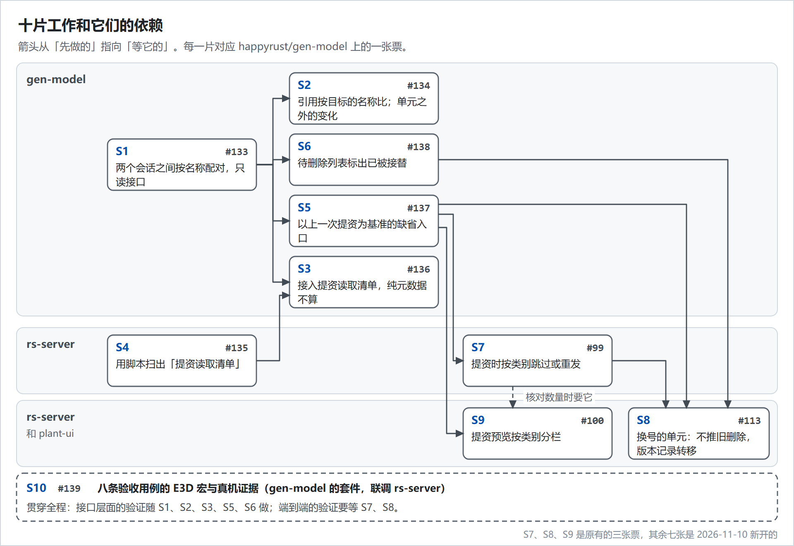

*图 26　十片工作和它们的依赖。*

| 片 | 票 | 做什么 | 在哪个仓库做 | 要等 |
| --- | --- | --- | --- | --- |
| S1 | [#133](https://github.com/happyrust/gen-model/issues/133) | 两个会话之间按名称配对，只读接口的显式入口。这一片里内容比较只去掉两个计数，引用先按参考号比 | gen-model | 不用等 |
| S2 | [#134](https://github.com/happyrust/gen-model/issues/134) | 引用按目标的名称比；上级移动、被引用的对象改名计入修改 | gen-model | S1 |
| S4 | [#135](https://github.com/happyrust/gen-model/issues/135) | 用脚本扫出「提资读取清单」并加护栏测试 | rs-server | 不用等 |
| S3 | [#136](https://github.com/happyrust/gen-model/issues/136) | 接入提资读取清单，纯元数据的变化不算修改 | gen-model | S1、S4 |
| S5 | [#137](https://github.com/happyrust/gen-model/issues/137) | 以上一次提资为基准的缺省入口：找基准、认接替、从未提资 | gen-model | S1 |
| S6 | [#138](https://github.com/happyrust/gen-model/issues/138) | 待删除列表标出已被接替的记录 | gen-model | S1 |
| S7 | [#99](https://github.com/happyrust/gen-model/issues/99) | 提资时按类别跳过或重发，两条路径并存；提资成功时写「提资时的会话号」 | rs-server | S5；纯元数据的完整判定另等 S3 |
| S8 | [#113](https://github.com/happyrust/gen-model/issues/113) | 换了号的单元：不推旧参考号的删除，版本记录转到新参考号；待删除列表和删除确认里显示已被接替 | rs-server、plant-ui | S5、S6、S7 |
| S9 | [#100](https://github.com/happyrust/gen-model/issues/100) | 提资预览按类别分栏 | plant-ui、rs-server | S5；核对数量时要 S7 |
| S10 | [#139](https://github.com/happyrust/gen-model/issues/139) | 八条验收用例的 E3D 宏与真机证据 | gen-model 的套件，联调 rs-server | 接口层面随 S1、S2、S3、S5、S6；端到端要 S7、S8 |

S1 和 S4 没有前置，可以同时开工。S1 做完，显式入口就能不依赖 rs-server 单独验证。S2、S3 只让判定更准，方向都是从「多判修改」往「少判修改」收，不挡 S5 和 S7。S7、S8、S9 是原有的三张票，改口径的说明在各自 2026-11-10 的评论里。

### 9.2 哪些已经定了

- **用户定的**：开发计划里的 D1–D29。D1–D15 来自前三轮的 13 条共识，D16–D29 来自第四轮的回答；发布票之前又确认了两题（6 节总表的第 9、第 12 行）。
- **由回答推出来的**：下表的 P1–P14 和一条建议。用户如果推翻其中某一条，对应的票要跟着改。

| 编号 | 做法 | 用户看过吗 |
| --- | --- | --- |
| P1 | 所在单元没有真实名字的有名构件：显式入口出行，缺省入口不出行 | 看过，没有反对 |
| P2 | 上卷不越过交付单元的边界 | 看过，没有反对 |
| P3 | 单元自己那一行是新增或删除时，单元取这个类别；改名的单元，新名那一条不标「从未提资」 | 看过，没有反对 |
| P4 | 「单元」取 gen-model 配置的最小交付单元类型；提资按别的类型算单元的不在结果里 | 追问过：先按草稿开票，做到 #137 时先数再定 |
| P5 | rs-server 走哪条路径只看单元在不在结果里；现有的「不发」规则先于类别；gen-model 调不通时全走今天的办法 | 看过，没有反对 |
| P6 | 版本记录上「提资时的会话号」每次要么写成这次的，要么清空；指纹照旧登记 | 看过，没有反对 |
| P7 | 接替按待删除记录配对，原因是删除或改名都算 | 看过，没有反对 |
| P8 | 引用的目标一直到库顶都没有有名祖先时，退回用参考号比 | 没有单独问过 |
| P9 | 有名构件的「属主」按最近的有名祖先认；上级只是改名不算换了属主 | 没有单独问过 |
| P10 | 同名但类型不同时，结果里有两行同名 | 没有单独问过 |
| P11 | 库还没有入库时，缺省入口报错 | 没有单独问过 |
| P12 | 一次提资涉及多个库时，rs-server 按库各问一次 | 没有单独问过 |
| P13 | 提资预览里，结果之外的单元单独归一栏 | 没有单独问过 |
| P14 | 重名的构件所在的单元按修改处理 | 没有单独问过 |
| 建议 | 判为未修改而跳过的单元，rs-server 把版本记录刷新成与这次判断一致。可以不做 | 没有单独问过 |

P1–P3 是 2026-11-10 发布票之前给用户看的；P5–P7 是 2026-11-11 连同这份说明一起给用户看的。

### 9.3 实施时要验证的事

这些不需要用户定，由做对应那一片的人验证。编号与开发计划 §12 一致。

| 编号 | 要验证什么 | 为什么要紧 | 分到哪一片 |
| --- | --- | --- | --- |
| V1 | 单元子树里任何一次增、删、改，是否都会把某个仍然存活的元素的会话号推到那次会话 | 旧记录退回用指纹里的会话号当基准，靠的是这一条。目前是按增量管线的写法推断的 | S5（#137） |
| V2 | 正式库里提资版本记录的实际内容：有没有指纹，指纹里有没有会话号，状态怎么分布 | 开发库里这张表是空的，只能从写它的代码看字段 | S5（#137）、S7（#99） |
| V3 | 复制一个单元时，单元内部的引用指向新复制出来的成员，还是指向原件 | 决定案例 2「按原内容重建」能不能判成未修改 | S2（#134）、S10（#139） |
| V4 | 库文件自带的反向引用表能不能在基准会话上点查 | 同库里被引用的对象改名，靠它找引用方；查不了就退回扫描 | S2（#134） |
| V5 | 上级位置怎么比：逐级比位置和方向，还是折成世界矩阵再比 | 逐级比不用容差，但上级之间互相抵消的移动会被判成修改。建议逐级比 | S2（#134） |
| V6 | 缺省入口的冷算开销：一次提资涉及多少个不同的基准会话，每张名称表要扫多久 | 超过 300 秒会超时；需要时把同一基准会话的单元合并、加缓存 | S5（#137） |
| V7 | `FUNC` 在命令行上怎么设；清单里提资读不读它 | 案例 6 在 E3D 上的版本靠它 | S3（#136）、S10（#139） |
| V8 | E3D 界面上哪个操作生成 Copy-of 名称，复制出来的成员名称是什么样 | 确认缺省的两条前缀够用 | S10（#139） |
| V9 | 一个项目的多个库之间，E3D 是否拒绝重名 | 只影响「别的库里同名」这条提示出现的频率，不影响配对 | S1（#133） |
| V10 | 提资按别的类型算单元的（支吊架、接地）有多少 | 用户要先看到这个数，再决定补不补 8.1 的缺口 | S5（#137）、S7（#99） |
| V11 | 被跳过的单元留下的 Modify 状态，有没有别的地方在读 | 决定「跳过的单元刷新版本记录」那条建议是不是必须做 | S7（#99） |
| V12 | 中台对「同一位号、按修改提交、版本号接着走」的处理是否符合预期 | 换号且修改的单元靠它重发 | S8（#113） |

### 9.4 现在的状态

- 方案已定，决策记录 ADR-098 的状态是「已接受，未实施」。
- 十张票都已发布，用户定了先不派人实现。
- 开发计划、ADR-098、词汇表（`CONTEXT.md`）里的词条和这份说明，都还在本地工作区，没有提交。
- 接口的路径和字段名、版本记录上新字段的名字，都是草案，实现时可以调整。

## 附：相关文档

- 开发计划：[`2026-11-10-name-keyed-increment-dev-plan.md`](2026-11-10-name-keyed-increment-dev-plan.md)。§2 是现状的证据，§3 是决定，§5 是算法，§6 是接口草案，§7 是三方的契约，§9 是验收，§11 是已知后果，§12 是要验证的事。
- 决策记录：[ADR-098](../adr/ADR-098-name-keyed-identity-is-an-on-demand-read-computed-in-gen-model-over-refno-keyed-increment-data-and-is-never-persisted.md)。
- 口径的来历：[#92](https://github.com/happyrust/gen-model/issues/92)「定稿『仅参考号变化』的判定口径」。
- 词汇表：仓库根目录的 `CONTEXT.md`，词条「提资」「提资版本记录」「提资基准」「refno 口径」「名称口径」「真实名字」「有名构件」「自动命名」「名下」「换号」「接替」。
- 图的源文件：[`2026-11-11-name-keyed-increment-explained/`](2026-11-11-name-keyed-increment-explained/)，每张图有同名的 `.svg`。
