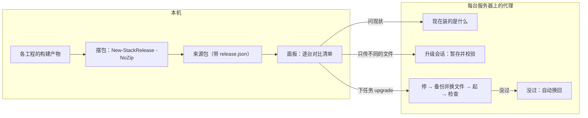

# 部署面板自动升级：把本机最新程序补丁到所有服务器

## 目标

在本机面板上点一次（或让它自动），把本机摆好的最新一套程序推到服务器列表里的每一台：只传变了的文件，逐台停、换、起、检查，起不来就自动换回原来那一版。代理自己的 exe 也走这条路。

- **升级什么**：发布包里的程序和静态文件（后端、rs-server、数据库程序、两个网页、schema、stack 脚本），外加代理 exe。
- **不动什么**：`stack.toml`、库数据、E3D 项目文件、日志、令牌。清单以外的文件一律不碰。
- **管哪些部署**：由发布包装出来、代理以正常身份管着的。「只看」的那种和手工装的老部署（云服务器上原有那套 AMS）要先换成发布包形态，另算。

## 现成能用的，和还缺的

- **清单已经有了**。包里的 `release.json` 记着约 450 个文件（共 586 MB），每个带字节数和 sha256；8 个部件各带版本和「是不是没提交的代码编的」。一项长这样：

```json
{"path":"安装和测试说明.md","bytes":44465,"sha256":"624c364b…6492b7d"}
```

- **摆包脚本已经有了**。[scripts/stack/New-StackRelease.ps1](scripts/stack/New-StackRelease.ps1) 加 `-NoZip`：照说明文件把本机各部件的最新产物摆成包目录、写清单，不编译；它会把后端配置模板里的口令清空，清不干净就不出包。主线冻结，这个脚本只调用、不改。
- **代理已经有**：任务机制（同一时刻只跑一个，带进度、输出、结果落盘）、审计、能力清单 `caps`、增量开关。
- **还缺三样**：
  - 没有传文件的通道，请求体上限 1 MB：

```14:14:output/gui-20261112/spike/deploy-agent/src/http.rs
pub const MAX_BODY: usize = 1024 * 1024;
```

  - `stack.ps1` 没有升级命令（只有 up / down / status / init / smoke / doctor 等）。
  - 包里不带代理 exe。

## 流程



1. **摆包**（本机）：面板调摆包脚本得到来源包目录；前面可以挂一条你自己的编译命令。来源也可以直接指一个解开的发布包。
2. **预览**：面板问每台代理现在装的是什么（代理按磁盘上的实际文件算，带缓存），列出每台要换哪些部件、传多少 MB、要不要停服务，并标出：在忙、代理太老、没开升级、这台不收这个渠道、文件被人改过。
3. **传**：只传服务器上没有的内容，每块不超过 8 MB，断了接着传，传完按 sha256 核对。不影响在跑的服务，可以两台同时传。
4. **换**（一台一台来）：等后端空下来 → 记下并暂停增量 → `stack down` → 旧文件挪进备份、新文件就位 → `stack up` → `stack smoke` 0 级 → 恢复增量开关。哪一步没过就自动换回并重新起来。只有网页文件变的时候不停服务。
5. **代理自更新**（放最后）：先试跑新 exe，再改名替换、交接端口；新的 20 秒内没应答，旧的自己换回来接着干。

预期（按今晚量到的数）：后端 exe 224 MB，云服务器上行 4–7 MB/s，传一次约 1 分钟；整套停再起约 1 分钟不可用。

## 协议新增（只加不改，`schema` 仍是 1）

类型放 [output/gui-20261112/spike/deploy-dash-proto/src/](output/gui-20261112/spike/deploy-dash-proto/src/lib.rs) 的新文件 `upgrade.rs`，路由接在现有表后面：

```613:618:output/gui-20261112/spike/deploy-agent/src/server.rs
        ("GET", ["v1", "info"]) => h_info(sh),
        ("GET", ["v1", "status"]) => h_status(sh, req).await,
        ("GET", ["v1", "logs"]) => h_logs(sh, req, None).await,
        ("GET", ["v1", "logs", src]) => h_logs(sh, req, Some(*src)).await,
        ("GET", ["v1", "notices"]) => h_notices(sh, req),
        ("GET", ["v1", "jobs"]) => h_jobs_list(sh, req),
```

- `GET /v1/upgrade/inventory`：现在装的包、各部件版本、文件清单、代理 exe 的版本和种类、升级开没开。
- `POST /v1/upgrade/sessions`：开会话，回会话号和一次性随机数。`PUT …/<id>/manifest`：交清单和签名，回「还缺哪些内容」。
- `PUT /v1/upgrade/sessions/<id>/blobs/<sha256>?offset=<n>`：传一块。只对这一条路由把请求体上限放到 8 MB。
- `POST /v1/jobs`：`kind` 加 `upgrade`、`rollback`、`upgrade_agent`，结果里带升级报告。
- `GET /v1/upgrade/history`：最近几次升级。
- `caps` 加 `upgrade.v1`。老代理没有这一项，面板显示「这台的代理不支持升级」。

```rust
/// 清单里的一个文件（同 release.json 的 files 一项）。
pub struct UpgradeFile { pub path: String, pub bytes: u64, pub sha256: String }

/// `PUT /v1/upgrade/sessions/<id>/manifest` 的清单。
pub struct UpgradeManifest {
    pub release: ReleaseId,            // name / version / channel / created_at
    pub components: Vec<ComponentId>,  // id / version / sha256 / dirty
    pub files: Vec<UpgradeFile>,
    pub agent: Option<AgentExe>,       // 代理 exe：version / kind / bytes / sha256
}
```

## 代理一侧（[deploy-agent](output/gui-20261112/spike/deploy-agent/src/lib.rs) 新模块 `upgrade/`）

- **落盘**：`<根>\run\gui\upgrade\<会话>\` 下 `blobs\`（按 sha256 存）、`backup\`（换下来的旧文件）、`journal.jsonl`（每挪一个文件先记一行）、`report.json`。留最近 2 次的备份。
- **路径把关**：清单里只许相对路径；带 `..`、盘符、冒号、设备名的整份拒绝；`stack.toml`、`run\`、`logs\` 和库数据目录不许出现；只删「旧清单里有、新清单里没有」的文件。
- **崩溃恢复**：代理起来时发现上次的日志没走完，就照日志换回，并发一条通知。
- **库版本**：新后端起来后，健康里的库版本对不上（`old` / `newer`）时，缺省当作没过、自动换回。预览里勾了「这一版要重建库，我知道」才留下，之后照现有的「升级数据库」走。
- **渠道**：`agent.toml` 的 `[upgrade] accept_channels`。正式服务器可以只收 `release`，挡住测试包和没提交的代码编出来的包。
- **磁盘**：开会话时就算好要多少空间（要收的加备份），不够直接拒绝。
- **自更新**：接在 [headless_agent.rs](output/gui-20261112/spike/deploy-dash/src/headless_agent.rs) 和面板 exe 的 `--agent` 两种身份上，换的都是「正在跑的这个 exe 文件」。

## 面板一侧（[deploy-dash](output/gui-20261112/spike/deploy-dash/src/main.rs)）

- **数据层** `src/data/upgrade.rs`（新）：读来源包、算差、上传（重试、续传）、逐台应用、汇总报告。连接沿用 [remote.rs](output/gui-20261112/spike/deploy-dash/src/data/remote.rs)。
- **存档** [client_store.rs](output/gui-20261112/spike/deploy-dash/src/client_store.rs)：每台多存升级密钥（和令牌一样加密存）、是否自动升级。老存档照样读得了。
- **界面** `src/ui/upgrade.rs`（新）：
  - 汇总条上「升级…」；服务器行上的版本徽标（最新 / 落后几个部件 / 不支持）。
  - 升级抽屉：来源包、每台一行的预览和勾选、「先升第一台，好了再继续」、进度、结果、「回到上一版」、「重新摆包」。
- **命令行**：`deploy-dash.exe upgrade --source <目录> --all|--servers a,b [--canary] [--yes] [--json]`。给脚本用，也是自动模式的底子。
- **自动**：盯来源包的 `release.json`，变了并稳定 30 秒后，只给标了「自动」的服务器升级；在忙的跳过，过一会儿再试。面板开着（或 `upgrade --watch` 在跑）才生效。
- **配套代理**：面板旁边放同一版的 `deploy-dash-agent.exe`，发现服务器上的代理旧了就在预览里提示一起升。

## 安全

- 能往服务器推 exe，等于能在服务器上跑任意程序。所以缺省关着：服务器上生成了升级密钥才算开。
- 升级密钥只用来给清单签名（HMAC-SHA256，连同代理给的一次性随机数），从不在网上传。现在的协议是明文的，令牌可能被同网段抓到；光有令牌推不了程序。
- 每个文件按签过名的清单核 sha256。每次升级、换回都进审计：谁、从哪来、从哪一版到哪一版。
- 公网上的服务器照今晚的做法走 ssh 隧道。TLS 仍是第二版的事。
- 依赖只用 `spike\Cargo.lock` 里已有的（`sha2`、`hmac`；要压缩时用 `flate2`），不联网。

## 分期与验收

- **U0 设计定稿**：`output/gui-20261112/remote/UPGRADE-DESIGN.md`（协议、落盘布局、换文件日志格式、失败处理表）；proto 加类型和夹具。
- **U1 传输（代理）**：现状清单、会话、分块上传、验签。验收：220 MB 的文件分块传完；中途断开能续；改一个字节被拒；没有密钥被拒。
- **U2 应用与换回（代理）**：`upgrade` / `rollback` 任务、日志、崩溃恢复、历史、审计。验收：沙盒里从旧包升到新包，四个服务正常；放一个起不来的后端 exe，自动换回、服务恢复；换文件中途杀掉代理，重起后自己换回。
- **U3 面板数据层和命令行**。验收：命令行对两台沙盒，第一台成功才升第二台；第一台失败就停。
- **U4 界面**。验收：用 agent-desktop 操作真实界面走完预览、升级、换回，截图。
- **U5 代理自更新**。验收：换成新版后面板自己重连、版本号变；放一个起不来的 exe，自动换回，断连不超过 30 秒。
- **U6 自动**。验收：重新摆包后 1 分钟内，标了「自动」的那台开始升级；没标的不动；在忙的跳过并稍后重试。
- **U7 真网络验收和文档**：云服务器经隧道实测上传速度、停机时长、隧道中途断开后的续传（等增量套件跑完再做）；[INSTALL-remote.zh.md](output/gui-20261112/remote/INSTALL-remote.zh.md) 加「升级」一节。

## 不在这一版

- TLS、按人分权（仍是第二版）。
- 二进制差分：先按文件传，量过不够再说。
- 在面板里编译：只留「摆包前先跑这条命令」的钩子。
- 接管手工装的老部署。
- 服务器上的正式安装（开机自启代理并自动拉起服务、无界面代理的安装命令）：今晚云测试查出现在没有现成路子。服务器重启后要有人手工把代理起起来，之后才能升它。
- 数据库重建本身：沿用现有的「升级数据库」。
- 升级别的电脑上的面板。

## 开工前提

- 云服务器这一轮测试已在 11-13 01:52 收工，这批文件现在没人在改，可以开工。真网络验收（U7）仍要等增量套件跑完。
- 源码里留着写了一半的「只看」驱动（`deploy-dash/src/watch.rs` 和无界面代理的 `--watch` 参数），没有单测。U1 开工时先把它关到特性开关后面，免得带进新编的代理。
- 每台服务器要手工放一次带升级能力的代理并生成升级密钥，之后才全走面板。
